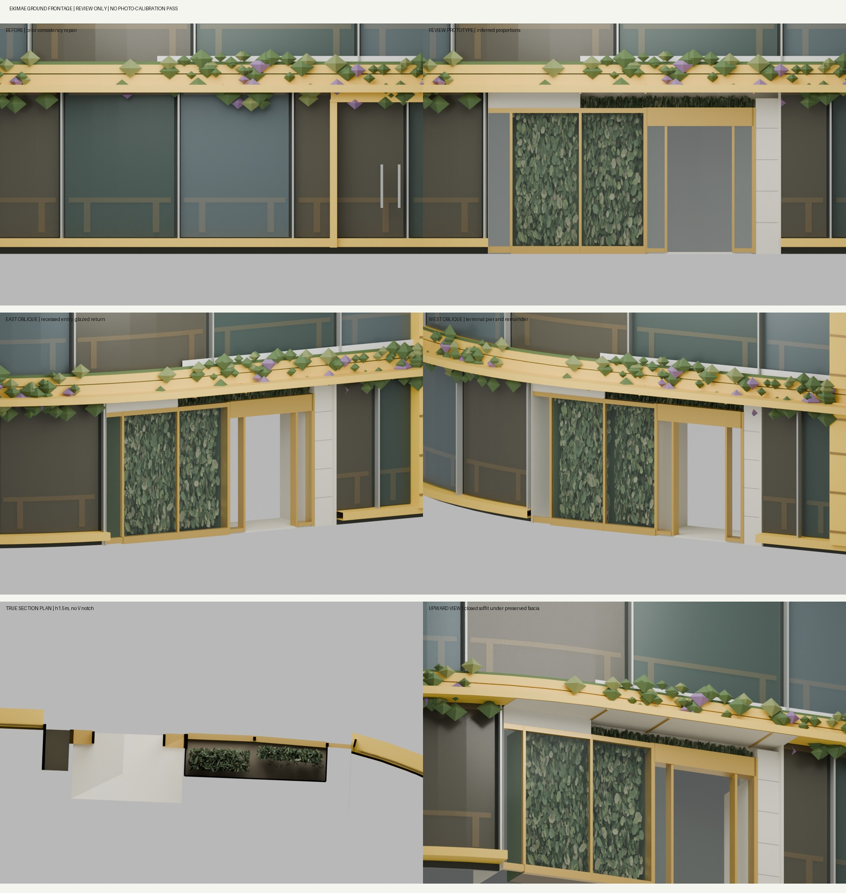

# 渋谷駅前ビル・店頭の構造試作 v1（レビュー専用）

**本番採用・写真忠実度の合格ではありません。マージしても現行モデルは置き換わりません。**

## 用途と配置
北側店頭のガラス内植栽、金色の入口枠・欄間・細い袖ガラス、淡色の端柱、庇下面のつながりを比較する独立した試作です。このディレクトリだけに保管し、通常表示、loader、資産台帳、性能予算には登録しません。QFRONT・西武・歩行表示・FPS・既存配布GLBは変更しません。マージ・デプロイは行っていません。

- 編集用: `source/ekimae-ground-frontage-prototype.blend`
- 確認用の最終出力: `web/ekimae.glb`（ここでの web は試作の相対パス。配信登録なし）
- 再生成: `source/*.py` と固定入力 `input/`
- 比較: `evidence/prototype-review-board.jpg`、同じカメラの before/prototype 正面・左右斜め画像、実断面・庇下面画像
- 数値: `evidence/validation.json`、`binary_check.json`、`clip_manifest_check.json`、変更三角形表



## 入力と保全
最終GLB SHA256: `e437ee3ec6cbc88e23e7f40ad55cd9b0452705ab9e99e8d89a32d44ebe00e035`。
固定入力GLB SHA256: `4ecb3412bc946a8aa88ac9ab0ac4d9f415b8d5bcadac819ead9d8d59885b89c8`。これは先行する入口整合試作の固定スナップショットで、main の現行GLBそのものではありません。今回の before はこの固定入力との比較です。

入力には当該GLB、看板・viewerの検証用固定コピー、元の生成器・データ最小セット、旧入口三角形シグネチャを含みます。全同梱ファイルは `MANIFEST.json` でSHA256固定しています。上階、屋根、看板、原点・地理変換、T.P.15.29mのアンカーは変更対象外。独立バイナリ検査では、非変更の元三角形22,953件の全属性と元ノード・材質・シーン接頭部を保全。409件の境界横断三角形は面分割し、高さ2.98mより上の面積差は丸め誤差内です。

編集領域は原角を基準に u=-1.70..3.70m、d=-1.10..1.05m、h=0..2.98m。例外として既存の仮入口殻・取手84三角形をシグネチャで限定除去（上端3.02mを含む）。共有材質全体は削除していません。別の入口、既存曲面上部、隣店の残りは保持します。

## 未確定・未達
- 角から既存曲面への直線状ガラス返しは推定。写真の強い折れ角の再現とは認めていません。表示奥行0.70m、入口奥行1.08m、幅・高さはモデル依存で未実測。
- 植栽は改善していますが規則的な薄い壁に見える部分が残り、写真の不均一な垂れ下がり・量感には未達。既存上部植栽は保持。
- 店内は抽象的な空間。実際の扉枚数・作動方式・内装・商品を再現したとは扱いません。
- 2024実上部を使った条件付きカメラの地上基部RMSは104.57px/900px高。仮想上部平面の別対応では32.52pxですが、元上部モデルの校正合格ではありません。2025入口枠内の条件付き残差16.36px/1280px高も実寸・深さの独立検証ではありません。
- 2024/2025写真は各撮影時点の形の補助資料。2025年10月の外観継続は未確認。
- 元入力23,446→試作60,760三角形、19→29プリミティブ/材質、1,787,720→6,095,644 bytes。現行B枠3,000,000 bytesを単体で超過。予算拡張・A昇格は行いません。
- 全景実行、歩行、FPS、npm全体テスト・ビルドはこの資料追加作業では未実行。試作の局所保全検査は本番検証の代替ではありません。

## 再生成
Blender **4.2.3** とPython 3が必要です。通常のgeometry再生成はネットワーク・全repo・元写真を必要としません。

```sh
python source/run.py --blender /path/to/blender-4.2.3
```

このコマンドは同じディレクトリの生成物と検証JSONを上書きします。作業用コピーで実行してください。元生成器のprovenance、clipped-base、addition中間GLBはコマンドで再作成されるため重複同梱しません。提出されたportable core再生成で最終GLBの同一SHA256を確認済みです。

`--render` を加えると同一カメラと条件付きカメラを再描画します（通常PythonにNumPy/SciPyが必要）。比較板とアンカー重ね図は `python source/make_board.py` と `python source/annotate_camera_checks.py`（Pillowが必要）で生成します。`.blend` は編集用インポート保存で、バイト同一保証の対象は最終GLBです。

## 出典・権利
写真の複製やスクリーンショットは含めていません。参考写真は閲覧・形の観察のみ、テクスチャ化なし。
- 2024: https://www.shibukei.com/headline/18341/
- 2025近接: https://kure1129.livedoor.blog/archives/39201057.html

追加した植栽・枠・柱・庇下面は自作プリミティブ。元PLATEAUデータの帰属を継承します。固定検証用の既存看板GLBには Joli Rumi の2025年11月写真派生画像が含まれるため、`ATTRIBUTION.md` を参照。今回の参照写真2点とは別の既存ライセンス付き資産です。未許諾の参考写真、ログ、バックアップ、私的な作業記録は同梱しません。
