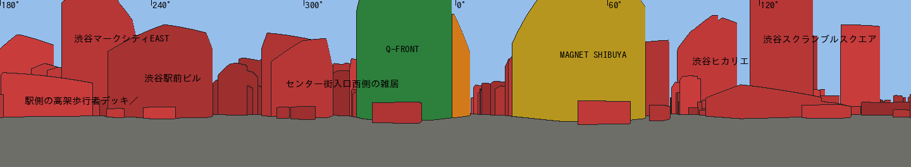
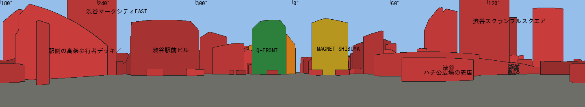
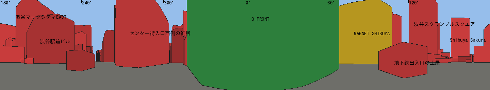
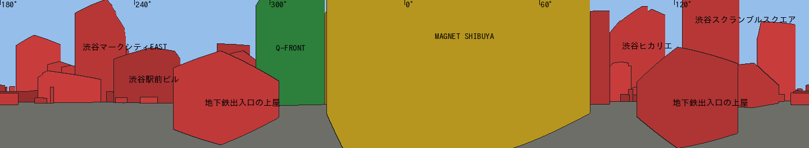
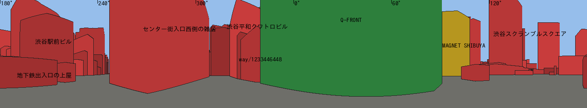

# Gate C0 報告書（Shibuya Scramble Core v1）

パック 09 のひな形に沿っている。**この Gate では、建物・地面・ビューアーを一切変更していない**（読み取りと計画のみ）。

## A. 監査環境
- **日時**：2026-10-12
- **旧リポジトリ** `kesusugar/shibuya-scene`
  - ブランチ `claude/shibuya-weapons-implementation-28u1y1`、SHA `e2ec86198ade89e5ee9a6fac6840ebad66567eab`
  - 未コミットの変更なし。**読み取りのみ**。
- **新リポジトリ** `kesusugar/shibuya-scene-2`（Private）
  - `main`：`de3dbca61555a2bdbf254ebaba5a0d1773e69e11`
  - `claude/g3-magnet`（PR #3、MAGNET v2）：`5fe8cbf8272e3532cbd762b61a925ec15e598b68`
  - `claude/g4-seibu-a`（西武 A 館）：上と同じ SHA。`assets/buildings/seibu-a/` が**未コミット**で残っている（参考写真と PLATEAU）。触れていない。
- **C0 の作業場所**：別の作業ツリー `claude/core-c0-audit`（`claude/g3-magnet` から分岐）。
  - 追加したのは `docs/core/` と `tools/core/` だけ。
- **元データ**：旧リポジトリの `public/data/shibuya-scene-data.json`（OSM の取得日 2026-09-08）と PLATEAU 2025 渋谷区（地域メッシュ 53393596 の建物・道路）。
  - **建物のデータ**：666 棟（OSM の建物 ID をキーにした）。
  - **描画のされ方（別に数えた）**：旧 1.0 では汎用の箱 378、個別モデル 10、除外 274（`ASSET_REGISTER.csv` の `old_status`）。2.0 で描画しているのは 3 棟。

## B. 既存の制作状況（リポジトリにある実ファイルで照合）
| 建物 | 実ファイル | 状態 |
|---|---|---|
| QFRONT | `assets/buildings/qfront/`（`qfront_v5_day/night.blend`、`web/qfront.glb`、viewer.json、manifest）、最後のコミット a76afeb | v5 はオーナー承認済み。**看板は 2018 年のもの**で、2025 年の看板の層はまだ分けていない |
| MAGNET | `assets/buildings/magnet/`（生成スクリプト、`magnet_day/night.blend`、`magnet.glb`、`magnet_signs_2025.glb`、QA の比較画像） | v2 で PR #3 のレビュー待ち。WebGL のガラス +34 などの課題を報告済み |
| 栄楽ビル | `assets/buildings/eiraku/web/eiraku.glb`（MAGNET の Blender ファイルの中で作った） | MAGNET と同じ PR |
| 西武 A 館 | 参考写真と PLATEAU の抜き出し、粘土色のテスト画像のみ（未コミット） | **未完成**。モデルはまだない |
| その他 | なし | 2.0 の画面にあるのは、3 棟と灰色の円盤だけ |

## C. Core の地図と見える建物
- **Core の範囲と選定理由**：`CORE_SCOPE.md`
  - 50 m の円の中に中心がある建物は 7 棟しかない。そのため、**5 視点の見え方で決める**ことにした。
- **5 視点**（`CAMERA_REGISTER.csv`）
  - 位置は地図から決めたもので、**実写真による確認はまだ**（U1）。
  - 写真の撮影位置を割り出した実カメラは 3 つ：M027（11.4 px）、Q032（13 px）、Q031（27.9 px、一部のみ）。
- **全建物の台帳**：`ASSET_REGISTER.csv`（666 行）
  - 5 視点のどれかから見える建物は 129 棟。そのうち Tier 1 候補が 25 棟（**未着手 22**）、Tier 2 候補が 15 棟（すべて未着手）。
- **看板の骨組み・駅側・路面設備の欠落**
  - 屋上の看板の骨組み：旧データの 1 か所（3 位の建物）を含めて、2.0 では全部ない。
  - 駅側：デッキ 2、駅舎 1、売店 1。
  - 地下鉄の出入口：6。
  - 路面：Core の車道 20、歩道・横断歩道 75、白線 15、信号 4（実物より少ない）、樹木 6。いずれも 2.0 では全部ない。

- 色の意味：緑＝完成、黄＝レビュー中、橙＝制作中、赤＝未着手。
- 画像の中央が北で、右へ進むほど東になる。

## D. 優先順位 Top 20
- 詳しい表（欠落ラベルを含む）は `VISIBLE_GAPS.md` にある。
- 「画面占有の根拠」は、5 視点の中で最大となる全周に対する割合と、その視点。

| 順位 | ID | 建物・設備名 | 可視視点 | 画面占有の根拠 | 旧資産 | 2.0 状態 | 次の作業 |
|---|---|---|---|---|---|---|---|
| 1 | way/116806281 | MAGNET | 5 | C04 で 22.4% | 個別モデル | レビュー中 | PR #3 の後に統合 |
| 2 | way/136691386 | QFRONT | 5 | C03 で 20.2% | 個別モデル | 完成 | 2025 年の看板の層、地面の高さ |
| 3 | way/136690966 | センター街入口の西側の雑居ビル | 4 | C05 で 8.9% | 箱＋看板の骨組み | 未着手 | **C1-1** |
| 4 | way/617560918 | 渋谷スクランブルスクエア | 5 | C02 で 2.9% | 個別モデル | 未着手 | C1-3（スカイライン） |
| 5 | way/87250190 | マークシティ EAST | 5 | C02 で 2.1% | 個別モデル | 未着手 | C1-3 |
| 6 | way/904652357 | 渋谷駅（駅舎） | 5 | C02 で 1.7% | 個別モデル | 未着手 | C2（駅側） |
| 7 | way/60739635 | 渋谷駅前ビル | 5 | C02 で 3.1% | 箱 | 未着手 | **C1-2** |
| 8 | way/355250634 | 駅側の高架デッキ | 5 | C02 で 3.9% | 除外 | 未着手 | C2 |
| 9 | way/1200029947 | サクラステージ | 5 | C02 で 1.4% | 箱 | 未着手 | C1-3 |
| 10 | way/204091879 | ヒカリエ | 5 | C01・C04 で 1.3% | 除外 | 未着手 | C1-3 |
| 11 | way/55588118 | フクラス | 5 | C04 で 0.8% | 除外 | 未着手 | C1-3 |
| 12 | way/55895868 | SHIBUYA109 | 2 | C01 で 0.6% | 個別モデル | 未着手 | C5 |
| 13 | way/136691389 | 平和クワトロビル | 3 | C05 で 0.9% | 箱 | 未着手 | C1-1 |
| 14 | way/136691379 | センター 244 ビル | 3 | C05 で 0.8% | 箱 | 未着手 | C1-1 |
| 15 | way/114755219 | 第一勧銀共同ビル | 3 | C02 で 0.6% | 箱 | 未着手 | C1 の後半 |
| 16 | way/55896465 | 西武 A 館 | 2 | C01 で 0.6% | 個別モデル | 制作中 | C1 の Top 3 の後に再開 |
| 17 | way/1333409445 | しぶにしデッキ | 3 | C02 で 0.4% | 除外 | 未着手 | C2 |
| 18 | way/155807211 | 地下鉄出入口（QFRONT 前） | 3 | C03 で 1.9% | 除外 | 未着手 | C2 |
| 19 | way/155807210 | 地下鉄出入口（センター街側） | 3 | C05 で 1.6% | 除外 | 未着手 | C2 |
| 20 | way/155538676 | ハチ公広場の売店 | 3 | C02 で 1.5% | 箱 | 未着手 | C2 |

## E. 問題と制約
- **地面の高さの不一致**（`TERRAIN_ALIGNMENT.md`）
  - 原因：各建物が自分の PLATEAU の地面を 0 m にしている。QFRONT は T.P. 15.099、MAGNET は 14.561（最も低い南東の角）。
  - 実際の道路の差は 0.2〜0.4 m。Core の道路には約 1.1 m の起伏がある。
  - 対策の候補：基準面を T.P. 15.000 m にし、建物ごとに上下に動かし、地面を高さの網にする。
  - **実施は C2 で行う。今は何も変えていない。**
- **写真**（`UNCERTAINTIES.md`）
  - Top 20 のうち 17 件は、建物ごとの写真がまだない。
  - QFRONT の 2025 年の写真は 3 枚だけ。
  - ライセンスが不明な写真が 9 枚あり、参照のみとする。
  - 2018 年の看板を 2025 年とは扱わない。
- **Blender と WebGL の見え方の差**：MAGNET のガラスが +34、西側の壁が −29。C3 でまとめて対策する。
- **測定条件**
  - FPS などはまだ測っていない。この環境の SwiftShader の数値は無効。
  - オーナーの PC（内蔵 GPU の場合を含む）で測るまで、数値は約束しない。

## F. 次に申請する作業（C1）
- **Top 3**（`CORE_ROADMAP.md`）
  1. **C1-1** センター街入口の西側の街区（3・13・14 位）。看板の壁と 1 階の店舗。
  2. **C1-2** 渋谷駅前ビル（7 位）。屋上の看板と壁面ビジョン。
  3. **C1-3** スカイラインの 5 棟（4・5・9・10・11 位）。輪郭、高さ、ガラスの色。
- **変更するファイル**
  - `assets/buildings/<id>/`
  - `src/main.ts` の建物一覧
  - `tests/<id>-asset.test.ts`
  - `docs/core/ASSET_REGISTER.csv` の状態の列
- **比較画像**：写真の撮影位置を割り出したカメラでの Cycles と WebGL の画像、5 視点のパノラマの撮り直し。
- **止める条件**
  - 2025 年の写真が 3 枚未満のとき
  - ライセンスがはっきりしないとき
  - 建物を足したことで、ほかの建物の表示が壊れたとき
- **オーナーの確認待ちの事項**
  1. 西武 A 館の順位を下げてよいか（16 位で、3 視点からは見えない）。
  2. 優先度の重みをこのままでよいか。
  3. 基準面を T.P. 15.000 m にするか、14.916 m にするか。
  4. スカイラインの 5 棟の作り込みの程度。
  5. C1 の最初に写真を集めること（Top 3 の対象について、2025 年の写真を Wikimedia Commons から集めて台帳に載せる）。
