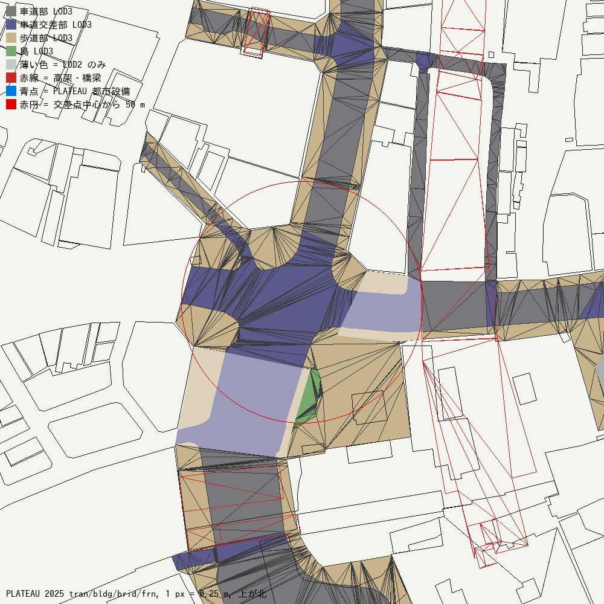
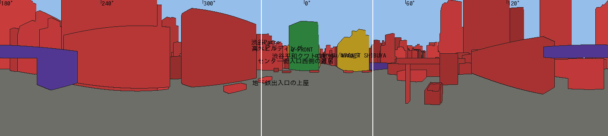
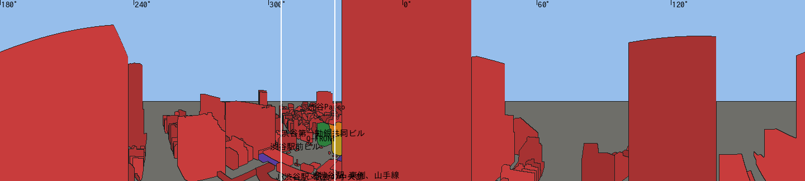

# Gate C0 補足監査（オーナー指示 2026-10-12 による）

- オーナーが採用した作業順序：C0 補足 → 地面と高さの基準 → WebGL の共通品質 → 建物（A/B/C）→ 拡張 → NPC。その最初の段階の記録。
- 資産・ビューアー・旧リポジトリは変更していない。
- 区別して書く
  - **検証済み**：計算や実データで確かめたもの
  - **推定**：根拠はあるが確かめていないもの

## 1. 新たに使った PLATEAU データ（検証済み）
- 取得元：PLATEAU 2025 渋谷区（`13113_shibuya-ku_pref_2025_citygml_1_op`）の地域メッシュ 53393596。
- 取得したもの：橋梁（brid）、都市設備（frn）、植生（veg）、地形（dem）、各コードの意味を定めたコード表。
- 抽出：`tools/core/plateau_core.py` で、交差点から半径 320 m 以内を取り出した。

| データ | 件数 | Core（50 m 以内）での有用性 |
|---|---|---|
| 建物 LOD2 | 544 | 全棟に屋根の段差がある。**OSM の way がない建物が 103 棟**ある（下の 3） |
| 橋梁 LOD2 | 7 | JR 山手線・銀座線の高架、連絡通路、西武 A・B 館の連絡橋（推定）、横断歩道橋 |
| 道路 LOD3（車道部・車道交差部・歩道部・島） | 116 面 | 交差点の中心部をほぼ覆う（`terrain/plateau_core_plan.png`） |
| 道路 LOD2 のみ | 176 面 | 東側と南西の一部 |
| 都市設備 | 1,960 | **Core は 0 件**。調査範囲は東へ 100〜200 m の明治通り沿いの帯だけ |
| 植生 | 24 | Core は 0 件 |

- コードの意味は PLATEAU のコード表から読み、推測していない。

## 2. 高架・駅の連絡通路・デッキ（`STRUCTURE_REGISTER.csv`、77 行）
- **高架を台帳に加えた。**

| ID | 推定される実体 | 交差点からの距離 | 高さ（T.P.） |
|---|---|---|---|
| brid_95680199 | JR 山手線・山手貨物線の高架橋 | 50.5 m | 14.7〜31.6 |
| brid_a4d3aa47 | 銀座線の高架（西側） | 87.5 m | 15.7〜29.1 |
| brid_0e0c081e | 銀座線の高架（東側） | 184.7 m | 24.5〜30.7 |
| brid_cb8a47ec | 山手線の高架（北側） | 103.3 m | 16.2〜22.5 |
| brid_bd5e7fe1 | JR とマークシティを結ぶ連絡通路の橋部分 | 67.6 m | 15.6〜33.3 |
| brid_74a18c48 | 西武 A 館と B 館の連絡橋（推定） | 103.1 m | 21.2〜49.6 |

  - OSM の線路（`bridge`、`layer`）で、位置の照合用の行も加えた。
  - 見え方の計算では、山手線の高架橋が 12 位（MAGNET 前で全周の 1.2%）に入った。
- **駅側の「デッキ」（way/355250634）の実体**
  - OSM の登録内容：`indoor=corridor`、`level=2;3`、`building:min_level=1`。
  - PLATEAU では、地上（T.P. 15.41）から屋根（26.9〜35.7）までの、中身の詰まった建物（建物 ID 13113-bldg-744）として登録されている。
    - 外形は OSM とほぼ同じで、面積は PLATEAU が 1,150 m²、OSM が 1,189 m²。
  - したがって「高さ 20 m の中身の詰まった箱」という扱いは、**外形としては PLATEAU と一致する**。
  - 通路は、その 2〜3 階の内部にあると考えられる（推定）。
  - **1 階が通り抜けられる構造（ピロティ）かどうかは、OSM でも PLATEAU でも表現されていない。** 写真で確かめる項目として残す（U7）。
  - 開口部：REF-A は北面の窓から撮った写真なので、北面にガラス面があることは確実である。範囲と高さは写真から測る。

## 3. PLATEAU の面による見え方の再計算
### 方法（検証済み）
- 建物の柱を「最も高い屋根で外形全体を押し上げた形」から、**PLATEAU LOD2 の面**（屋根の段差を含む）に替えた。
  - PLATEAU と対応づかない OSM の建物は、柱のまま残した。
- 高さは T.P. 15.000 m を 0 とする共通の基準にそろえた。
  - 地上の視点：その地点の路面 + 1.6 m
  - 高所の視点：旧プロジェクトで写真から求めた高さ（±0.3 m）
- 処理：`tools/core/build_records_v2.py`、`visibility_pano_v2.py`、`build_register_v2.py`
- 結果：`ASSET_REGISTER_V2.csv`（776 行。OSM 666、PLATEAU のみ 103、橋梁 7）、`coverage_v2/`

### 実際に成り立つ高所の視点を 2 つ追加し、埋まっていないことを確認（検証済み）

| 視点 | 撮影位置の出典 | 埋まり確認（200 本の光線） | 判定 |
|---|---|---|---|
| X01 駅の連絡通路の窓（旧 REF-A） | `In_Front_of_Shibuya_Station.jpg`（2010、CC BY 2.0）、目印 7 点から算出 | 最初は**全光線が 0.31 m 以内で壁に当たり、埋まっていた** | 下記 |
| X02 渋谷ストリーム高層部（旧 REF-B） | `Shibuya_scramble_av_night_from_Stream.jpg`（2024、CC0）、誤差 7〜28 px | 最も近い面まで 42 m | 埋まっていない |

- X01 は、PLATEAU の連絡通路の建物の北面から **2.5 m 内側**にあった。
  - 高さは床（基準高 0.41 m）と屋根（19.2 m）の間で、重なる PLATEAU の橋梁も同じ通路を表している。
  - これは「窓越しに撮影した」という事実と一致する。
  - そこで、この 2 つの物体を窓として外し、写真の視野（左右 ±33°）の範囲で計算した。最も近い面までは 21 m で、埋まっていない。
- 方法の誤りを 1 件直した。
  - 前の柱の方法では、X02 の視野の 34% をスクランブルスクエアが塞いでいた。
  - PLATEAU の面では、交差点・QFRONT・渋谷駅前ビルが視野に入り、実写真と一致した。

### 結果
- **見える建物**：235 件（C0 では 129 棟）。
  - Tier 1 候補：31 件
  - Tier 2 候補：37 件
  - 増えたのは、PLATEAU のみの建物、高架、高所の視点の分。
- **C0 から変わった点**
  - **JR 渋谷駅の駅舎（PLATEAU のみの 3 棟）が 13〜15 位に入った。** C0 の台帳では抜けていた。
    - OSM は駅を屋内の通路で描くため、建物の way がない。
    - ハチ公口では全周の 2.4%。
  - 山手線の高架橋が 12 位、マークシティ WEST が 8 位に上がった。
- **C0 から変わらなかった点**
  - 1〜3 位は MAGNET・QFRONT・西側の雑居ビルで、C0 と同じ。
  - 渋谷駅前ビルは 7 位で、C0 と同じ。
  - 西武 A 館は 16 位で、C0 と同じ。
- **高所の視点の内容**
  - X01 の写真の視野：45% が路面で、建物は QFRONT 6.5%、MAGNET 5.3%、西側の雑居ビル 2.4%。
  - 交差点の路面は、高所から見ると最大の要素になる。地面を先に作る判断を裏付ける。

## 4. 地面の高さの実測（`terrain/ground_contact.json`、検証済み）
- 方法：PLATEAU の建物の地面の各角と、すぐ外側（1〜6 m）の PLATEAU 歩道の面の高さを比べた（`tools/core/ground_contact.py`）。
- 外向きの向きの符号に誤りがあったので直し、測り直した。
  - それまでは全方向の探索で歩道を見つけていたため、数値の変化は最大 0.04 m だった。
  - 表は直した後の値である。

| 建物 | 0 m の標高 | 正面の歩道の高さ | 歩道 − 建物の地面 |
|---|---|---|---|
| QFRONT | 15.099（平らな 1 つの値） | 15.13（南西の角）〜15.29（南東の角）、北東 15.62 | +0.03〜+0.23（正面）、+0.52（北東） |
| MAGNET | 14.561（最も低い南東の角） | 14.79（南東）〜15.02（南西）〜15.22（西） | 南と西の正面 +0.19〜+0.22、北側 +0.85〜+1.16 |
| 西武 A 館（制作中） | 15.62（平らな 1 つの値） | 15.6（交差点側）から井の頭通りを上り 18.1 | 0.0〜+2.5 |

- **PLATEAU の道路 LOD3 には、縁石の段差がない。** 歩道と車道が接する 2,125 点で、高さの差は最大 0.008 m だった。
  - 縁石の高さは別に決める必要がある（`C2A_PLAN.md`）。
- **0.54 m の差の内訳**
  - 2 つの 0 m の差は、QFRONT 15.099 と MAGNET 14.561 で 0.538 m。
  - 正面の歩道の実際の高さは、QFRONT 15.13〜15.29、MAGNET 14.79〜15.02（南側）。
  - したがって約 0.2〜0.3 m は実際の坂、残りは MAGNET が「最も低い角」を 0 m にしたことによる。
- **西武 A 館は、坂の上側で最大 2.5 m 埋まる。** 再開時には、1 階と地面の形を坂に合わせる必要がある（記録のみ）。

## 5. 写真の入手性（Commons の再調査、検証済み。ただし下限の値）
- 方法：`tools/core/commons_survey.py`。
  - リクエストは 1 件ずつ、4 秒以上の間隔で送った。
  - HTTP 429 は待って再試行した。最終的に失敗したものは「未確認」とした。
  - 結果：`coverage_v2/commons_survey_summary.json`
- **件数は下限である。**
  - 位置からの検索は 500 件で打ち切られる。
  - キーワード検索は各 100 件まで読んだ（「Shibuya Crossing」は全 1,347 件、「渋谷スクランブル交差点」は全 760 件）。
  - メタデータの 1 回分（78 件）は HTTP 414 と 429 で取れず、年が未確認。
  - 23 回の 429 は、待って再試行して回収した。

| 対象 | 確認できた写真の数 | 2025 年 | 2024 年 | 2026 年 | 2023 年以前 |
|---|---|---|---|---|---|
| 交差点から半径 250 m 以内（位置情報つき） | 500 | 15 | 33 | 103 | 349 |
| 交差点（キーワード） | 188 | 3 | 14 | 4 | 116（年不明 51） |
| 渋谷駅前ビル | 12 | 4 | 5 | 1 | 2 |
| 西側の街区（センター街入口、大盛堂） | 15 | 1 | 5 | 0 | 9 |
| 駅側（ハチ公口） | 30 | 1 | 3 | 3 | 21 |

- **2025 年の写真は、重複を除いて少なくとも 23 枚**あり、すべて CC BY・CC BY-SA・CC0（再利用できる）だった。
  - 2025 年の写真が「ない」わけではなく、少ないことがわかった。
  - 2026 年の写真（108 枚）は「近い年代」として形の確認に使える。
- **重要な発見：東急東横店（ハチ公広場側）の解体が 2025 年に進んでいた。**
  - 写真「Demolition of Tokyu Toyoko (Hachiko square) 2025-03-23」と「東急東横デパート撤去後 20251011」がある。
  - 2025 年の駅前は、月によって姿が違う。
  - PLATEAU のみの駅舎 3 棟（13〜15 位）が、このどの時点の姿なのかは未確認（U8）。
  - 2025 年のどの時点を再現するかを、オーナーに確認する必要がある。

## 6. 2025 年基準の資料と別年代の資料の区別（`REFERENCE_REGISTER.csv` の `era_class`）

| 区分 | 使ってよい範囲 | QFRONT | MAGNET | 西武 A 館 |
|---|---|---|---|---|
| `2025_basis` | 形・材質・看板 | 3 | 39 | 0 |
| `near_2025`（2024・2026 年） | 形・材質。看板は 2025 年の資料で確認できた場合のみ | 6 | 6 | 6 |
| `near_2025_restricted` | 形のみ（2026 年の西武は閉店セールの看板） | — | — | 11 |
| `other_era_reference`（2023 年以前） | 変わっていない部分の形のみ。看板・ビジョンには使わない | 111 | 17 | 9 |
| `unknown_year` | 年が確定するまで看板に使わない | 7 | 0 | 1 |

- **QFRONT の 2025 年の写真は 3 枚しかない。** 今の看板は 2018 年のもので、2025 年の看板の層を作るには写真が足りない。

## 7. 新たな不確実な点
- **U7**：駅の連絡通路の建物の 1 階が通り抜けられるかどうか（OSM・PLATEAU とも表現なし）。
- **U8**：2025 年の駅前（東急東横店の解体）を、どの時点の姿で再現するか。PLATEAU 2025 の測量の時点も未確認。
- **U9**：PLATEAU の建物の地面と道路の面は、同じ地点で 0.2 m ほど食い違う。道路の面には縁石の段差がない。
  - そのため、建物の置き方は C2a で実測に基づいて決めた（`C2A_PLAN.md` の改訂）。

## 8. C0 からの訂正
- **自己レビューの「REF-A は箱の内側」という記述**
  - OSM の外形では、北の壁の 0.4 m 外側だった。
  - PLATEAU の外形では、2.5 m 内側だった。
  - 自己レビューの該当箇所は訂正済み。
- **都市設備**
  - C0 では「PLATEAU にあるかもしれない」と考えていたが、Core には 0 件だった。
  - 信号・街灯・標識は、OSM と写真から台帳を作る必要がある。
