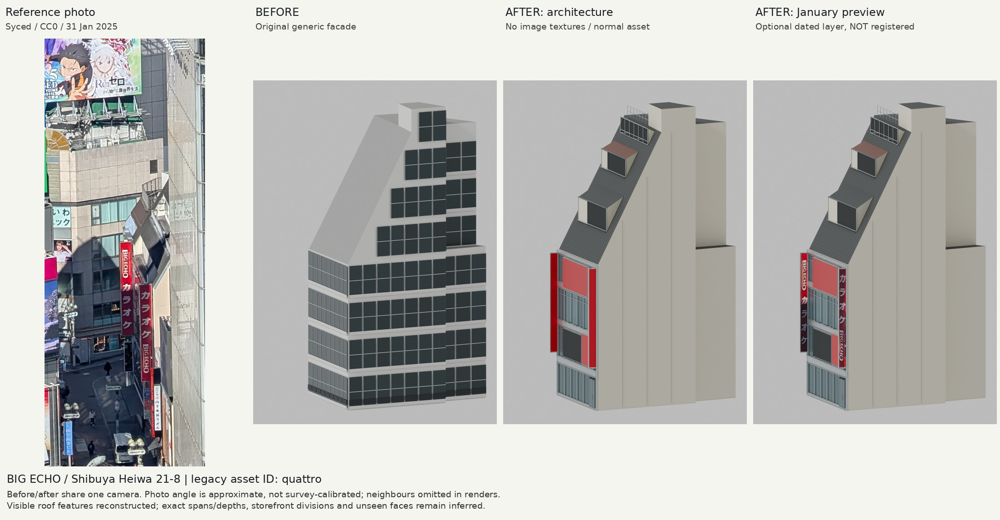
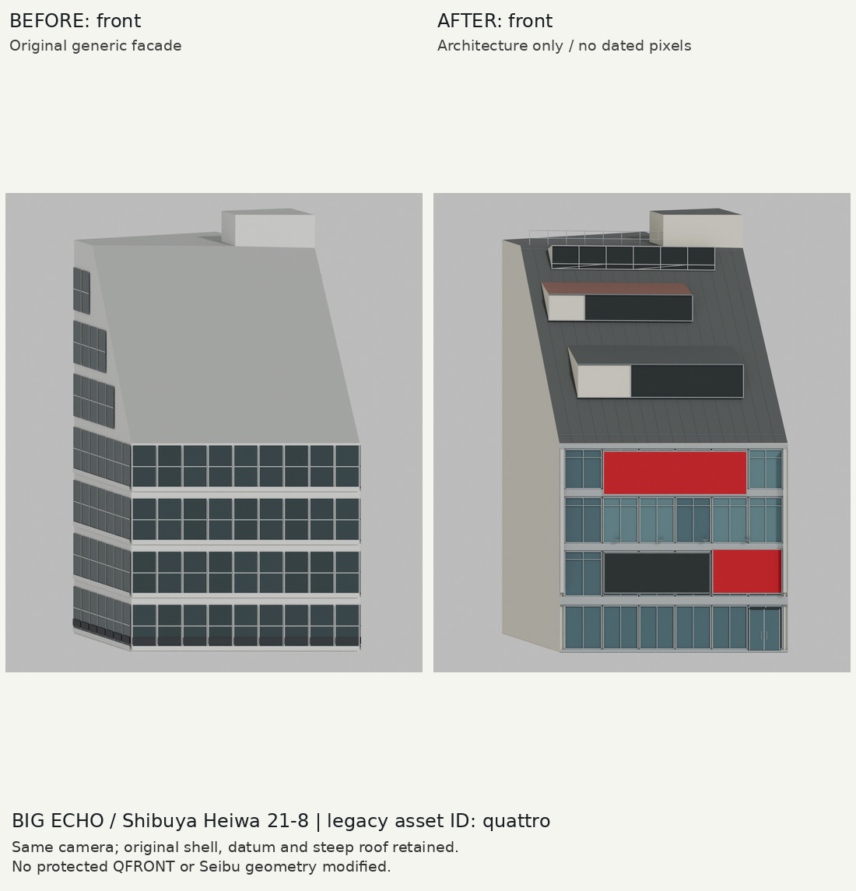
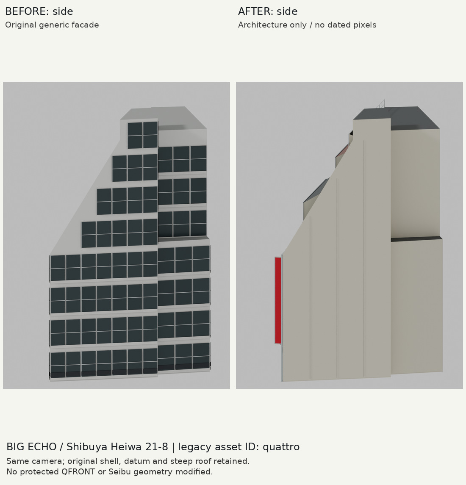

# BIG ECHO / 渋谷平和ビル21-8：限定的な写真照合外装

## 同定・保全
資産ID`quattro` / way136691389は維持し、表示用説明だけをBIG ECHO / 渋谷平和ビル21-8へ訂正。mineo / 平和クワトロ21-9は隣棟。raw PLATEAUのファイルはbyte完全一致、旧誤名称も履歴として保持。元GLBの屋根・壁・接地スカートも同じ三角形。

QFRONT/西武の元footprintと元shellの平面交差は0㎡。西武A館との距離は約0.829 m。単純な1m外周detail-envelopeなら0.749㎡重なるため、北東/背面には張り出さない設計を選んだ。最終GLBの全三角形と保護footprintの平面交差も独立検証で0㎡。保護ビルそのものには変更なし。最終の保護ビル装飾まで含む3D衝突検証ではない。

## 変更と実際の見た目の確認
低い4層正面、銀色の枠、大小の赤い筐体、無地の画面筐体、2本の張出し縦看板、屋根手すり、クリームの空白側壁と暗い急勾配屋根。8層の規則窓を全周へ並べる旧版は廃止した。初稿から屋根の明るい横線を削除し、縦目地を弱め、下段の画面の筐体を追加。追加レビューで連続した屋根面が写真の特徴を落としていると確認し、下段の暗い開口/淡色頬と縁、上段の茶色の浅い庇、頂部の銀色フレーム開口と低い筋交いを制作。原形を切り取らず上に重ね、幅/高さ/深さは推定と明記。前/後は同じカメラで正面・側面・参考方向の3組をレンダーし、実画像を確認した。

写真はSyced、2025-01-31、CC0。元画像の切抜きとモデルは厳密なカメラ校正なし。近隣の遮蔽を除いた単体表示で、寸法の一致や写真忠実度の合格は意味しない。公式/不動産サイトの写真は目視だけに利用し、画像を資料・テクスチャへ転載していない。

## 日付レイヤー
Jan2025の縦看板2面のみ別GLBへ。建築GLBのtexture数は0。viewerのlayersは未登録、runtime編集なし。packed blendでも日付コレクションは非表示。日付のない大きな赤い箱は広告内容を持たない物理筐体。

## 検査
Blender4.2.3、独立再生成の2GLBがbyte完全一致。source hash、元shell全三角形、4層/24区画、上端31.015 m（T.P.46.015）、date separation、B予算、保護footprint非交差をfocused testで検査。baseは4,300三角形/14primitive、日付層は4三角形/2primitive。両GLB合計は既存B予算内。統合した全体アプリ/全テスト/FPSはこの単体制作では未測定。親による配信/統合確認は別途。

## 残る差
写真で明瞭な屋根の3種類の突起は限定的に追加したが、実寸・用途・全設備は未確認。正面区割りと金物の実寸は推定。低層入口・隠れた側面/裏面、10月のテナントと広告、夜の輝度は未確認。既存shellを保った限定的な建築改善で、フル店舗再現ではない。
