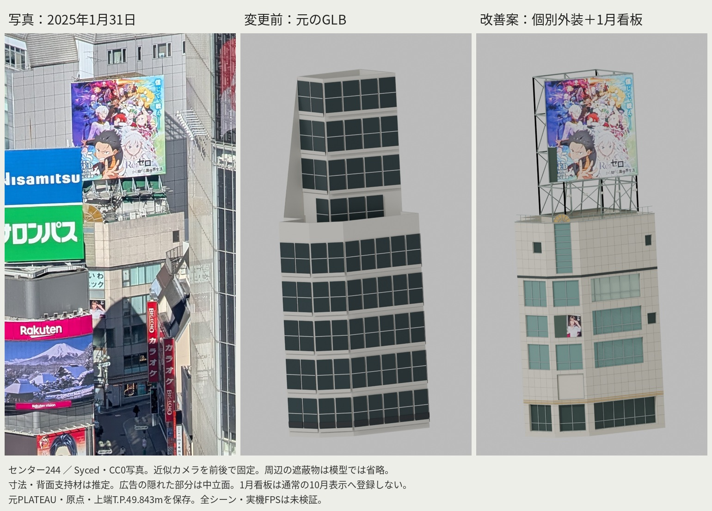
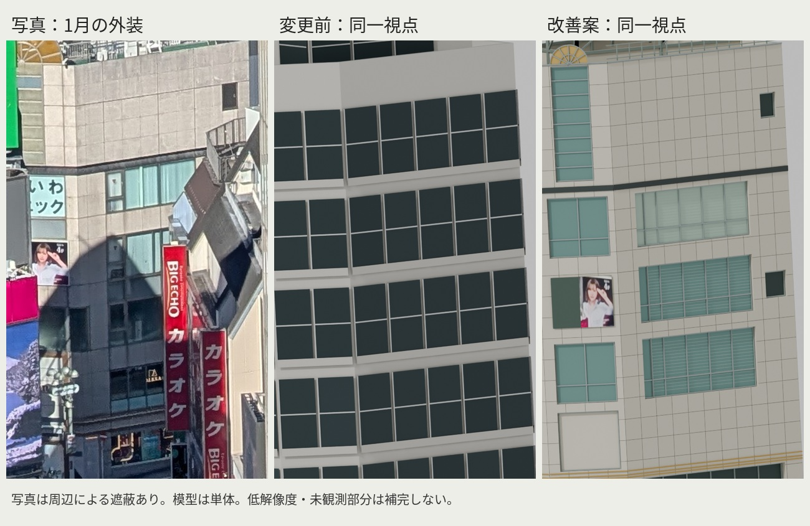
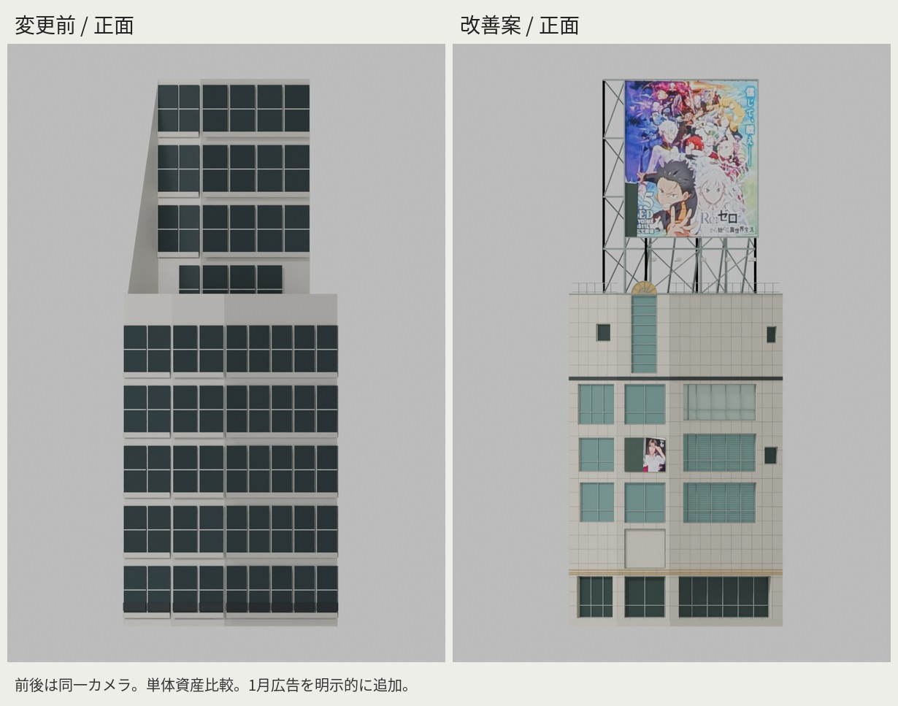
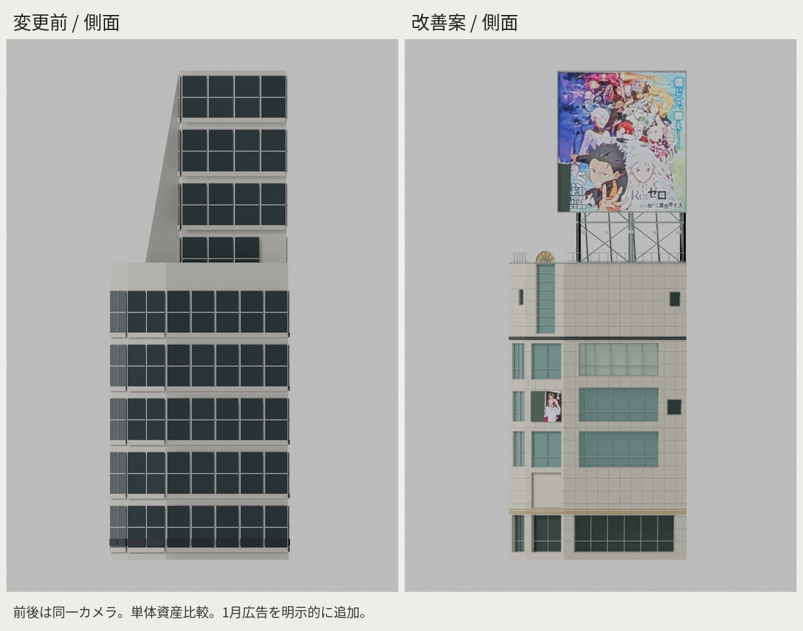

# センター244 個別外装・写真照合

## 結果

元の一様な9階窓列を、2025年1月31日・2月7日の写真に対応する石材折れ面、広い窓と見込み、黒い上部帯、小窓、金色扇形・灰緑ガラス、屋上看板と開いた支持材へ変更した。QFRONT・西武・他建物・共通ランタイム・性能予算に変更なし。

比較は原GLBの実バイトからの前後同一カメラ。元GLB SHA256:396c5aa583cc459df38e516277e466a3bede74b2a54a2cea0475c1a5fae79df7。写真用近似正投影カメラは6対応点、RMS5.25px。局所的な画像比較用で、測量・全景のカメラ校正ではない。周辺遮蔽や周辺建物は単体レンダーに含まない。

## 重要な解釈と未達

上部の閉じた元形状を、そのまま一般階・ガラス窓で埋めるのは写真と矛盾する。面26を主看板方位とし、元上部の指定面・指定高区間だけを表示上の看板支持プロキシに置換した。ただし背面も空洞であることは未確認。元資料・全元ソリッドは別に保存し、元上部屋根形状を表示メッシュのまま保ったとは主張しない。詳しい面番号・高さ・判断は資産README。

元主屋根z20.153m、笠木z21.635m、原点とT.P.上端49.843mは維持。看板幅8.955m・下端z25.15m、鋼材・窓・目地・奥行は推定。細い装飾と鋼材の張出しで、実表示境界は元planBoundsより最大約6cm外へ出る。原planBoundsと実表示boundsを混同しない。

1月看板・DA VINCIは別GLB。看板左下の隠れた絵柄は透明にし中立背板、DA VINCIは観測できる右の人物/4F部分だけをパネル右42%に割付。隠れた文字は生成・補完しない。公式の撮影日不明画像は閲覧専用で、配布・テクスチャには使わない。写真CC0と広告イラスト・商標等の権利は別。

現在のviewer.layers登録は無条件読込なので、1月レイヤーは未登録。通常の10月表示には中立筐体・建築外装だけが入る。比較画像では1月を明示して広告レイヤーを読込。日付切替・他建物の広告層は変更していない。

左下店頭、背面、窓の精密割付、実際の室内・構造・2025年10月の全店舗・照明は未確認。現状を写真一致や完成とは認定しない。

## 検査

- Blender4.2.3 LTS生成、メートル、座標系と原点、元plateau.json SHA256一致。
- base+1月layer合計8,423三角形、17描画プリミティブ、1,050,684bytes。B既存予算120,000/40/3,000,000以内。
- 上端z34.843002m、T.P.49.843002m（浮動小数誤差）。元の全頂点を非表示ソリッドで保持。
- 窓3箇所の実GLB光線検査で約11–16cmの奥行、看板9箇所で支持材が広告面の手前に来ないことを確認。
- source/data/recorded_ground.jsonは既存接地照会値の再利用。新規地面測定ではなく欠測3点は残る。
- 提供済みpinned依存/ソースを別検査ディレクトリで使用し、tsc成功、buildings.test.ts8件＋center244-fidelity.test.ts3件、計11件成功。アプリ全回帰テストではない。既存neighbourhood.test.tsのCenter244だけを低い元屋根保持・上部の明示的解釈へ更新した。他建物とC重複除外の検査は保持。共有作業領域で本物のcontext_input/context_statsを発見し、現行コミットのGit blobと一致を確認。Center244のneighbourhoodテストも1件成功（他5件は対象外フィルタ）。合計12件の対象限定検査であり、他建物の全統合検査ではない。
- 完全な周辺アセット未取得のためフルシーン検査未実施。実機FPS未測定。

独立レビュー：exact4.2.3で建物・広告GLB/viewer/statsの再生成ハッシュ一致、写真テクスチャ再処理のバイト一致、元参照メッシュ・低屋根・光線・予算を別工程で確認。詳細はevidence/center244/independent-review.md。
