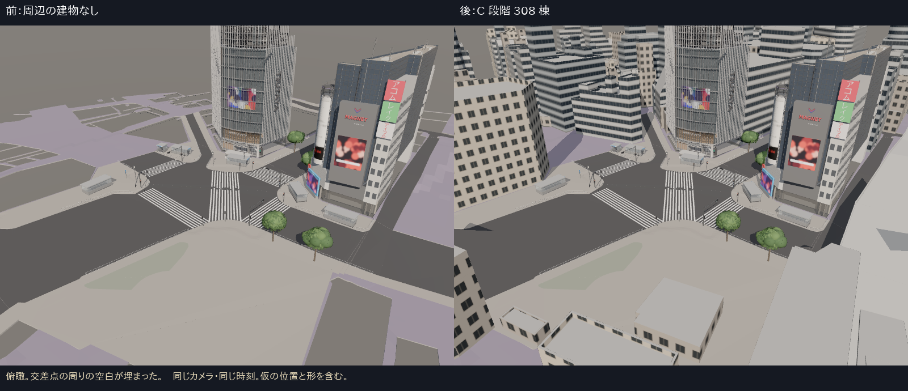
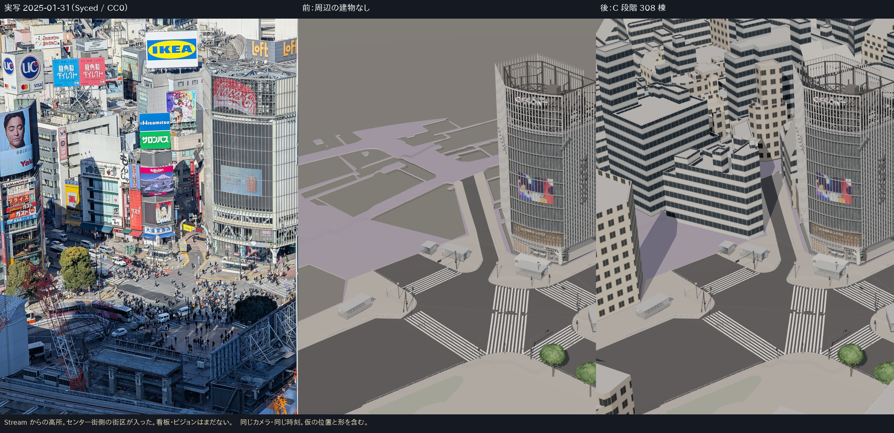
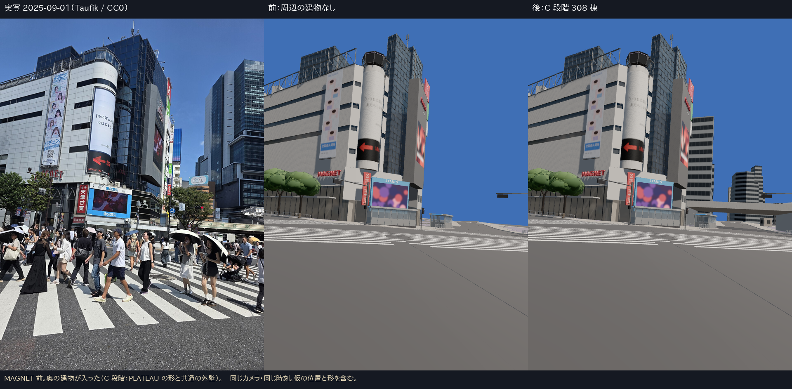
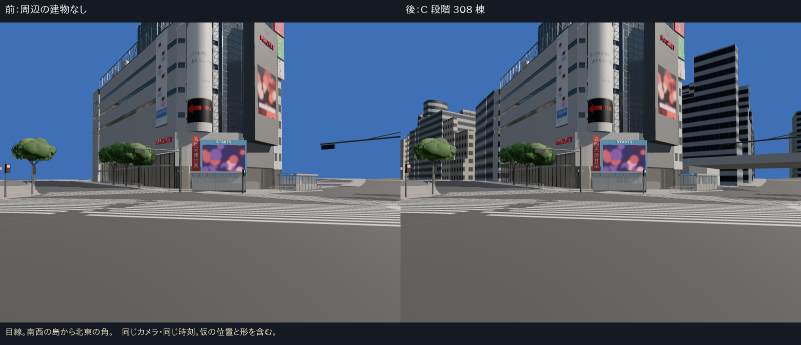
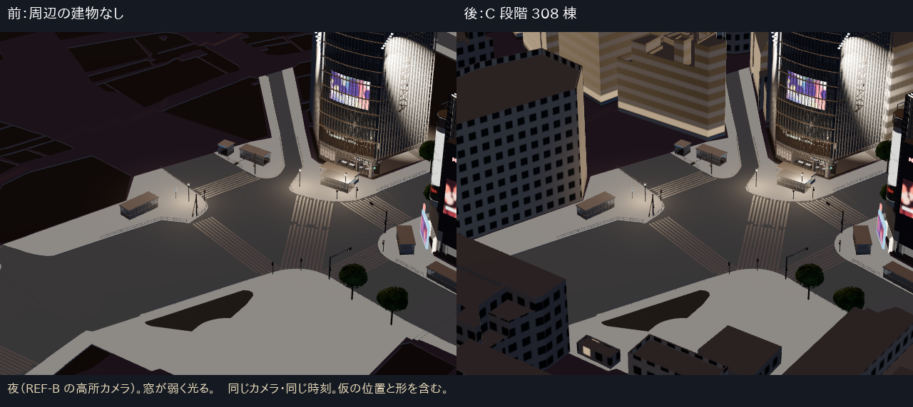

# 建物の制作（その 1）：周辺建物の C 段階を一括で入れた

- 2026-10-12、ブランチ `claude/core-c2b-fix`。C2b の作り直しのあとに進めた。
- **C 段階は完成扱いにしない**（`DECISIONS.md` 2026-10-12）。A・B の建物ができるまでの、街の「器」である。

## 1. なぜ先に C 段階を一括で入れたか
- これまで場面にある建物は QFRONT・MAGNET・栄楽ビルの 3 棟だけで、交差点の周りは何もない地面だった。
- A・B の建物を 1 棟ずつ作っても、周りが空のままだと、写真との比較で建物以外の差（空、周りの空白）が大きすぎて判断しにくい。
- PLATEAU 2025 LOD2 の形は 300 棟分すでに手元にあり、機械的に入れられる。費用が小さく、効果が大きい。
- A・B の建物ができたら、その建物は C から外す（`select_context.py` の `OWN_ASSETS`）。

## 2. 内容
| 項目 | 値 |
|---|---|
| 範囲 | 交差点の中心から 250 m |
| 建物 | 308 棟（うち駅側 5 棟は `station` のグループ）、橋・高架 7 件 |
| 除外 | QFRONT、MAGNET（栄楽ビルを含む）、地下鉄出入口の上屋 |
| 外壁 | 自作のタイル 2 種類（帯状の窓・個別の窓）× 色 2 種類。1 区画 3.2 m × 1 階 3.6 m、建物の地面から階を数える |
| 夜 | 窓の部分だけ弱く光る（強さ 0.55） |
| 資産 | `context_core.glb` 31,106 三角形・10 描画単位・約 2.3 MB（新しい予算区分 `context`：150,000／16／6 MB） |
| 表示 | 既定で表示。`?context=off` で消す、`?context=nostation` で駅側だけ消す |

- 詳細と再生成は `assets/context/core/README.md`。テストは `tests/context.test.ts`。

## 3. 同じカメラの比較（`evidence/c1-context/boards/`）

## 4. 差と未達（正直な評価）
- 街の密度と高さの感じは写真に近づいた。**一方で、建物の 1 棟ずつは写真と全く違う。**
  - 渋谷の外観を決めているのは看板・大型ビジョン・1 階の店で、C 段階にはそれがない。
  - 窓のタイルは同じ柄の繰り返しで、近くで見ると作り物に見える。
- 駅側 5 棟は、2025 年 10 月の写真で形を確かめていない（`station` のグループ）。
- PLATEAU の建物の地面と C2a の地面の食い違い（約 0.2 m、U9）は直していない。

## 5. 次にやること（建物の B 段階）
優先順は `NEXT_BUILDING_AUDIT.md` と `ASSET_REGISTER_V2.csv` のとおり。

1. **センター街入口の西側の街区（way/136690966）を B 段階で作る。**
   - Stream の写真（2025-01、CC0）に PLATEAU の外形を重ねた図：`evidence/c1-context/next/stream_plateau_overlay.png`（赤）。屋上の「Hisamitsu／サロンパス」の看板、楽天・DMM のビジョン、「大盛堂書店」の 1 階が、この街区に重なる（隠れ線は消していないので、奥の建物の線も見える点に注意）。
   - 作り方：PLATEAU の外形から、店ごとの区画（写真で見える縦の切れ目）を分け、区画ごとに外壁の色・窓・1 階の店・看板を付ける。看板は形とは別の層（`signs`）にし、2025 年の写真に写っているものだけを使う。
   - 写真：`stream_2025.jpg`（2025-01）、`crossing_12214.jpg`（2025-02、高所）、`crossing_joli_2025.jpg`（2025-11）。
   - 作ったら `select_context.py` の `OWN_ASSETS` に `way/136690966` を足して、C を作り直す。
2. 渋谷駅前ビル（way/60739635）。
3. 駅側（2025 年 10 月の写真で形を確かめてから）。
