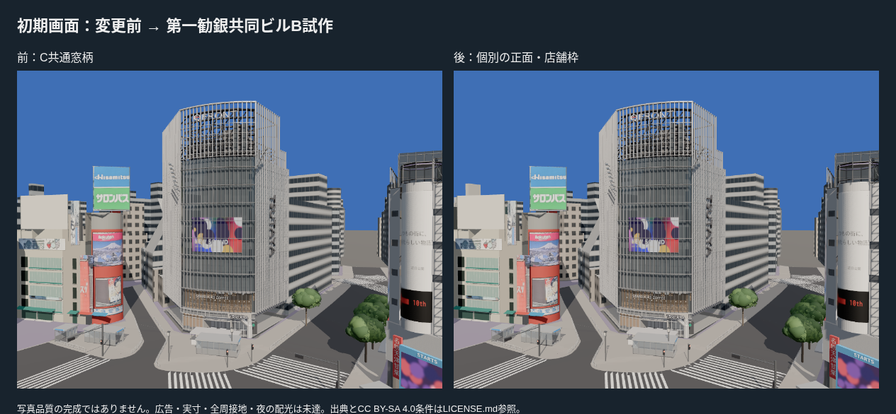
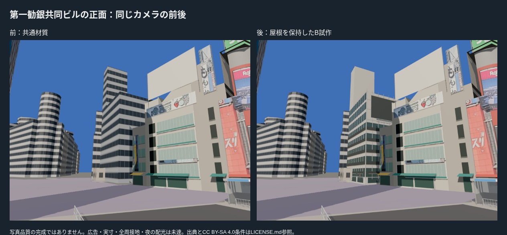
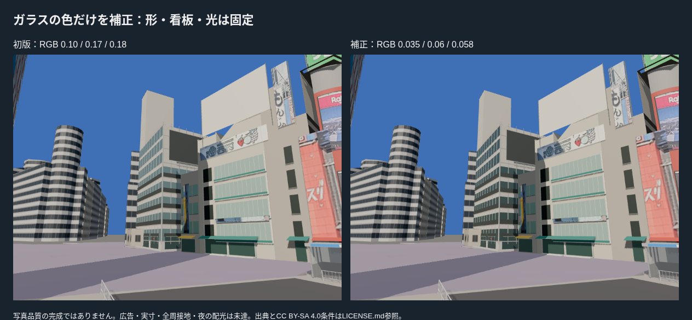
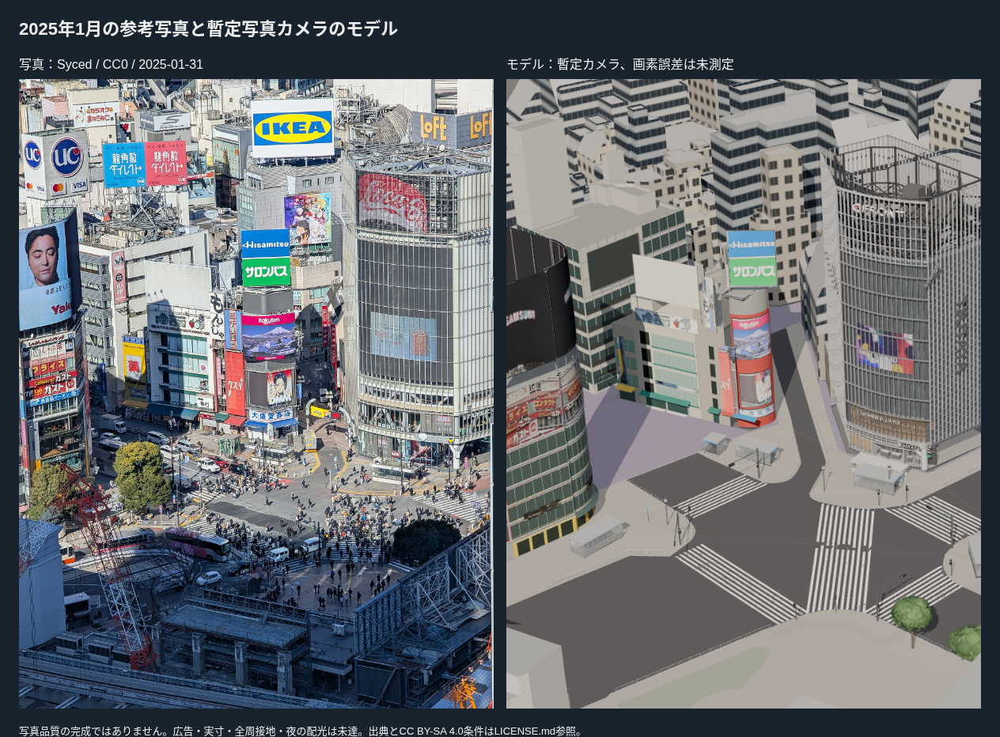
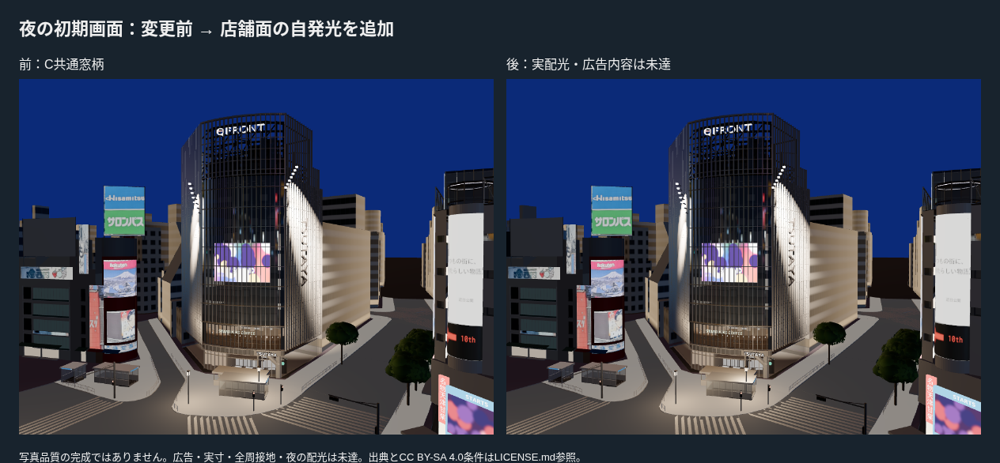

# 初期画面周辺の第1段階：第一勧銀共同ビルの個別B試作

PR #19マージ後main c820b00から、way/114755219 / bldg_5e891186-4803-48a0-9664-284f212881acを制作した。QFRONT・西武・信号・樹木・出入口を再制作せず、通常表示の初期画面に見える未制作の建物を一棟選んだ。

## 対象を変更した理由

最初に通常URLの既定カメラ（QFRONT基準、画角55度、1000×750）を撮影。センター244・クワトロはQFRONTや既存看板に隠れる部分が大きかった。左右や歩行の全体評価より先に、初期画面左側に見える第一勧銀共同ビルを優先した。既存資産のヒント・初期カメラ・露出・光の共通値は変更していない。

ENTRYは比較用にcaptureでHUDを隠し、time=dayで既定の昼を明示しただけで、写真合わせや別poseへ切り替えていない。通常表示の初期位置は維持する。初期画面で変わる範囲は左端の一部に限られ、画面全体の完成度が大幅に改善したとは扱わない。基準撮影の1000×750は今回の制作比較用。設計にある1440×900・縦長・左右約30度の総合確認はP4へ残る。

## 制作と写真比較

- 元のPLATEAU表面・屋根全頂点・上部看板の塊を保持。共通窓柄を、南・東の個別ガラス、窓枠、赤い腰壁、暗い店舗面と看板筐体へ置き換えた。
- 2025-01-31のStream写真と2025-02-07の高所写真（Syced、CC0）で、窓の格子・赤い腰壁・暗い店舗帯など形の種類を参考にした。建物名と全施設の対応、窓数・階高・看板位置・テナントは独立実測ではない。
- 初版ではガラスが参考写真の暗い帯より明るく見えた。**ガラスの色だけ**RGB(0.10,0.17,0.18)から(0.035,0.06,0.058)へ下げ、屋根・窓割り・看板枠・光は固定して再撮影した。反射の影響が大きく、色だけの変更による画像の差は小さい。写真一致の改善を数値で認定したわけではない。
- 広告画像やテナントの文字は作っていない。写真から看板を切り出して新たに貼る作業は後工程。広告がない黒い筐体は写真との差として残る。

Streamの既存写真カメラは仮校正で、地面の独立した検証がない。写真対モデルは形の種類・前後関係の補助として使い、画素誤差や実物位置の精度を認定していない。初期画面・正面は前後を同じカメラ同士で比較した。参考写真の撮影日を2025年10月と混同しない。

## 接地・統合・予算

座標はT.P.−15、viewer.jsonはgroundElevationTP=15。元の屋根と全体位置の差は0 m。南・東正面の外側62点を照会し、49点でC2a地面T.P.15.140〜16.135 mが得られた。13点は範囲外。元の足元を全体上下移動で直さず、当たる地面へスカートだけをつないだ。未照会区間の補間、全周接地、入口の段差と実勾配は未達。

同じIDのCを一度だけ除外し、通常building一覧へ追加。contextは300棟＋橋5件。センター244・クワトロはCとして残る。select_context.pyにも独立資産の除外を登録し、再抽出時の重複を防ぐ。

- **18ファイル・82テスト成功、型チェックを含むViteビルド成功。** 対象Cの重複除外、保留2棟の保持、地面照会、屋根全頂点の保持、広告テクスチャ不使用、元の壁にガラスが隠れないことを実GLBで確認。
- 新資産868三角形・10描画単位・56,136 bytes。
- 全体308,045三角形・251描画単位・18,827,716 bytes。現行予算内。FPSはクラウドで評価していない。
- 基準・初版・補正後の資産は各撮影中固定し、ブラウザを一つずつ実行した。撮影ログで読み込み・失敗・エラーを確認。計12回の撮影で失敗・ブラウザエラー・レイヤーエラーは0。最終版の初期画面と正面を保存した。

夜は店舗面と器具の自発光のみ。看板の広告内容、実際の店舗照明・配光・反射は未達。写真品質の完成・Gate合格とは扱わない。

## 次に残ること

センター244・クワトロ、遠景の固有外装、ハチ公広場の不足と歩道の仕上げを、初期画面の左右・歩行も確認して順位付けする。今回の施設の形状・寸法の精密化、黒い看板面への適切な年代の広告層、周辺Cの共通窓柄も残る。高度な既存資産を作り直す方針へ戻らない。
