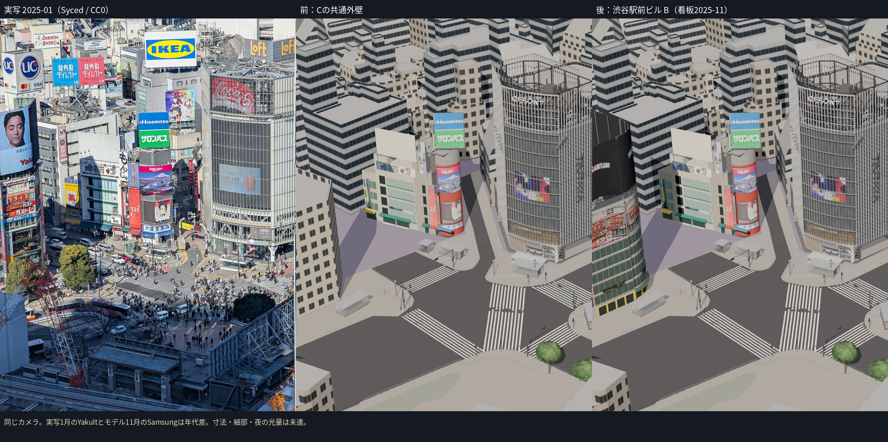
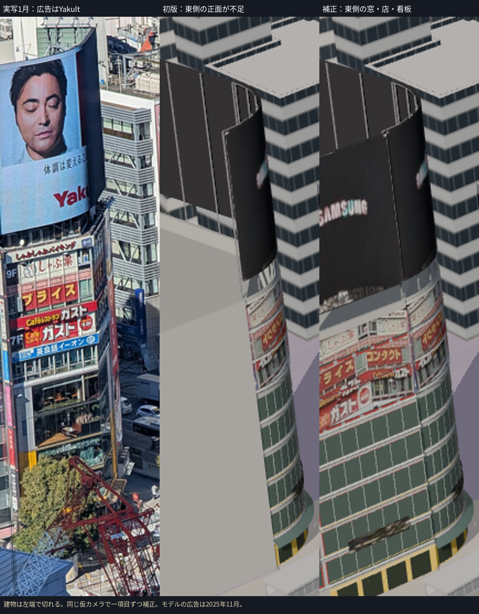
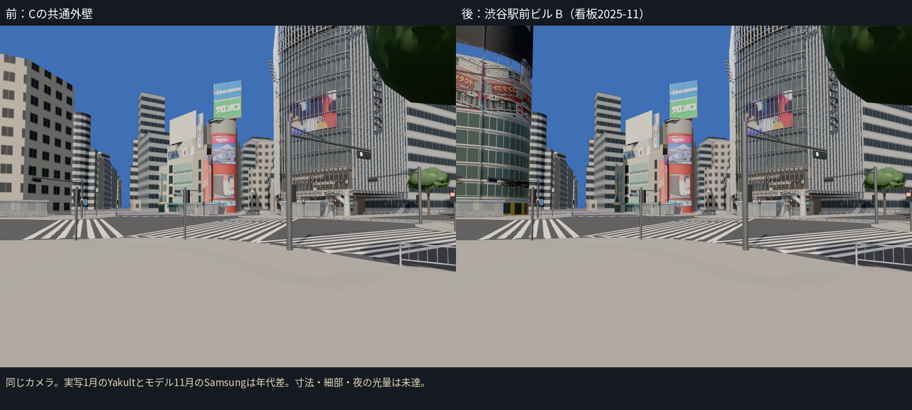
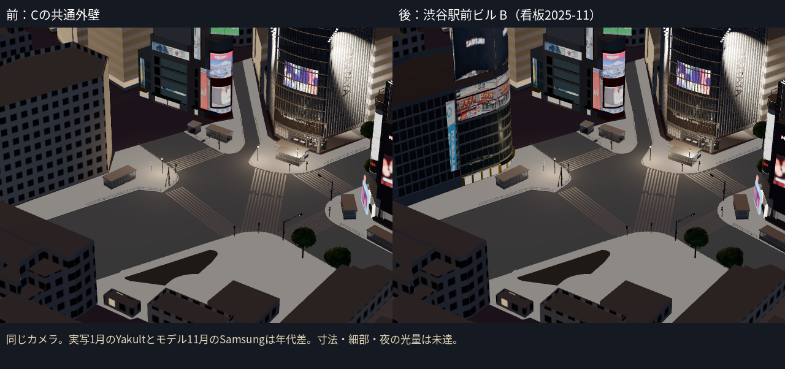

# C1：渋谷駅前ビルのB段階

way/60739635 / PLATEAU bldg_6abf2261-478c-437a-93f4-8ba23d7b1cadを、共通のC外壁から個別のBモデルに置き換えた。通常表示へ追加し、Cの同じ建物を一度だけ除いた。渋谷駅前ビルは交差点の南西側の独立した建物で、駅舎・連絡通路ではない。2025年10月の確認が必要な駅側5棟は変更していない。

## 作ったものと補正

- PLATEAUの段差のある屋根、裏側、残る壁を保存。北東の斜めの壁2面を、写真で見える丸い角に置き換えた。曲面の半径8.72 m、階高3.4 mなどはB段階の推定。
- 明るい水平部材、暗い窓、赤い窓枠、低層の黄色い店舗と金色の細い枠、ガラスの開口、庇、屋上の大型ビジョンと支持物を作った。
- 屋上ビジョンと飲食店・アイシティ・ロクシタンの看板は、2025-11-01の写真から7種類を抽出し、`signs-2025-11.glb`へ分離。2月のYakultと11月のSamsungを同じ広告として混ぜていない。
- 初版を同じStreamカメラで見ると、東側の長い正面が灰色の面のままで、角の曲面だけでは店舗や看板が不足していた。**東側正面という一項目を補正**し、窓・店舗・看板・ビジョンの続きへ置き換えた。カメラや他の建物は同時に変えていない。

## 実写と同じカメラでの比較

1月の実写の屋上はYakult、今回のモデルは11月のSamsung。広告内容の差は年代差として扱う。建物の位置・主要な輪郭・窓と店舗の有無を同じ既存の仮カメラで比較した。屋上の高さ・幅、外壁の色、窓の割り付け、店舗の切れ目には差が残り、独立したカメラ校正や寸法の測量を完了したとは扱わない。Streamでは建物の左側が画面外に出る。

## 写真・年代・ライセンスの確認

|写真|確認・使用した範囲|限界|
|---|---|---|
|2025-01-31 / Syced / CC0 / Stream|PLATEAUの対象と写真の建物の対応、主要な輪郭・看板と店の配置の比較|画面の左端で切れる。広告の内容を11月と一致として評価しない|
|2025-02-07 / Syced / CC0 / crossing_12214|赤い窓枠、明るい水平部材、上層の飲食店帯、アイシティ、低層の黄色とカフェ、巨大な屋上ビジョンを別写真で確認|屋上の上端が切れ、地上の入口は樹木で隠れる。テクスチャには使わない|
|2025-11-01 / Joli Rumi / CC BY-SA 4.0 / crossing_joli_2025|屋上のSamsungと青いHiT側、店舗の構成。7テクスチャの四隅を記録して透視変換で抽出|広角・低解像度・樹木の遮蔽。HiT側の左端は元写真で切れ、アイシティ・ロクシタンも一部が不鮮明|

出典と写真のハッシュは`assets/buildings/ekimae/source/refs/`。画像の派生物と看板GLBは**CC BY-SA 4.0**として、Joli Rumiへの帰属・元URL・改変内容を`source/textures/LICENSE.md`に記録した。今回の比較板に元写真として載せたのはCC0の1月写真だけ。モデル内に11月の派生テクスチャを含むため、比較板もCC BY-SA 4.0として `boards/LICENSE.md` に帰属と改変を記録。Street View・生成画像・根拠のない広告内容は使用していない。

切れた画像の範囲を復元したものではない。元写真にある範囲を板へ割り付けたため、画像自体の遠近、曲面のつなぎ目、角と東側に続く文字の重複は未達。近接して見たときのテクスチャ品質はBの試作として記録する。

## 地面・検証・予算

- 北側・丸い角の前面82点をC2a地面に投影。anchorはT.P.15.290、PLATEAU地面15.240との差は+0.050 m。元の屋根を保ったまま全体をこの高さに置いた。地面のGLBは変更していない。
- Cは306棟＋橋7件に再生成。駅側のグループとstreet v2は維持。
- **12ファイル・62テスト成功。TypeScript/Viteビルド成功。** 実GLBの座標・外形、旧壁が屋上と飲食店看板を隠さないこと、Cの重複除外、地面、11月の看板層と夜の画像発光を確認した。
- 前後のStream・地上・夜、初版のStreamで資産読み込み・画面のエラー・ブラウザエラーを確認。通常表示の既定建物は5件。
- B資産は6,640三角形・18描画単位・1,736,204 bytes。全体は293,187三角形・203描画単位・17,902,464 bytes。既存予算内。内訳は`evidence/c1-ekimae-b/budget.json`。クラウドFPSは評価しない。
- 看板は色の画像を夜の発光にも使う。2025年の夜写真に対する光量校正は未了。

残る差：丸い角と東側の実寸・正確な窓割り、看板の割り付け・文字の重複、HiT画像の不足範囲、店舗の入口の数・用途、庇の寸法、裏側の外観、夜の明るさ。写真品質の完成・Gate通過を認定しない。

次は駅側の2025年10月写真と形状の照合。駅舎・連絡通路を、1月・2月の工事状態で10月として作らない。既存B建物の未達も引き続き同じカメラで一項目ずつ補正できる。
