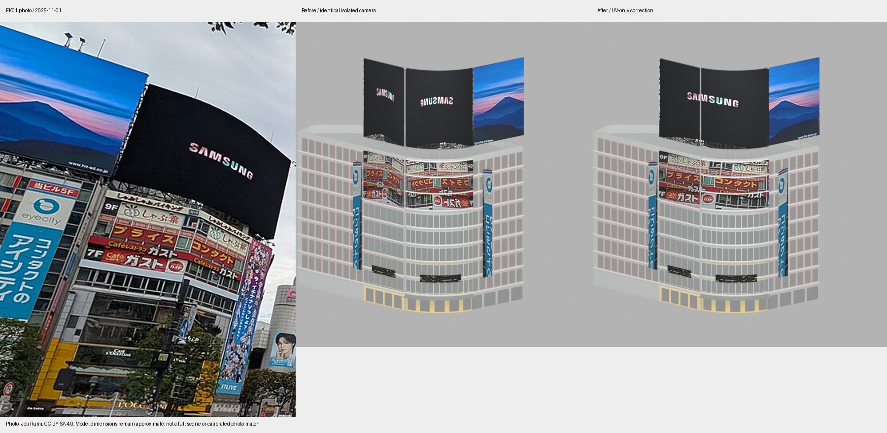

# 駅前ビル：既存看板のUV割付け補正

対象は既存の way/60739635。QFRONT・西武には変更なし。11月1日のEK01写真と既存の7画像を確認し、屋上Samsungと3段の飲食店帯を角・東側それぞれに丸ごと繰り返していたUVを、一続きの割付けへ変更。曲面・北側で左右反転していた画像の読み方向も補正した。実写にもある飲食店名の反復は元画像内に残し、文字を創作・補完していない。

## 保持と限界

- base GLBはバイト単位で保持。看板の頂点・法線・インデックス・画像バイトも保持し、UVだけ変更。位置、原点、接地、元PLATEAU、建物一覧や重複除外は変更なし。
- 画像は従来の2025年11月レイヤーのみ。2月のYakultは混ぜていない。派生画像・比較板はJoli Rumi / CC BY-SA 4.0。
- 曲面と東側の分配は既存の曲面長と13m幅から算出する近似。元画像の低解像度・写り込んだ足場や背景・遠近歪み、曲面の物理的な隙間、HiTの欠落端、屋上寸法、店舗同定・入口、夜の光量は未解決。看板筐体を新たに作っていない。
- 比較は同一の固定された孤立モデルのBlenderカメラ。実写とカメラ校正した比較でも、通常WebGLシーンの画像でもない。

## 実行した検証

Blender 4.2.3で生成・読込・前後レンダー成功。変更前の看板を元ソースから再生成し、リポジトリmanifestのSHA-256 4b2297c627cc1382078e6a671cc0865b44fd7e1fa9a0033e058b4322b7b94d96と完全一致を確認。7材質・296三角形・1,194,088 bytesは不変。UV有限・0〜1範囲、頂点/法線/インデックスと埋込画像の一致を検査した。npmテスト、ビルド、全シーンWebGL、FPSは未実行。

## 再生成

既存の通常コマンドで全生成できる。UVだけ直す場合は build_ekimae.py の最後へ --signs-only を追加し、ground引数を - とする。既存statsの接地サンプルを再利用して signs-2025-11.glb のみを出力し、base/viewer/stats/emissiveを上書きしない。

編集用スナップショットはsource/blender/ekimae-uv.blend。通常再生成後、Blender 4.2.3でsource/blender/save_editable.pyを実行すると、建築本体と11月看板を読み込み、画像を埋め込んだblendを再保存する。地理座標を保持する。
