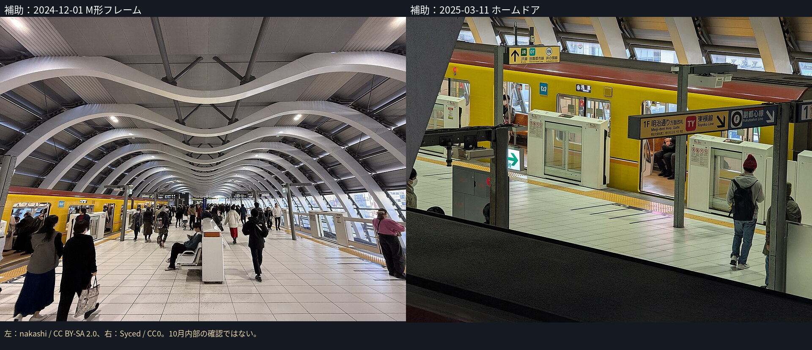
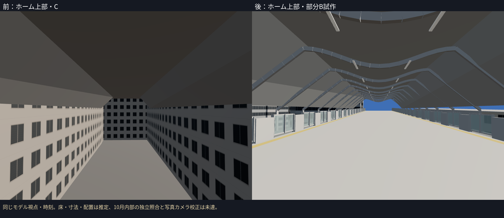
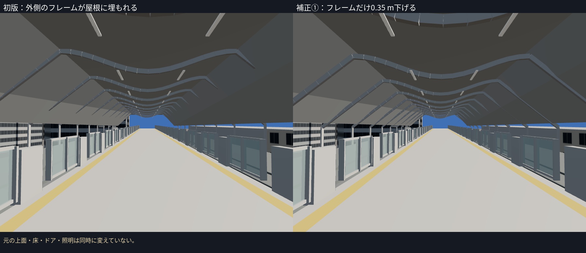
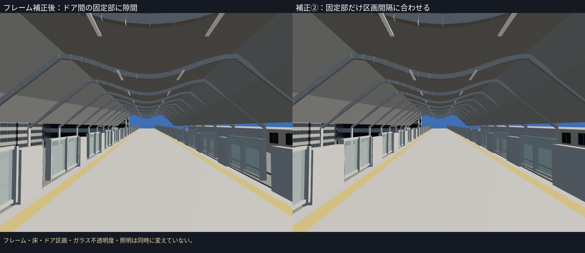
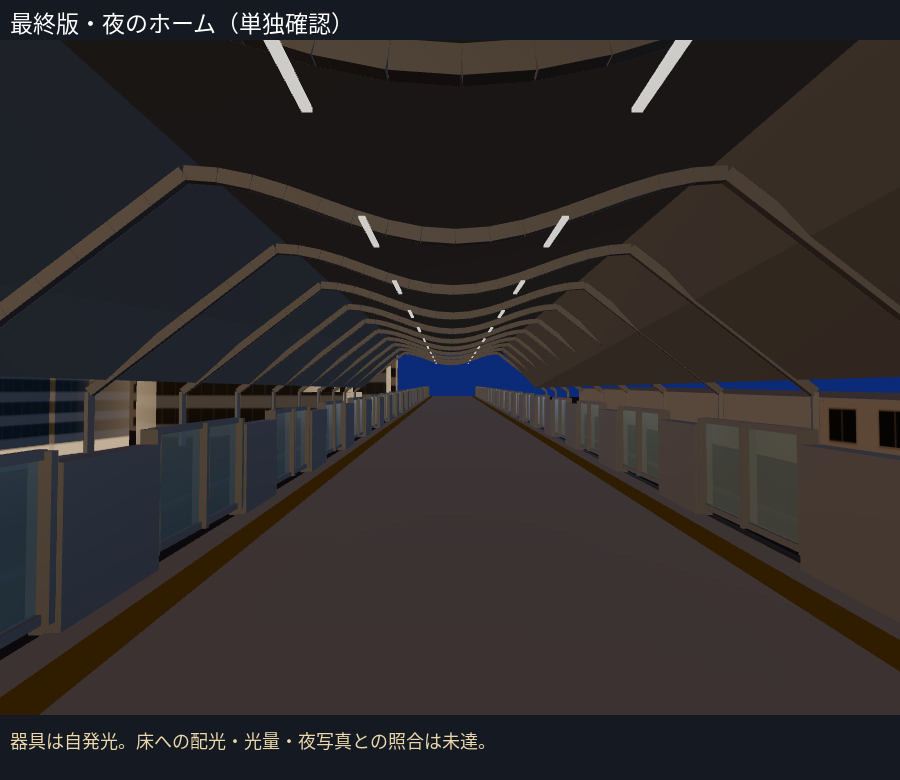
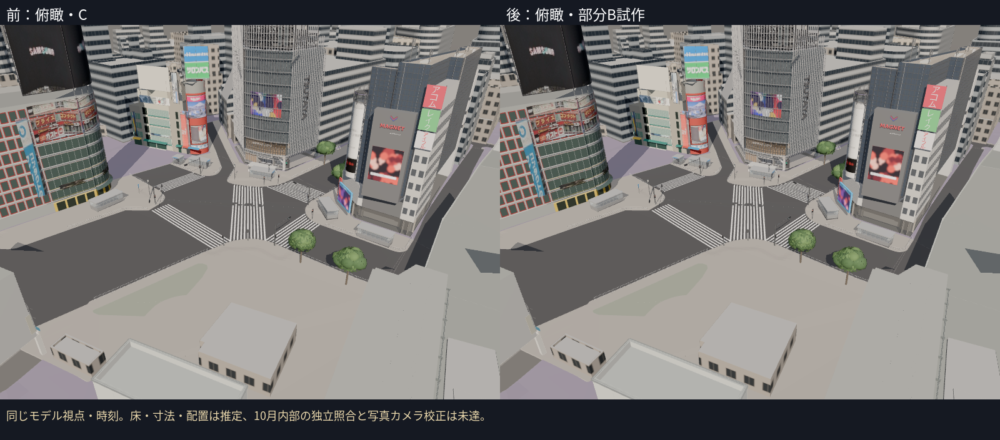
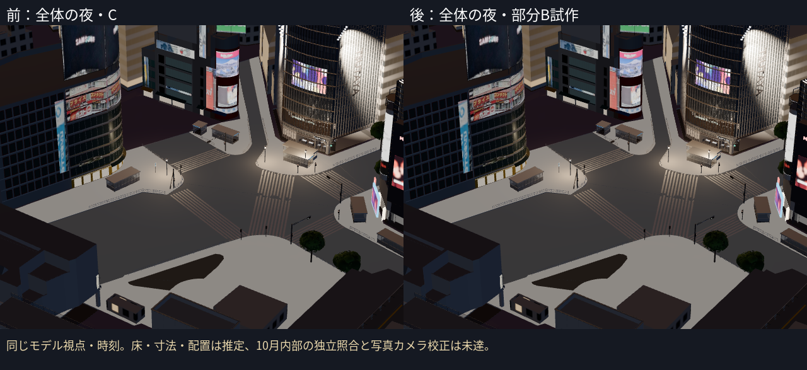

# 駅側の第6段階：銀座線ホーム上屋の部分B試作

PR #17をマージしたmainから、way/810356690の上部を個別B試作へ置換。元の屋根・上部デッキの全頂点を保持し、上部の閉じた壁を開放して、M形フレーム・島式ホーム・ホームドア・点字帯・線路・照明を追加した。下部は元の形を保持し、全体のB完成とは扱わない。通常表示へ追加し、同じIDのCを一度だけ除いた。

**10月の内部の独立した照合は未達。床・フレーム・ドア・線路の寸法と配置も推定**としてHUD・台帳へ記載。

## 上面を保持した理由と写真の使い方

- PLATEAUの上面は最高T.P.35.5 m、側部T.P.30.7 m。歩行者デッキも上にあるため、元の平らな上面をM字へ変形せず、その下にM形フレームを作った。共通T.P.15 m基準、上下移動0、元の屋根との頂点差0 m。
- GC01：2025-03-11のホーム・ドア、GC02：同日の上部歩行者デッキ。Syced、CC0。
- GC03：2024-12-01のM形フレーム。nakashi、CC BY-SA 2.0。
- 上の3枚は**形の補助資料**。10月の状態を確認した写真とは扱わない。日付・作者・ライセンス・公式メタデータ・縮小写真・ハッシュを資産`source/refs/`へ保存した。写真をモデルテクスチャへ貼っていない。
- [10月18日の工事記録](https://view.tokyo/?p=73418)は駅側の高架工事の文脈のURL参照だけで、M形のホーム内部を独立確認した資料ではない。記事写真は再利用していない。

## 制作と二項目を順に補正

- 屋根下の閉じた壁だけを開け、線路床より下は元の形を保持。16本のM形フレーム、両側のホームドア、点字帯、線路と照明器具を規則配置した。28区画のドア配置・寸法は実数の確認ではなくB推定。
- 床は近傍のPLATEAU高架上面T.P.28.125 mと29.531 mから補間した**仮のホーム床**。ホーム床を実測した値ではない。島式ホームを線路床より1.1 m上げ、線路の軌間は標準的な銀座線の1.435 mとした。橋との接続・高さ・勾配の実照合は未達。
- 初版ではM形フレームの外側が屋根に埋まり、途中で切れて見えた。**フレームの高さだけ0.35 m下げた**。元の屋根・床・ドア・光量は同時に変えていない。
- その画像を保存してから、ドア間の固定部に不自然な隙間がある点を補正。**固定部の幅と中心を区画間隔から決めてつなげた**。ドア区画の位置・数、ガラスの不透明度0.8、フレーム、床・照明は同時に変えていない。

初版はrib_drop_m=0・continuous_housing=false、フレーム補正後は0.35・false、最終版は0.35・trueで再生成できる。広告・人物・列車の模型は追加していない。

## 地面・夜・写真に対して残る差

地面4点の照会で、西端付近1点からC2a T.P.15.282 mが得られた。元の下端T.P.14.86 mとの差は約0.422 m。残る3点は範囲外。下部は元の形を保持し、地面合わせを完了したとは扱わない。仮のホーム床をC2a地面の実測値と混同しない。

夜は器具の自発光で、床への実際の配光や光量の調整は未達。ドアの透明度・反射、曲面の継ぎ目、フレームの色と太さ、床のタイル、案内板、駅設備、下部の外観も未達。

| 写真の種類 | 今回の表現 | 残る差 |
|---|---|---|
| 連続したM形フレーム | 元の上面下のM形フレーム | 曲面の滑らかさ・接合・数・位置・10月照合 |
| 透明なホームドアと固定部 | 閉じたドア、連続した固定部 | 透明度・反射、実区画、筐体と機器の細部 |
| 島式ホームと点字帯 | 推定の床・線路・帯 | 実際の床高さ・勾配・線路位置、タイル・点字 |
| 照明と屋根下の空間 | 器具と自発光 | 実際の配光・光量、天井仕上げ |
| 下部と上部歩行者デッキ | 元の形を保持 | 地面・入口・階段・外壁の確認 |

モデル前・初版・フレーム補正後・最終版は同じ視点・時刻。夜のホームは最終版の単独確認で、変更前や写真と一致したカメラの比較ではない。**写真カメラの校正・写真対モデルの画素誤差は未計測**。写真品質の完成・Gate合格を認定しない。広告の切り貼り補正は後工程。

## 検証と次の対象

- **17ファイル・78テスト成功、TypeScript/Viteビルド成功。** 実GLBの元の屋根全頂点、M形の起伏、上部の開口と下部の保持、透明材質、固定部の隙間が塞がること、重複除外を確認。テストは写真の同定・床や下部の正解を保証しない。
- 新資産11,314三角形・11描画単位・715,544 bytes。全体307,417三角形・241描画単位・18,788,864 bytes。実GLB集計は`evidence/c1-ginza-canopy/budget.json`、予算内。
- Cは301棟＋橋5件、未制作の駅側グループはbldg_d7fb4726の1棟。ただし今回の上部以外・10月内部も未確認で、確認済み施設が増えたとは数えない。
- 既定10資産、nostationで駅側5資産を除き既存5資産へ。読み込み・失敗一覧・ブラウザエラー・レイヤーエラーを記録。撮影中は資産を固定し、ブラウザは一つずつ実行した。FPSはクラウドで測らない。

次は残るbldg_d7fb4726のJR施設候補。各部分B試作の写真同定・地面・夜の光量の精密化も残る。
