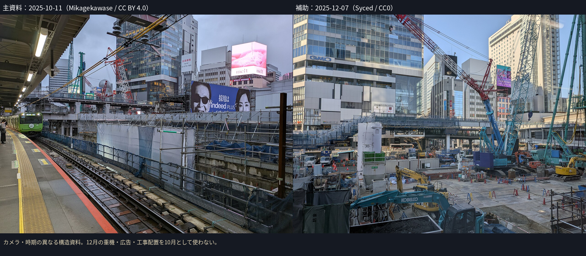
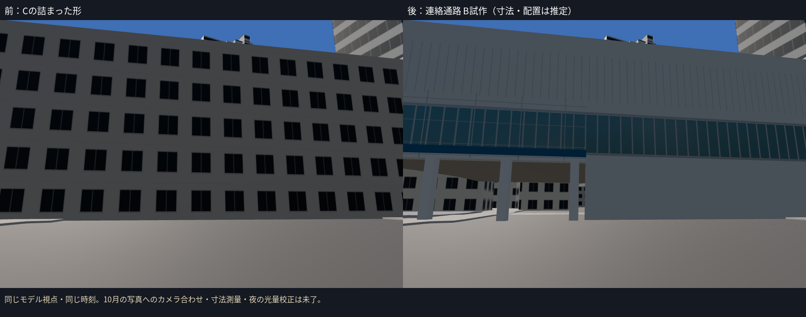
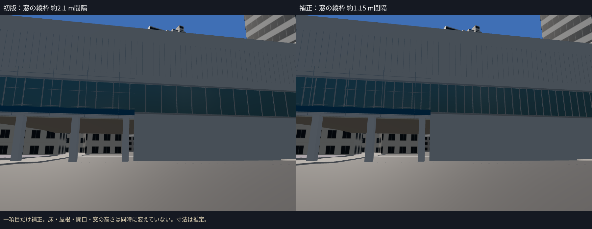
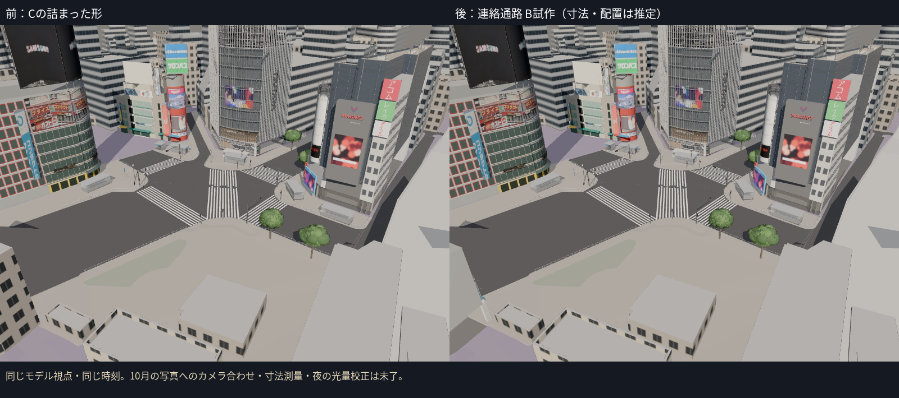
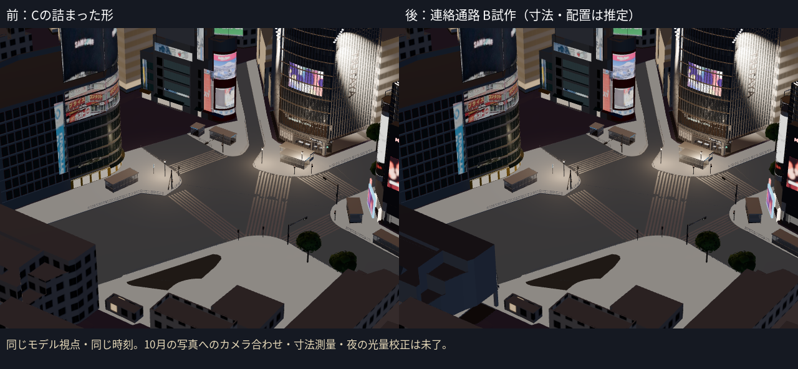

# 駅側の第1段階：連絡通路・橋のB試作（2026-10-13）

オーナーの指示により、広告の切り貼り・割り付けの補正を後工程へ残し、駅側へ進んだ。今回の対象は**駅・マークシティの連絡通路と推定される部分**（way/355250634 / bldg_84560e8a-53da-47bf-a0c8-93a0e6d434b5）と、重なる橋部分（brid_bd5e7fe1-da73-494d-83a9-2dfdb790bb3d）。同定は既存台帳と位置からの推定を含む。駅舎5棟全体を10月確認済み・B完成とは扱わない。

## 写真をどこまで確認できたか

- **2025-10-11 / Mikagekawase / CC BY 4.0**：JRホームから見た旧東横店の撤去後。桁・柱・柱間の開口、養生・足場が見える。交差点側の駅舎正面は写りきらず、個々のPLATEAU建物の正面寸法を確定できない。
- **2025-12-07 / Syced / CC0**：撤去跡からの連絡通路・桁・柱・ガラス帯を、補助として新たに確認した。12月の重機、広告、工事配置を10月として使わない。10月の開口位置・窓寸法を独立して確定した根拠にはしない。
- **2025-02-02 / ウィ貴公子 / CC BY-SA 4.0**：ハチ公口正面の形の参考として閲覧したが、10月の正面を認定する根拠に採用していない。画像は新しいモデルのテクスチャへ使用していない。

Commonsの公式メタデータで日付・ライセンスを確認。追加の12月写真は`docs/core/station_refs/`、10月写真は既存の`building_refs/station_oct2025.jpg`。画像を単に入手したことを、駅舎5棟の同定・時点の確認の完了には数えない。

この参考板は異なるカメラの写真を並べた**構造の種類の資料**。モデルとの画素誤差の比較ではない。

## 作ったもの

元のCの連絡通路と橋は、どちらも下まで詰まったLOD2の箱だった。橋をそのまま重ねると開口を塞ぐため、二つを一つの`station-concourse`資産へ置き換えた。

- 元の屋根の全頂点と絶対T.P.を保持。建物全体を地面の最小値へ上下移動しない。構造物の接続高さを優先する。
- 橋との接続側（x > -14 m）だけ、壁の下部を柱と桁へ置換。西側の下部の詰まった形は残し、写真で十分確認できない範囲まで開放しない。
- 開口の床下面は推定T.P.21 m。新しい柱の足はC2a地面への光線で個別に合わせた。北面81点の地面はT.P.15.648〜15.888 m。開口高さ・柱の本数と位置は推定。
- 明るい外装、ガラス帯、縦枠、金属の目地、桁、柱、青い養生部材と足場、弱い夜の光を制作。広告画像を新たに貼り付けていない。
- 初版を見て、窓の縦枠が粗かったため、**縦枠の間隔だけ**約2.1 m→約1.15 mに補正。窓の高さ・床・屋根・開口は同時に動かしていない。
- 通常表示へ追加。Cの建物1件・橋1件を一度ずつ除き、Cは305棟＋橋6件へ再生成。既存の`?context=nostation`では新しい連絡通路も消す。

前後は同じカメラ・同じ時刻で確認した。10月写真のカメラに新しく合わせたものではなく、**10月実写との画素誤差・正面の実寸は未計測**。種類・欠落の確認と、同じモデル視点での補正の確認を区別している。

## 検証と未達

- **13ファイル・65テスト成功。TypeScript/Viteビルド成功。** 元の屋根の全頂点が絶対座標を保つこと、両方のCの重複除外、東側の開口を通る光線、西側の壁を残すこと、実GLBの有限な座標を確認した。テストは写真の同定や10月の寸法を保証するものではない。
- 高所・目線・夜・連絡通路の前後と初版で、資産の読み込み・失敗・ブラウザエラーを確認。通常表示は既定6資産。`nostation_check.json`で、既存のnostation指定では通路が消えて5資産となり、エラーがないことを確認。
- B資産：592三角形・7描画単位・38,484 bytes。全体：293,645三角形・210描画単位・17,930,768 bytes。既存予算内。クラウドFPSは評価していない。
- 主な未達：通路・橋との正確な対応、10月の北面正面資料、開口の範囲・高さと柱の位置、窓の寸法、上部の外装と壁・ガラスの色、実際の工事囲い・足場の配置、夜の光量。B試作であり、写真品質の完成を認定しない。

駅舎側の5件（bldg_20234796、bldg_9b0ce3b9、bldg_5369333e、bldg_d7fb4726、way/810356690）はCのまま。10月写真から正面を同定できていないため、個別B化は次の作業として残る。広告の補正も、各建物の未達一覧に残している。
