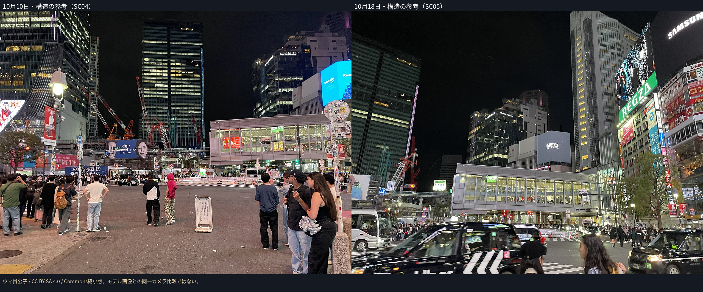
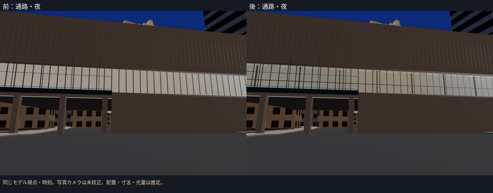
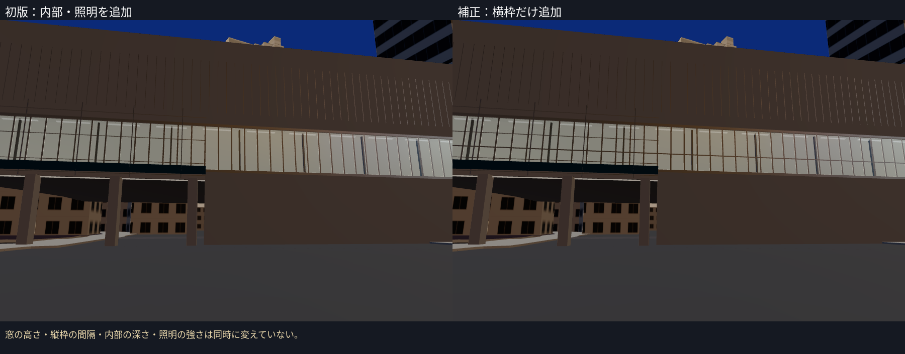
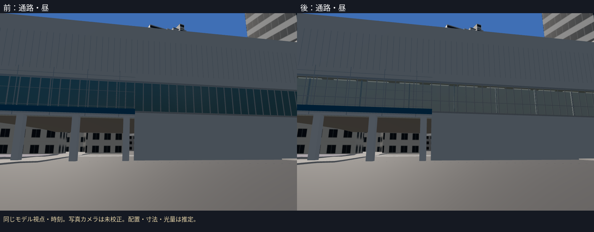
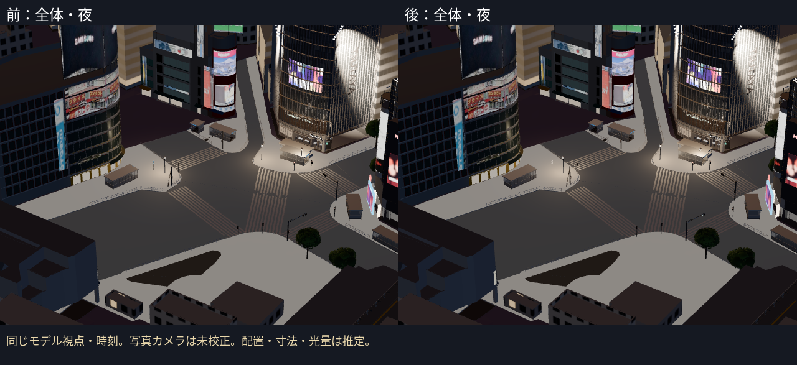

# 駅側の第3段階：連絡通路の窓奥・照明と横枠

PR #14をマージしたmainから、駅・マークシティ連絡通路の北側ガラス帯を補正した。元の一様な発光面を、透明なガラスと浅い内部・照明器具へ置換し、初版の比較後に横枠だけを追加した。通常表示で見えるB試作。新しい駅舎を同定・B完成したとは扱わない。

## 対象を選んだ理由と10月写真

次候補の台帳bldg_5369333eは「推定：ハチ公口側」で、正面の確定資料がまだない。Commonsで新しく2025年10月10日・18日の交差点側の写真を得た。連絡通路の北側ガラス帯、明るい内部、横枠を確認できるため、この目立つ差を先に補正した。残る4候補の正面の同定は未達のまま。一般の住宅の窓割りを未確認の駅施設へ追加していない。

- SC04：2025-10-10 23:13:28、IMG 6646。
- SC05：2025-10-18 23:19:29、IMG 8427。
- 作者はウィ貴公子、どちらもCC BY-SA 4.0。`station_glazing_refs/SOURCE.json`に公式URL・ライセンス・改変・ハッシュ、同フォルダに公式メタデータと1000 px縮小版を保存。
- 窓・内部の**種類**の参考。写真をテクスチャに貼っていない。12月補助写真の窓寸法を10月の実測値に読み替えていない。

## 制作→比較→一項目の補正

1. 元の北側壁のうちガラス帯の高さだけを開けた。窓の奥に深さ0.75 mの浅い床・天井・壁、柱、照明器具を作り、ガラスを透明にした。これはBの浅い表現で、通路内部全体の再現ではない。深さ・柱間隔・透明度・光量は推定。
2. 初版を既存の通路視点で撮影。夜は一様な発光面から器具と奥行きが見える表現になった。写真にある上下を分ける横枠が未反映だった。
3. **横枠だけ**を追加。ガラス中央から0.55 m下の位置は推定。窓の高さ・縦枠44区画・内部の深さ・照明の強さは同時に変えていない。

元の屋根の頂点・T.P.高さ、下部の開口、西側の地上の形を保持した。追加した内部は北側の浅い部分に限る。広告の切り貼り修正はオーナー指示で後工程に残す。広告レイヤーや周囲の夜の設定は今回変更していない。

## 写真に対して残る差

モデルの前・初版・後は同じ通路視点・時刻。夜の全体も前後で同じ視点。**写真のカメラへの校正、写真対モデルの画素誤差は未計測**。参考写真とモデルを同一カメラの比較とは扱わず、写真品質の完成・Gate合格を認定しない。

| 写真の特徴 | 今回の表現 | 残る差 |
|---|---|---|
| 窓を上下に分ける横枠 | 横枠を一本追加 | 枠の正確な高さ・本数・太さ、縦枠の実間隔 |
| 明るい通路の内部 | 透明なガラスと浅い床・天井・照明器具 | 内部の奥行き、配置、床の意匠、人・店舗、光量・色温度 |
| ガラス越しの柱や反射 | 浅い内部の柱と共通のガラス反射 | 柱の位置、透過・反射の比率、実写真の背景 |
| 上部の外装・屋根の輪郭 | 元のPLATEAU屋根・上部外装を保持 | 10月写真との輪郭・外装の高さ・色の照合は未達 |
| 工事中の駅側と他の施設 | 既存の形を保持 | 工事囲い・足場の実配置、残る4施設の同定 |

## 検証

- 14ファイル・**69テスト成功**、TypeScript/Viteビルド成功。
- 新しい実GLBの遮蔽テストで、ガラス越しに奥の面があり、元の北側壁がガラス帯を塞がないこと、横枠がガラスの手前にあることを確認。既存の屋根の全頂点、下部の開口、西側の壁、北側上屋・高架の保持テストも成功。
- 通路資産は848三角形・9描画単位・54,128 bytes。全体は294,540三角形・221描画単位・17,980,280 bytes。既存予算内。
- 前・初版・後の読み込み、失敗一覧、ブラウザエラー、レイヤーエラーを記録。既定7資産、C304棟＋橋5件、未確認の駅側4候補はそのまま。
- 撮影中は資産を固定し、ブラウザを一つずつ実行した。FPSはクラウドで測らない。

写真の出典は増えたが、残る駅施設の同定を完了したわけではない。次は4候補のうち、bldg_5369333eなどの正面が分かる10月資料から個別に外観を決める。今回の通路にも輪郭・光量・配置の未達が残る。
