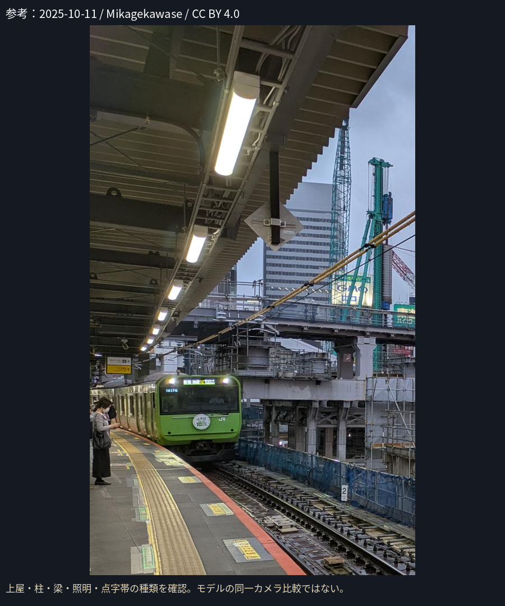
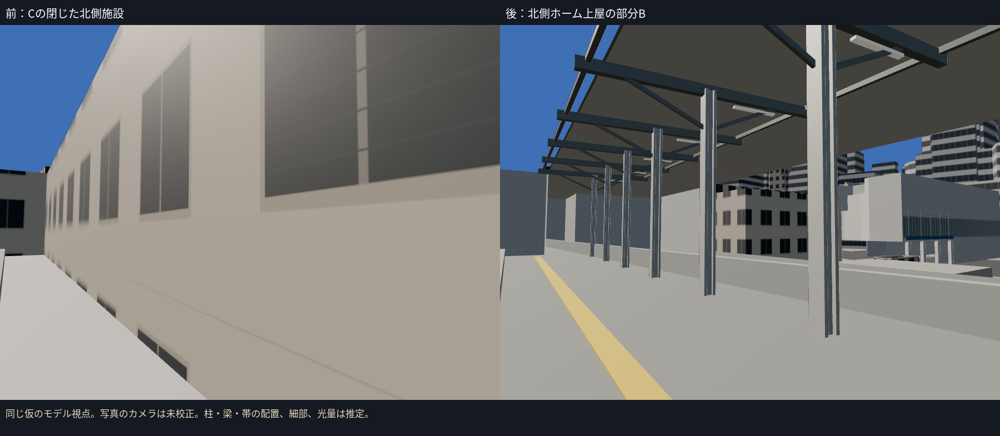
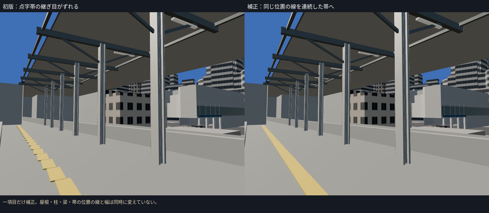
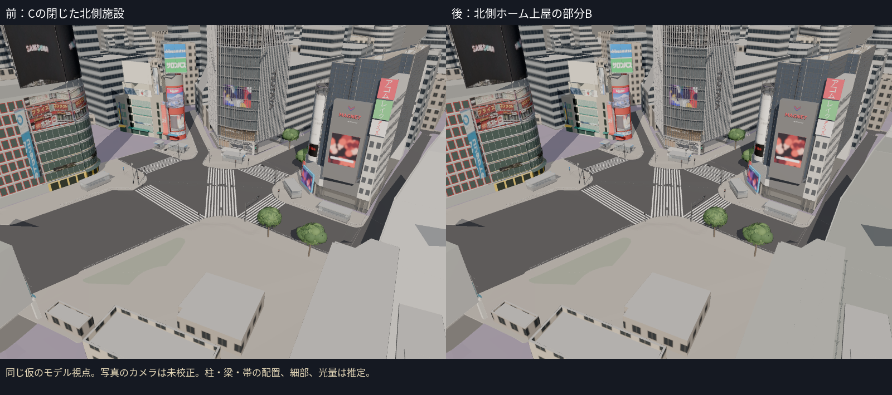
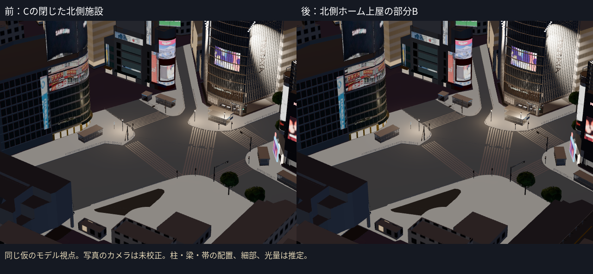

# 駅側の第2段階：JR北側ホーム上屋の部分B試作

駅側5候補のうちbldg_20234796-412f-494e-b712-f3f7d6e3197bの**北側上屋を部分B化**した。南側の未確認の形と、JR高架brid_95680199-7365-41de-a5b7-9275321fe8bfの元の全形状は同じ資産へ保持し、Cの二件を一度ずつ除いた。通常表示へ追加。高架全体・南側正面が10月確認済みとは扱わない。

## 10月写真から候補を絞った根拠

2025-10-11 / Mikagekawase / CC BY 4.0の写真を、元の4624×3472解像度で確認した。出典・改変・ハッシュは`station_north_refs/SOURCE.json`、Commons公式応答は同フォルダの`commons_metadata.json`。構造の参考に使い、写真をモデルのテクスチャへ貼っていない。

- メタデータの緯度35.659286・経度139.701186を、既存の原点35.6595・139.7005で近似換算すると平面座標は約(62.05, -23.82) m。
- 北側候補の屋根の端まで約1.54 m。他の4候補は40.1〜62.1 m離れている。
- 同じ位置に、元のJR高架のOuterFloorSurfaceがあり、床の高さは**T.P.21.29 m**。この床・北側の細長い屋根と、写真のホーム上屋・柱・梁・照明の種類から対象を絞った。
- 携帯GPSには誤差があり、**GPSだけで同定・柱位置・カメラを確定してはいない**。GPS高度60.84 mは使わず、高さはPLATEAU床を基準にした。

候補の距離は`evidence/c1-station-north/identification.json`。カメラの位置・向きの独立した校正は未達で、10月の南側正面も写りきらない。

検索した9月2025・2月2026の工事記事は、10月確認の根拠に数えていない。その写真を転載・モデルへ転用していない。ハチ公改札の移設前の入口を今回作ってはいない。

## 実装と一項目の補正

- y > -50 mの北側で、閉じた壁のうち床より上を開放。下部と南側の形は残した。
- 元の屋根の全頂点を保持し、薄い天井面を追加。H形の柱、横梁・補強、蛍光灯の形、黄色の点字帯を作った。柱・梁・帯の位置と寸法は推定。
- JR高架の元の全頂点・面形状を同じ資産内で保持。高架自体の新しい形を創作せず、保持部分はCとして扱う。
- 初版の点字帯は、未回転のタイルの連なりが階段状にずれて見えた。写真の連続した帯を参照し、**帯の継ぎ目だけを補正**。幅・高さ・位置の線、柱・梁・屋根は同時に変えていない。細かい突起や溝はまだ作っていない。
- 既存の広告の切り貼り補正はオーナー指示で後工程へ残す。今回新しい広告・写真テクスチャは追加していない。

モデル前後は**同じ視点・同じ時刻**。位置は写真GPSの近く、高さはPLATEAU床＋1.6 m、向きは仮の確認用視点。写真のカメラに校正したものではなく、**写真とモデルの画素誤差は未計測**。参考板と同一モデル視点の比較を区別する。

|写真で見える種類|今回の表現|残る差|
|---|---|---|
|薄い天井と梁|元の屋根＋天井・横梁・補強|天井の小梁、配管、接合部、色|
|柱が並ぶ開放した上屋|H形の柱＋北側の閉じた壁を除去|正確な本数、間隔・位置、柱の種類の細部|
|白く光る蛍光灯|1.3 mの照明器具の形と弱い昼・夜の発光|筐体の丸み、正確な位置、光量|
|連続した黄色い点字帯|連続帯へ補正|線路との位置、点字の突起・溝、実寸|
|未確認の南側・高架の他の部分|元の形を保持|10月の正面・材質・細部|

## 検証と次の対象

- **14ファイル・68テスト成功、TypeScript/Viteビルド成功。** 実GLBで屋根・高架の元の頂点の絶対座標、北側の床上開口、南側壁の保持、撮影位置付近の元の床高さ、Cの重複除外を確認。テストは写真の同定や実測精度を保証しない。
- B資産は996三角形・9描画単位・68,400 bytes。全体は294,284三角形・219描画単位・17,964,636 bytes。既存予算内。
- Cは304棟＋橋5件。北側上屋の元の施設1棟を除き、未確認の駅側候補は4棟へ。北側資産の保持部分までB完成として数えない。
- 床・屋根は共通の絶対T.P.を保持。地面のサンプルは`stats.json`へ記録し、建物を地面の最小値へ一括移動していない。
- 前後のホーム視点・俯瞰・夜、初版で読み込み・失敗・ブラウザエラーを確認。既定7資産。既存のnostation指定では駅側2資産を消して5資産に戻す。

写真とカメラの対応、柱・梁・帯の配置、光量、天井細部、線路・架線の細部、南側の外観は未達。写真品質の完成・Gate合格を認定しない。次は残る4候補のうち、ハチ公口側bldg_5369333eなどの10月正面の同定と個別B化。広告の未達も各B建物の記録に残している。
