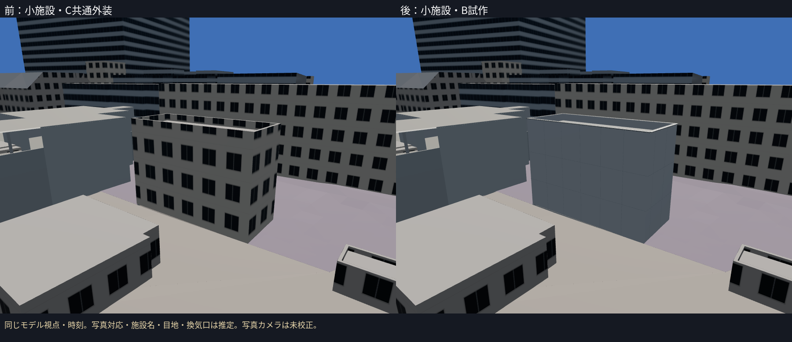
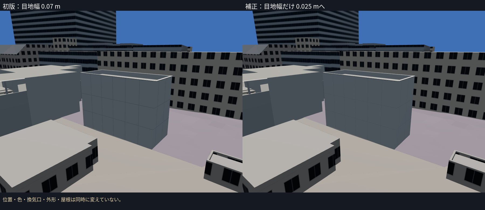
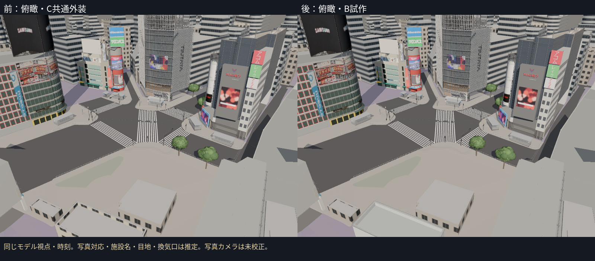
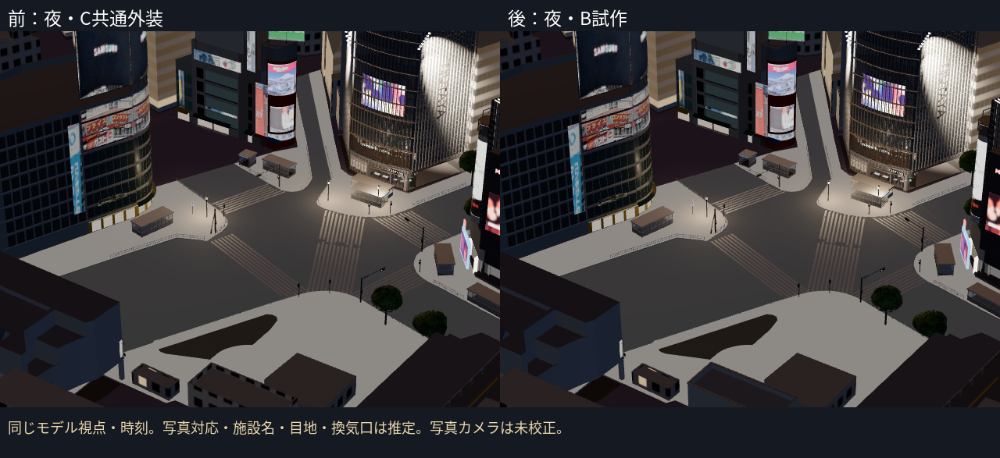

# 駅側の第4段階：西側の小施設のB試作

PR #15をマージしたmainから、bldg_5369333e-5975-493a-b05d-b341800715c2のCを個別B試作に置き換えた。住宅風の共通窓を外し、白い金属外装・目地・推定の換気口を作った。元の外形・屋根の全頂点を保持し、通常表示へ追加。同じIDのCを一度だけ除いた。

**正式な施設名と写真との対応は推定。10月の正面の独立した同定を完了したとは扱わない。** 台帳とHUDにも推定を記載した。

## 根拠と今回の進め方

- PLATEAU 2025の元の形は約18.2×7.2 mの長方形。地面側T.P.15.439 m、最高T.P.28.100 m、くぼんだ屋根T.P.27.087 m。外形・屋根は移動・拡縮せず残した。
- 新しく見つけた[2025年10月18日撮影の工事記録（再開発調査兵団）](https://view.tokyo/?p=73418)は、10月22日公開。銀座線高架・旧ホーム付近の白い設備棟候補の外装の種類を参照した。11月の関連記事の写真を10月の根拠に混ぜていない。
- 白い施設とbldg_5369333eの対応には推定が残る。台帳の「ハチ公口側駅舎」を正式名称として使わない。目地・換気口の配置と寸法は標準的なB推定。新しい入口・住宅風の窓・発光・広告を作っていない。
- 記事写真の再利用ライセンスは未確認。画像は公開URLで参照し、リポジトリ・比較板・モデルテクスチャへ転用していない。出典・撮影日・公開日・推定の範囲は資産の`source/refs/`に保存した。

元のCは未確認の共通窓割りだった。今回も外観全体の正解を確定したわけではないが、設備施設らしい外装を推定として通常表示へ出す進め方を採用した。

## 制作と一項目の補正

- 白いパネル、灰色の目地、屋根の縁の金属、水平方向の羽根を持つ換気口の形を作成。換気口は東側の短辺の上部へ推定配置。
- C2aの地面を周囲52点で測定。T.P.15.300〜15.501 m。元の下端より低い区間だけ28区間の裾を追加し、最大約0.139 mの隙間を塞いだ。屋根を地面へ一括移動していない。実際の基礎構造の測量ではない。
- 初版を撮影して、白い外装の目地が格子として強く見える点を確認。**目地幅だけ0.07 mから0.025 mへ補正**。位置・色・換気口・外形・屋根は同時に変えていない。

モデル前・初版・後は同じ視点・時刻。近接視点の初回撮影は高架の壁に遮られていたため、資産を変更する前に見通せる固定視点を設定し直した。掲載した前後はその同じ固定視点。**写真のカメラへの校正・写真対モデルの画素誤差は未計測**。写真品質の完成・Gate合格を認定しない。

## 残る差と検証

| 対象 | 今回の表現 | 残る差 |
|---|---|---|
| 白い設備施設らしい外装 | 白いパネルと細い目地 | 正面の同定、実際の材質・色、区画の位置 |
| 屋根の縁とくぼみ | 元のPLATEAU屋根＋縁の金属 | 10月の輪郭の独立照合、屋上設備 |
| 換気の開口の種類 | 推定の浅いルーバー | 開口の存在・位置・大きさ、羽根の形は未実測 |
| 地面との接続 | C2aに合わせた裾 | 実際の基礎・階段・入口・施工状態 |
| 周囲の旧ホームと高架 | 今回対象以外は保持 | 骨組み・撤去範囲・足場の10月照合 |

- **15ファイル・72テスト成功、TypeScript/Viteビルド成功。** 実GLBの全元頂点・最高高さ、地面の低い区間の裾、共通窓・発光がないこと、Cとの重複除外を確認。テストは写真の同定や外観の実測精度を保証しない。
- 新資産342三角形・6描画単位・24,288 bytes。全体294,856三角形・227描画単位・18,002,748 bytes。実GLB集計は`evidence/c1-station-service/budget.json`、予算内。
- Cは303棟＋橋5件、そのうち未制作の駅側グループ3棟。今回対象も写真対応・正面に未確定が残るので、確認済み施設が1棟増えたとは数えない。
- 既定8資産。`context=nostation`で駅側3資産を除き、既存の5資産を残す。
- 撮影中は資産を固定し、ブラウザは一つずつ実行。前・初版・後の読み込み・ブラウザエラーを記録した。FPSはクラウドで測らない。

広告の切り貼り補正は後工程のまま。次は残るC3候補、特にbldg_9b0ce3b9の旧ホーム・高架との対応を、今回得た10月18日資料も使って絞り、外観を個別に制作する。
