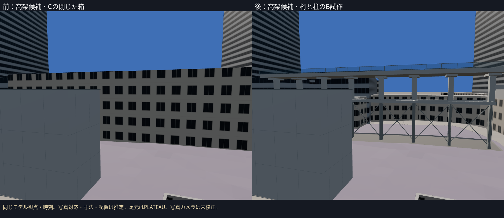
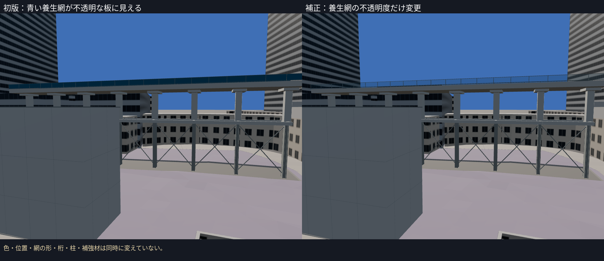
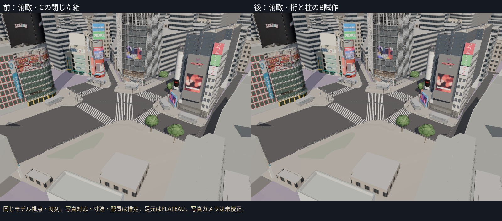
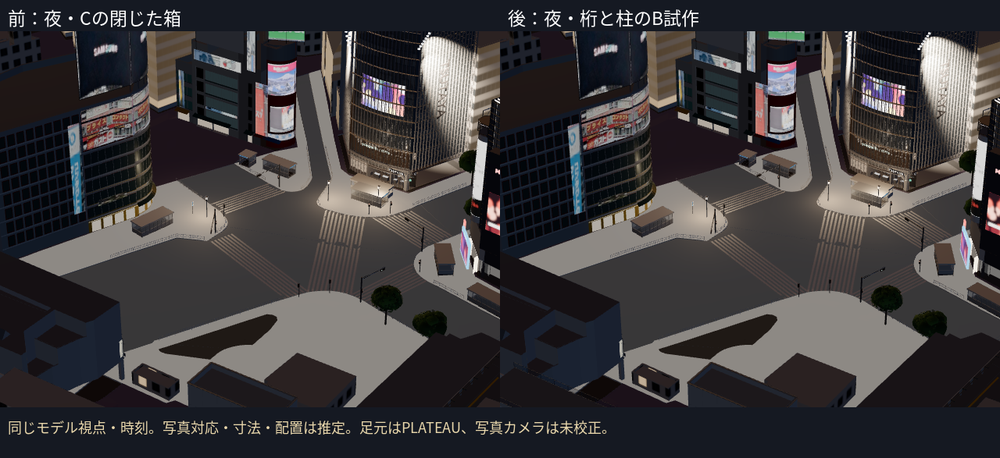

# 駅側の第5段階：西側の高架部のB試作

PR #16をマージしたmainから、bldg_9b0ce3b9-6e8c-4bf9-a86b-4f48e326b324のCを個別B試作へ置換。元の上面を残し、地面から上まで閉じた共通窓の箱を、桁・柱・補強材と青い養生網へ置き換えた。通常表示に追加し、同じIDのCを一度だけ除いた。

**台帳の「駅舎中央部」と写真の銀座線高架付近の構造との対応は推定。正式な施設名・10月全外観の独立した同定は未達。** 桁・柱・補強・網の寸法と配置も推定としてHUD・台帳に記載した。

## 形の根拠

- 元のPLATEAUは東西約60 m、幅約8.5 mの横長のブロック。元のRoofSurface全頂点を、上面T.P.32.300 mとして保持した。上下移動・拡縮はしていない。
- [2025年10月18日撮影の工事記録（再開発調査兵団）](https://view.tokyo/?p=73418)は10月22日公開。記事が銀座線高架付近と説明する写真で、開放した桁、柱、下部の補強材、青い養生網の種類を参照した。11月の関連記事の状態を10月として使っていない。
- 共通の住宅風の窓では、この開放した高架の種類を表現できないため、まず規則と標準的な寸法による試作を通常表示へ出した。写真と元のブロックの対応は確定していないので、写真品質の完成とは扱わない。
- 写真の再利用ライセンスは未確認。公開URLで外観を参照し、画像をリポジトリ・比較板・テクスチャへ転用していない。出典・日時・推定範囲は資産`source/refs/`に保存した。

## 制作と一項目の補正

- 元の上面と、その下0.9 mの桁を作った。6枚の側壁は桁の高さだけを保持し、それより下を開放した。
- 元の細長い範囲の中心線に沿って8支柱を規則配置。下部はH形の鋼材、上部はコンクリート柱と柱頭、中間に桁・横梁、下部の間にX形の補強材を追加した。間隔・高さ・寸法は推定。
- 中間桁は推定のT.P.25.3 m。養生網は推定の高さ1.1 mで、元の上面より上に追加した。網の最高値はT.P.33.4 mで、元の上面の高さ自体は変わらない。
- 初版を同じ視点で確認すると、青い網が不透明な板に見えた。**不透明度（alpha）だけ1.0→0.22へ補正**。色・位置・網の形・桁・柱・補強材は同時に変えていない。透明な面と金属枠による軽量近似で、実際の網目・光学特性を再現したものではない。

## 足元の制約

8支柱予定位置でC2a地面の照会を試みたが、どれも収録範囲外で**有効な地面サンプルは0件**。足元は元のPLATEAUの地面T.P.15.14 mを使った。`stats.json`の各点に`PLATEAU fallback`を記録した。支柱ごとの地面合わせ・実際の基礎高さは未達。記録した足元の高さを「測ったC2a地面」とは扱わない。上面を地面へ一括移動していない。

モデル前・初版・後は同じ視点・時刻。近接視点の最初の撮影は手前の建物に遮られていたため、資産を変更する前に北側の固定視点へ設定し直した。掲載した前後はその同じ視点。**写真のカメラ校正・写真対モデルの画素誤差は未計測**。完成・Gate合格を認定しない。広告の切り貼り補正は後工程のままで、新しい広告・発光は追加していない。

## 写真に対する残る差と検証

| 種類 | 今回の表現 | 残る差 |
|---|---|---|
| 開放した桁・柱 | 上面を保持した桁、規則配置の8支柱 | 施設IDとの対応、正確な柱数・位置・桁断面 |
| 下部の鋼材・補強 | H形の柱、横梁、X補強 | 実際の段数・接合部、部材配置 |
| 青い透ける養生網 | 透明な面と金属枠 | 実網目、光学特性、10月の施工範囲 |
| 地面との接続 | 元のPLATEAU地面高 | C2a範囲外、支柱ごとの実地面・基礎 |
| 周囲の駅施設 | 対象以外の形は保持 | 残る施設の形状と10月の工事状態 |

- **16ファイル・75テスト成功、TypeScript/Viteビルド成功。** 実GLBの元の上面全頂点、下部の開口、柱の存在、記録した足元との絶対高さ、透明な網、Cの重複除去を確認。テストは写真の同定・実測精度・足元の正解を保証しない。
- 新資産1,332三角形・5描画単位・78,096 bytes。全体296,172三角形・231描画単位・18,078,952 bytes。実GLB集計は`evidence/c1-station-viaduct/budget.json`、予算内。
- Cは302棟＋橋5件、そのうち未制作の駅側グループ2棟。今回対象も写真対応が未確定なので、確認済み施設が1棟増えたとは数えない。
- 既定9資産。`context=nostation`で駅側4資産を除き、既存の5資産を残す。
- 前・初版・後の7撮影で、読み込み・失敗一覧・ブラウザエラー・レイヤーエラーを記録。撮影中は資産を固定し、ブラウザを一つずつ実行した。FPSはクラウドで測らない。

次は未制作のway/810356690の銀座線駅上屋候補と、bldg_d7fb4726のJR施設候補。写真で種類を確認して個別に制作し、駅側の地面の収録範囲・既存の試作の同定にも未達を残す。
