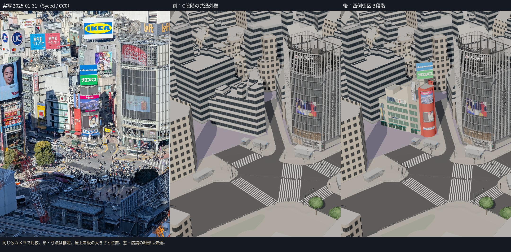
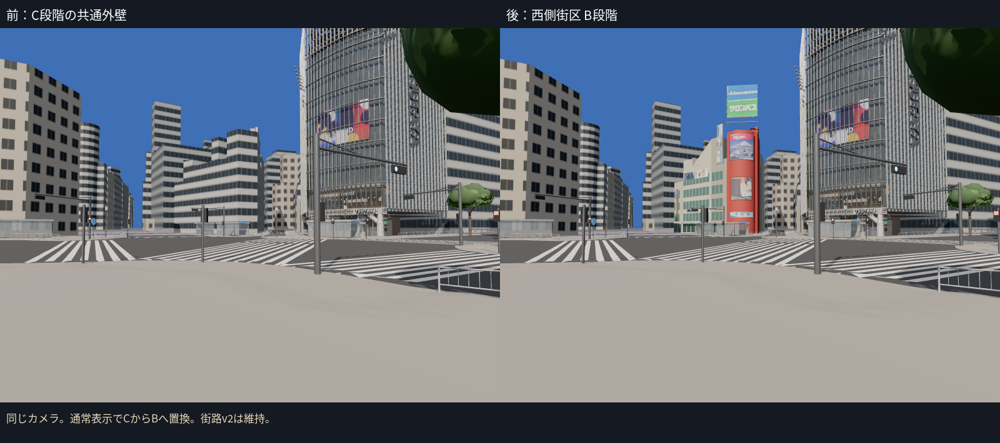
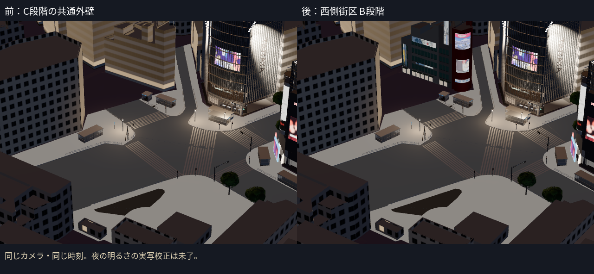

# C1：センター街入口西側のB段階（2026-10-12）

PR #9と `CODEX_C2B_REVIEW.md` の指摘を読み、way/136690966の外観を**通常表示で**CからBへ置き換えた。PLATEAUの外形・屋根の段差を残し、四区画の外壁、窓、1階の店、庇、赤い曲面、屋上看板、2025年1月のビジョンを作った。写真品質の完成・合格は認定しない。

## 前回の失敗を繰り返さないために変えたこと

- 最初に見える物を作った。カメラを新しく校正することを着手条件にせず、PR #9のカメラを使った。
- 推定の区画・寸法も通常表示に出し、状態を台帳・注記へ記録した。橙色や追加の表示モードで隔離していない。
- 写真で種類を確認した。薬局の黄色い縦看板、果物店の緑の水平窓、赤い角とビジョン、青・緑の屋上看板を個別に作った。既存の街路v2は変更していない。
- C→最初のB→高さを直したBを同じカメラで見た。白い縦看板が低すぎたので、その看板の高さだけ15.4 mから25.4 mへ修正し、支持物を付けた。その他の看板位置・窓の細部は同時に動かしていない。同じ仮カメラで看板中心の写真上のずれは73.88 pxから2.60 pxへ減った（`evidence/c1-west-b/default_and_height_check.json`）。これは独立した寸法測量ではない。
- 方針を `AGENTS.md` に残した。新しい制作スクリプトは建物生成の1本で、比較は既存の撮影スクリプトを使った。

## 実装と出典

|項目|内容|
|---|---|
|建物|way/136690966、PLATEAU bldg_e6e4de58-1a37-4345-8795-6b759771ade6|
|形状|PR #9のcontext入力から対象のLOD2面を抽出。壁を写真の区画境界で分割し、元の屋根と裏側の形を保持|
|外壁・店舗|四区画の色、窓の割り付けと枠、低層の店舗ガラスと照明・庇。割り付けは推定|
|看板|Hisamitsu/サロンパス、楽天、DMM、大盛堂書店、西村、薬局、飲食店など8材質。形とは別GLB|
|年代|2025-01-31の静止広告。11月・10月の広告を再現したとは扱わない|
|テクスチャ|SycedのCC0写真 `stream_2025.jpg` の四隅から透視変換で抽出。写真の元画像は変更していない|
|高さ|C2a地面の前面82点。最小T.P.15.347、最大15.410。PLATEAU地面15.330との差+0.017 mを屋根の差として記録|
|C段階|OWN_ASSETSへ追加し、対象を除いて再生成。建物307棟＋橋7件。stationの扱いは維持|
|夜|写真の色をemissiveMapにも使い、看板を白い一枚板として発光させない。店にも弱い照明|

写真の読取り画素・区画の根拠・高さの修正は `assets/buildings/west-block/source/data/facades.json`、生成結果は `stats.json`。CC0の2月写真とCC BY-SA 4.0（Joli Rumi）の11月写真は独立した外観参照に保持し、テクスチャとして混ぜていない。店舗・看板の親の細かな同定は未達。

## 比較画像

Streamは既存の**仮カメラ**で、独立したカメラの検証を今回やり直してはいない。写真にある看板・窓が通常表示に入った一方、外壁色、区画の幅、屋上看板の大きさと位置、細かい窓・店内は違う。背後のC段階の建物も個別の外観を再現していない。

夜は同じシーン・同じ時刻でのC/Bの比較。2025年の夜写真に対して明るさを校正したものではない。広告画像自体の陰影が残り、明るさも推定。

## 確認したこと

- 11ファイル・58テスト成功。TypeScriptを含むViteビルド成功。
- Cから対象のIDが一度だけ除かれること、PLATEAUの参照と地面の高さ、形と看板の分離、夜の画像テクスチャ、実GLBの有限な座標と既存予算を確認した。
- before/first/afterの各3視点で、街路・context・建物の読み込み状態、失敗した建物、画面の警告、ブラウザのエラーを確認した。通常表示の既定建物は4件。
- B資産は1,215三角形・19描画単位・1,632,600 bytes。既存B予算（120,000/40/3 MB）内。
- 全GLBは286,559三角形・179描画単位・16,050,764 bytes。全体予算内。クラウドFPSは評価していない。
- 比較・補正に新しいカメラ校正ツールや葉のIoU最適化を持ち込んでいない。C2b、駅側、西武A館、旧リポジトリを変更していない。

## 次に直すこと

1. 屋上の青・緑看板の大きさと位置、赤い角の幅・曲率を、今回の写真比較から一項目ずつ整える。Bの寸法はまだ推定。
2. 果物店と中間区画の階層・入居者・窓枠・入口の切れ目を、2月・11月の写真でも照合する。広告は年月別の層として追加する。
3. 次の建物は渋谷駅前ビル（way/60739635）。C2bの信号方向・不足する斜め横断歩道・樹木・柵の除外区間など、PR #9の未達も残る。

再生成は `assets/buildings/west-block/README.md`。全体の写真品質やCore v1のGateを完了としていない。
