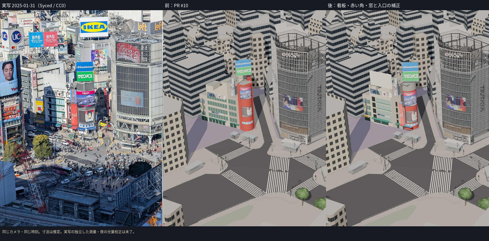
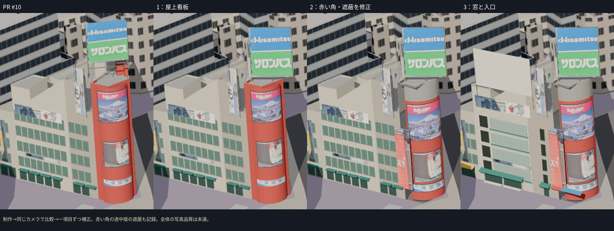
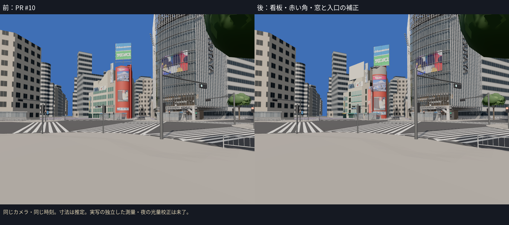
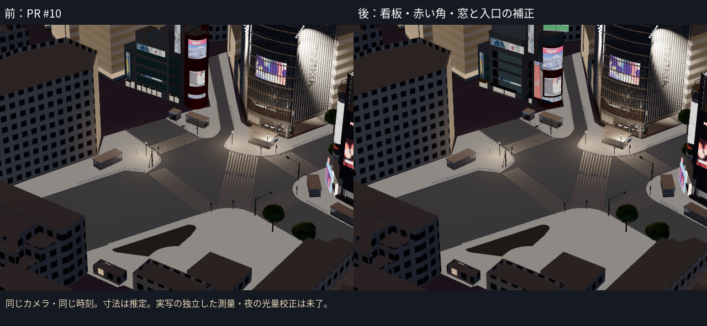

# 西側街区B：屋上看板・赤い角・窓と入口の補正

PR #10のBモデルを、引き継ぎに記録した順序で補正した。対象はway/136690966。通常表示・既存の仮カメラ・2025年1月の広告を維持し、渋谷駅前ビルにはまだ着手していない。

## 順に変えたもの

1. **屋上のHisamitsu／サロンパス看板**：中心、縦横の寸法、向きを補正し、支持枠も同じ変換に追従させた。中心高さ36.8→34.145 m、縦寸法9.1→11.288 m。支持物は元の屋根付近から看板上端まで伸びる。
2. **赤い角の形**：曲面の半径・向き・ビジョンの配置を補正し、平らな赤い側面（アスビの広告）と上部の灰色部分を追加。曲面側の画像は1月のまま。東端をPLATEAUのx=-34.818 mに制限し、写真の残差を減らすためだけに建物を外へ広げない。
3. **果物店・中間区画**：4段の横長窓、細い窓枠、緑の張り出した水平部材、左側の暗い奥まった部分へ変更。中間区画は同じ窓の格子から狭い縦の開口へ変更した。果物店の入口を大きな2つの開口にまとめ、庇を斜めにし、薬局・角の庇を分けた。写真にある白い屋上板と支持物も追加した。白い面に広告を創作していない。

曲面の最初の比較で、元のPLATEAUの平面壁がビジョンを隠す問題を見つけた。街路側の角の壁だけをB形状で置き換え、屋根と裏側を残した。`02-corner` はこの遮蔽がある途中版、`02-corner-visible` はそれを直した版。最終版では看板の中央への光線が看板に最初に当たることを実GLBでテストした。

## 写真との比較

|対象|変更前|変更後|読み方|
|---|---:|---:|---|
|屋上看板の四隅|19.28 px|1.36 px|四隅のx/y成分のRMS|
|曲面のビジョン3面の端|19.94 px|8.14 px|端のx/y成分のRMS。外形の制約を優先|

すべて**同じ既存の仮カメラ**での値。カメラを今回校正し直したものでも、独立した寸法・位置の測量でもない。四隅は手で読んでおり、曲面の端には読取りの曖昧さがある。モデルの寸法はB段階の推定。窓の高さは1枚の画素へ過度に合わせず、3.7 m間隔の4段として置いた。

使用した写真と確認範囲：

- 2025-01-31、Syced、CC0、`stream_2025.jpg`：同じ視点で位置・輪郭を比較。新しい赤い側面の画像もここから抽出し、四隅を`facades.json`に保存した。
- 2025-02-07、Syced、CC0、`crossing_12214.jpg`：4段の窓、左側の奥まった部分、緑の水平部材、斜めの庇、赤い平面と曲面、白い屋上板を別写真で確認。広告内容は1月と異なるため混ぜない。
- 2025-11-01、Joli Rumi、CC BY-SA 4.0、`crossing_joli_2025.jpg`：青・緑の屋上看板と赤い角・ビジョンの構成を確認。距離・人・信号による遮蔽があり、入口の数や窓の細部の独立確認には不足。テクスチャには使わない。

元写真とライセンスは既存の台帳を参照。比較板に使用した元写真はCC0の1月写真だけ。11月の広告を1月の資産として再現したとは扱わない。

## 検証と未達

- 11ファイル・59テスト成功。既存予算テスト、Cの重複除外、地面の高さ、画像による夜の発光、実GLBの座標を確認。追加の1テストは曲面の東端の制約と、旧壁による看板の遮蔽を確認する。
- TypeScriptとViteビルド成功。最終版をStream・地上・夜の同じカメラで撮影し、資産の読み込み状態・失敗・ブラウザエラーを確認。
- C2a地面の高さは変更していない。T.P.15.347、PLATEAU屋根との差+0.017 m。
- B資産は1,257三角形・25描画単位・1,751,748 bytes。全体は286,601三角形・185描画単位・16,169,912 bytes。内訳は`evidence/c1-west-refine/budget.json`。B資産と全体とも既存予算内。FPSはクラウドで評価しない。
- 外壁の色と汚れ、窓のカーテン・細かい入居者の看板、入口の実寸・各用途、裏側の外観、夜の光量は未達。写真の投影に近づいたことだけで写真品質の合格とは扱わない。

次は渋谷駅前ビル（way/60739635）のB段階。今回の補正は既存の制作スクリプトと撮影スクリプトで行い、新しいカメラ校正・監査ツールは追加していない。
