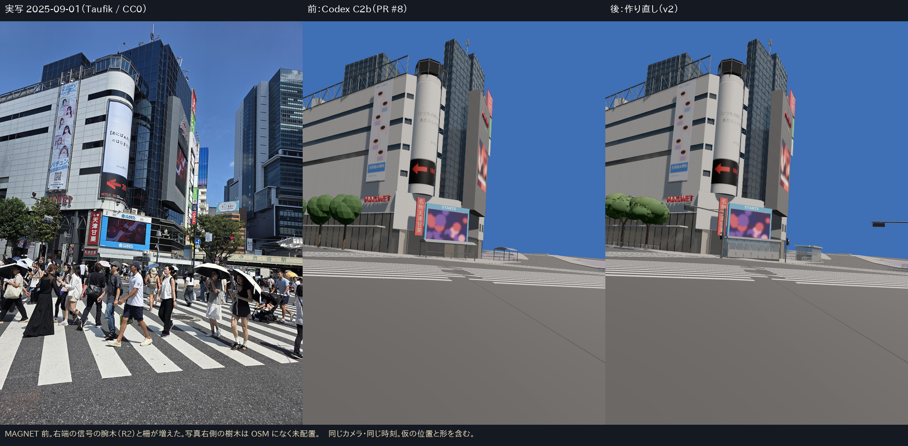
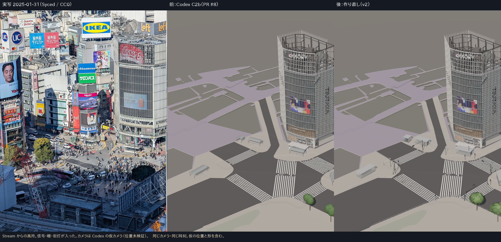
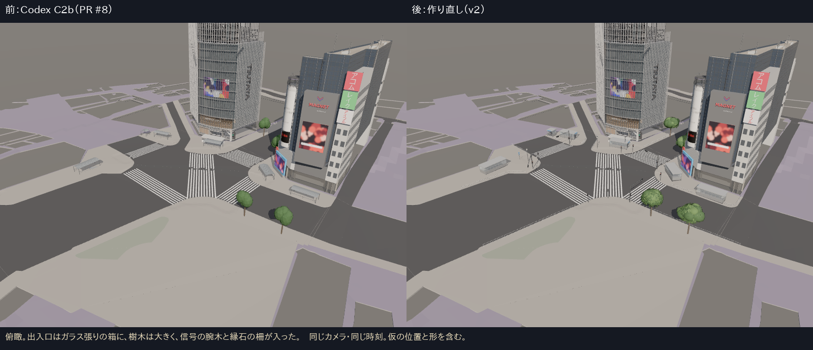
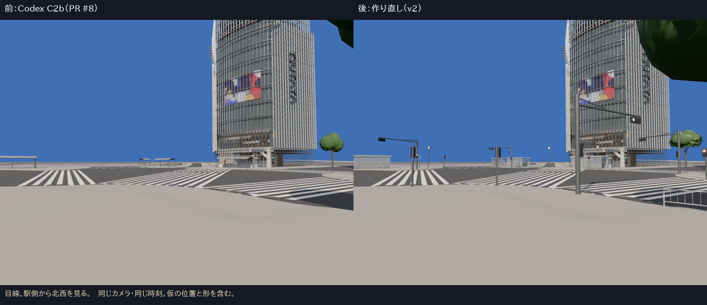
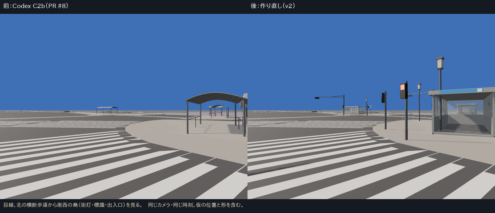
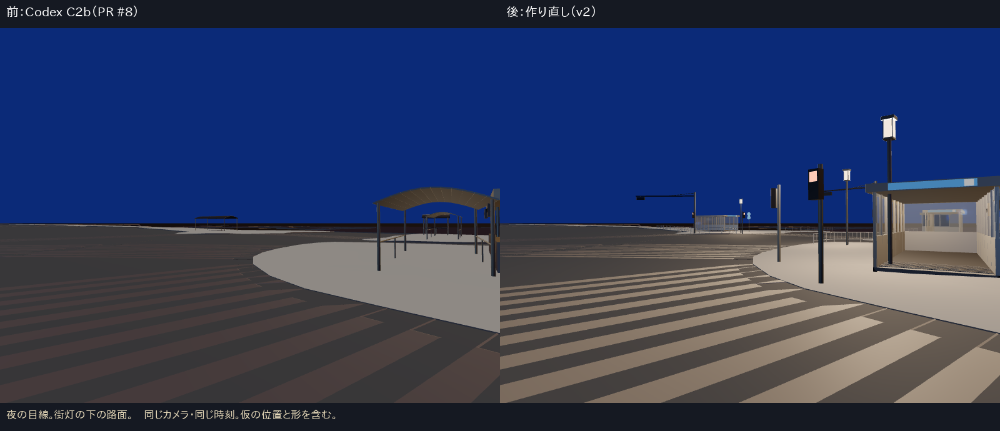

# C2b の作り直し（v2）の報告

- 2026-10-12、ブランチ `claude/core-c2b-fix`。PR #8（Codex）の街路設備を作り直した。
- 何がダメだったかと、次の進め方は `CODEX_C2B_REVIEW.md` に書いた。
- **完了・合格とは扱わない。** 位置と形の多くは規則と標準寸法による仮のもので、実測していない。

## 1. 変えたこと

| 項目 | 前（PR #8） | 後（v2） | 位置の根拠 | 形の根拠 |
|---|---|---|---|---|
| 地下鉄出入口 6 | 共通の曲面屋根 | ガラス張りの箱、明るい灰色の平屋根、看板の帯、下り階段 | OSM 2025-10 の形 | 2025-02 の高所写真（`crossing_12214.jpg`、CC0）で種類を確認。寸法は未測定 |
| 樹木 6 | 球 5 個、高さ 9 m | 塊 16 個＋葉 700 枚、高さ 8.5〜10.5 m、樹冠半径 2.9〜3.5 m | OSM 2025-10 の点 | 一般的な広葉樹。樹種は未確認 |
| 歩行者用の信号 10 | なし | 縦長の灯器（上の赤が点灯） | 規則 R1（横断歩道の端） | 標準的な形 |
| 車両用の信号 4 | なし | 柱 6.2 m、腕木 6.6〜9 m、横長の LED 灯器（運転者から見て左が青） | 規則 R2（OSM の信号ノード 4 つ） | 標準的な形 |
| 街灯 3、標識 1 | 橙色の実験表示だけ | 通常表示。灯具は灯籠形、夜は 120 cd で点灯 | Codex の写真投影 P01〜P04（変えていない） | 仮 |
| 柵 | 橙色の 1 区間だけ | 縁石に沿って 220 m（白、高さ 0.8 m） | 規則 R3（PLATEAU の縁石線） | 標準的な横断防止柵 |

- 配置の平面図：`evidence/c2b-fix/layout_plan.png`。台帳：`assets/street/core/source/data/street_register_v2.csv`（31 行、全項目に位置の根拠）。
- 資産：`street_core.glb` 38,656 三角形・16 描画単位・約 1.8 MB（B 段階の予算 120,000／40／3 MB の内側）。
- `?street=projected`（Codex の写真投影の実験）は残した。通常表示とは重なるので、比較のときだけ使う。

## 2. 同じカメラの比較（`evidence/c2b-fix/boards/`）

- 前は `origin/main`（PR #8 のマージ後）、後はこのブランチ。同じ URL の引数・同じ画面の大きさで撮った（`scripts/capture-street-fix.mjs`）。
- 画面なしの SwiftShader で撮影。FPS は測っていない。

## 3. 正直な評価（差と未達）
- 一目でわかる欠落（信号・柵がない、出入口がバス停に見える）はなくなった。**写真と並べると、まだ別物**である。
  - 写真には人・車・看板・店の光・路面の汚れがあり、これは C2b の範囲外。
  - M027 の右側の樹木（OSM にない）、ハチ公前の交番、車止めは、まだない。
- 夜：街灯の光量 120 cd は仮。路面が明るめに見える。C3a の暫定値 `nightGround: 0.5` も残したまま（街灯が 3 基だけなので、0 に戻すと交差点のほとんどが真っ暗になる）。
- 車両信号の位置は規則による推定で、写真での確認はしていない。
- テスト：`npm test` 10 ファイル・56 件すべて成功（街路の新しい部品、柵が横断歩道に入らないこと、夜の点灯、深さの範囲）。
