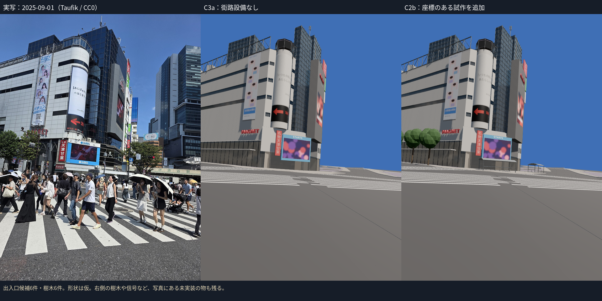
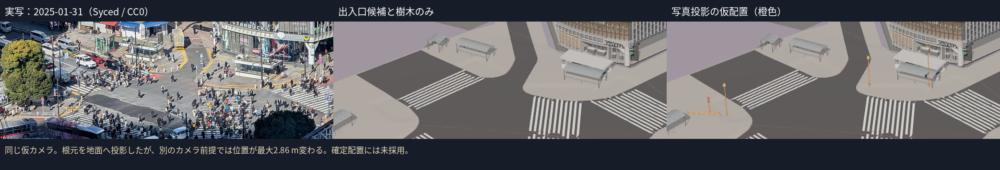
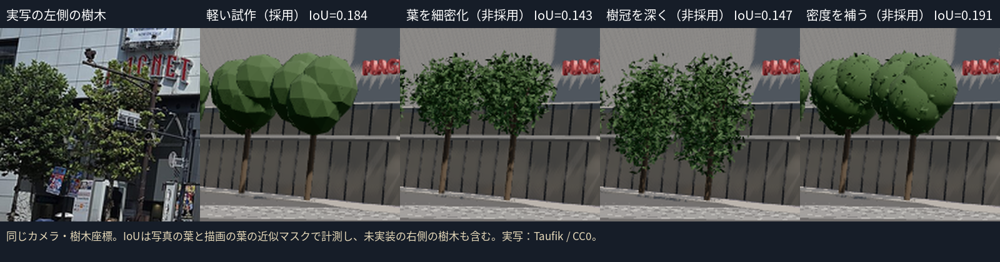
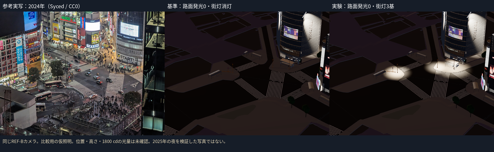

# C2b：街路設備の試作と検証（2026-10-12 UTC）

**C2bは完了・合格として扱わない。** 出入口候補と樹木の試作、写真投影の比較用設備、昼夜の実験、再生成・検証の手順を実装した。支柱・柵の位置はカメラの別案で最大2.861 m変わり、独立した位置検証が未達。仮配置は通常表示から分け、`?street=projected` のときだけ橙色と注記付きで表示する。地下の階段、車両用信号の支柱、全樹木、全街灯の再現は終わっていない。

## 実装したもの

|表示|内容|座標の根拠|確認できていないもの|
|---|---|---|---|
|通常の試作|上屋候補6件、樹木6件|2025-10-31 OSM履歴。作者データと地図座標の差は最大0.000 m|上屋・樹木の寸法、樹種、実測位置、写真との全輪郭。上屋のうち1件の用途|
|比較用の仮配置|灯具候補3基、うち1基に歩行者信号、標識支柱1基・板2枚、柵1区間|2025年1月の写真の根元をC2a地面へ投影|カメラ、灯具の種類の一部、高さ、厚さ、向き、光量|
|書き出さない|4個のOSM車両信号ノード、根元の隠れたP05|信号ノードは道路上の論理位置。P05には根元の画素の根拠がない|実際の支柱位置|

A7b・A7a・A5a・A6a・A6bは2025年の入口POIが上屋ポリゴン内にあることを確認した。way/1335178869は対応する入口POIを確認できず、用途未確認の上屋候補として台帳を更新した。「地下鉄出入口6か所すべてを同定済み」とは報告しない。車いす対応の入口にも共通の仮上屋を使っており、実物の形式を再現したわけではない。階段は地面の穴や踊り場を検証していないため生成しない。

地面のGLBをBlenderで読み、道路・歩道へレイキャストして足元の高さを取得した。ゼロ高さへの代替は使わない。歩行面に加えるのは足元の床のみで、上屋や葉に乗ってしまう処理を避けた。街路GLBや比較用GLBが壊れても、他の建物と地面は表示を継続する。

写真の高解像度版で、上段の駐停車禁止のX・下段の駐車禁止の斜線、柵の扇形、灯具の傘、歩行者の人型を読み、形へ反映した。P02の上部灯具の種類、P03の傘の共有、柵の区間分割や各寸法はなお仮。色は未確認の位置を示すため橙色にしており、実物の色差を改善したとは扱わない。

## 写真との比較

M027は2025-09-01、Taufik、CC0。既存のカメラ合わせは1280×1707でRMS 11.39 px。この写真の右側の樹木・信号や、周囲の建物は不足する。上屋と樹木を追加しただけで実写に近づいたと認定しない。

Stream写真は2025-01-31、Syced、CC0。駅側の2025年10月の形を確認する資料には使わない。根元を読んだ画素・地面座標・状態は `assets/street/core/source/data/furniture_register.csv`、写真の台帳とCommons公式API応答は同資産の `source/refs/` に残した。

### カメラと位置の差

- 上屋の屋根角12点（高さ3 mは仮）で自由に合わせるとRMS 3.20 pxでも、撮影高さ5882 m・視野角0.605°になった。物理的に使えない解として棄却した。
- 既存2024年カメラの位置を固定して2025年写真の向き・視野角を合わせた仮案はRMS 4.57 px、最大8.12 px。この値だけでカメラや位置を確認済みにしない。
- 写真のCommons GPS XYはこの固定位置と68.85 m違う。GPSの精度も未確認。GPS XY固定で高さ等を合わせた別案はRMS 4.89 px、推定高さ219.45 m。こちらも確認済みのカメラには採用しない。
- この2案で地面へ投影した位置は次のように変わった。`evidence/c2b/camera_sensitivity.json` に両方の座標を残した。

|設備|カメラ前提を変えた位置差 m|画素の変動に対する地面の感度 m|
|---|---:|---:|
|P01|0.424|1.334|
|P02|0.059|1.337|
|P03|2.475|1.434|
|P04|2.724|1.442|
|R01a|2.861|1.428|
|R01b|2.690|1.449|

右列は読取り2 px＋カメラのRMS分だけ画素を動かしたときの地面での変動で、**カメラ全体の位置誤差の信頼区間ではない**。左列も2案の感度検証であって、実測との誤差ではない。1 m以内の位置確認を満たせないので確定配置へ進めない。OSMの信号ノードと別物の支柱を比較して「OSMがずれている」とは判断しない。

同じ仮カメラで、P01/P02/P03のモデル支柱上端と写真で読んだ先端との差は2.13/8.73/4.70 px（900×1195）。この測定も配置と同じカメラを使うため独立した位置検証にならない。ビューアーの実際のカメラで根元が観測画素へ戻ることは6点で0.15 px未満を確認した。これはBlender→glTF→three.jsの座標・ロールの整合の確認である。

### 樹木の案を一つずつ比較

M027の手で範囲を限定した領域にHSVの葉色フィルターをかけ、描画側も樹木クラスと同じ葉色フィルターを使った。幹や枝を葉と比較しない。これは近似マスクで、人・建物の遮蔽やカメラ誤差がある。写真に写る未実装の右側の樹木も評価に含めた。

|案|変更した項目|GLB三角形|葉のIoU|写真側の葉の再現率|判断|
|---|---|---:|---:|---:|---|
|軽い塊状の試作|基準|6,984|0.1836|0.2316|通常表示に残す。写真品質は未達|
|細密葉|葉の作り方|34,584|0.1434|0.1615|非採用。密度が不足|
|深い樹冠|細密葉から樹冠の深さだけ変更|34,584|0.1472|0.1698|非採用。改善が小さい|
|密度補助|細密葉に内部の樹冠体積を追加|36,984|0.1910|0.2423|非採用。約5.3倍の三角形に対して改善が小さく、近似マスクの不確かさも残る|

最初の診断値0.2389は「樹木クラス（幹・枝も含む）」対「写真の葉」のIoU。最終評価では両側の葉だけへ条件を揃え、0.1836となった。両方をJSONへ残した。既定の葉の平均色は写真よりΔL*=+9.95、Δa*=-9.59、Δb*=+6.82で、明るさと緑の差も残る。輪郭・色とも合格とはしない。非採用の画像、入力、生成モードは `evidence/c2b/stages/` と `EXPERIMENTS.json`。

## 夜のライト実験

共通のREF-Bカメラ・区分マスクで比較した。写真は**2024年の参考**（Syced、CC0）で、既存カメラ自体にずれがあり、2025年の夜の検証ではない。400 px以上ある評価対象は車道・歩道の2区分だけ。位置・高さ・灯具種類・1800 cdは仮なので、実測照明を再現したとは扱わない。

|案|路面の発光|街灯|平均 \|ΔL*\||車道 ΔL*|歩道 ΔL*|
|---|---:|---|---:|---:|---:|
|基準|0|消灯|19.45|-27.9|-11.0|
|発光だけ変更|0.5|消灯|19.30|-5.8|+32.8|
|ライトだけ変更|0|3基×1800 cd|19.25|-27.6|-10.9|

照らされた歩道には局所的に強く白い部分もある。3基のライトだけでは広い道路の暗さを解消できず、0.20の差も十分な改善とは扱わない。一方、路面発光0.5は歩道が明るすぎる。この実験だけで未確認のライトを増やしたり、光量を上げて写真へ合わせない。通常表示は検証済み街灯がないためC3aの暫定0.5を残し、比較用のライトが読み込めたときだけ路面発光を0にする（明示したlook値は尊重）。ライトは影なし・昼は消灯。夜の灯具発光は路面への実際のSpotLightと別に設定した。

2025-11-01の夜写真（Joli Rumi、CC BY-SA 4.0）もライセンス確認して保持したが、カメラを合わせていないため上の数値評価へ混ぜていない。

## 動作・容量の確認

- Node 22.22.2、npm 10.9.7、Python 3.11.15と指定の4ライブラリ、Blender 4.2.3 LTS、Playwright 1.56.1 / Chromium build 1194で実行した。BlenderはCLI。特別なアドオンやMCPは使わない。
- `npm test`：9ファイル・50テスト成功。TypeScriptとViteビルド成功。街路と写真投影の欠落・不完全な部品・不正座標の分離、歩行面、昼夜の点灯、既存予算も検証する。
- ブラウザ：通常の街路欠落／比較用の街路欠落でも3建物と地面を継続、歩行目線が地面＋1.6 m、実験ライト3基の夜点灯と路面発光0、仮配置の注記、写真投影6点の整合を確認した。欠落GLBがHTTP 200のHTMLを返しても資産成功にしない。
- 通常GLBは6,984三角形・5描画単位・519,920 bytes。比較用は2,640三角形・6描画単位・155,904 bytes。合計9,624三角形・11単位・675,824 bytesで既存B予算（120,000/40/3 MB）以内。
- これまでの全GLBは223,010三角形・139単位・10,853,192 bytes。全体予算（4.5M/1,400/90 MB）以内。資産数の集計で、影・ポスト処理を含むGPUの実測ではない。
- 同じ入力でGLBを再生成する確認を実施。通常GLBはSHA256も一致。比較用GLBは頂点・材質・変換・向き付き三角形集合が一致し、三角形の並び順だけ異なる（`projected_reproduction.json`）。既定のM027通常画像・区分画像は最初の軽い樹木案と画素単位で一致した。
- 長い撮影はビルド後のpreviewで固定した。開発HMRによる撮影中断は成功扱いにせず撮り直した。完成画像ごとのブラウザ状態・エラーは `capture_log.json`。日々の作業にクラウドFPSを使用しない。

## 次に行うこと

1. 2025年の別の写真で、独立した非同一平面の点（建物の高さが分かる角と道路の点）を使い、カメラを検証する。屋根角の低いRMSだけで判断しない。
2. 支柱の同定・根元・高さと複数写真の整合を確認し、1 mを超える差を台帳へ残す。確認できたものから通常表示へ移す。出入口候補1件の用途と各上屋の実物の形式も確認する。
3. M027右側やハチ公側の未登録樹木、残る街灯・車両信号・標識・柵の範囲を補う。根拠のない物は置かない。夜の2025年写真のカメラも合わせる。
4. C2bの位置確認を経て、HANDOFFの建物順へ進む。準備の実物確認は `NEXT_BUILDING_AUDIT.md`。3枚の写真を取得しただけで建物の正面を確認済みにしない。

コマンド・出典・再生成は `assets/street/core/README.md` と `DEV_ENVIRONMENT.md`。旧リポジトリ・西武A館の作業・公開範囲を変更していない。
