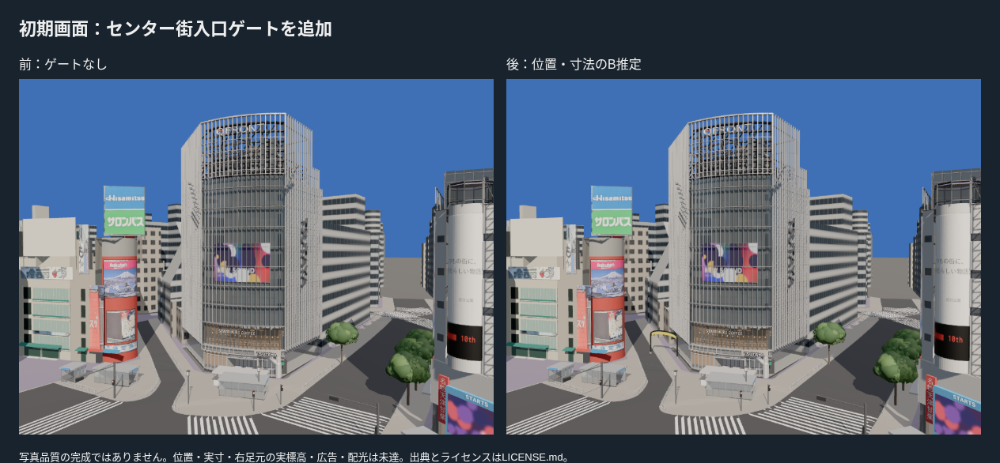
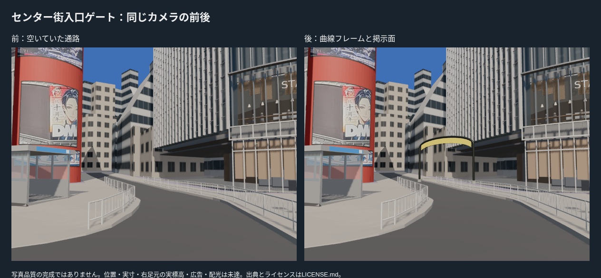
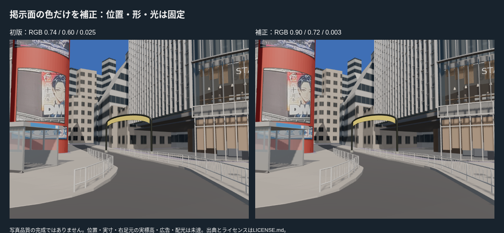
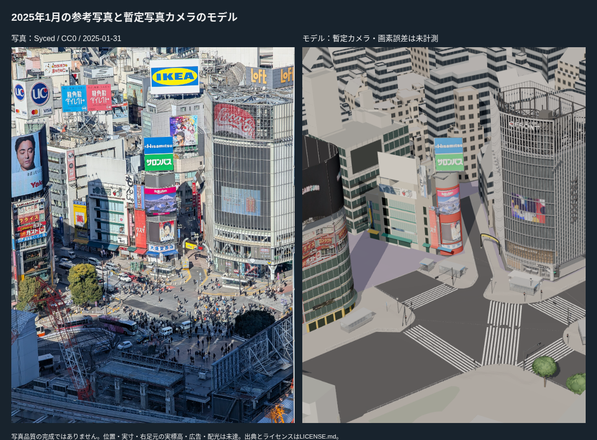
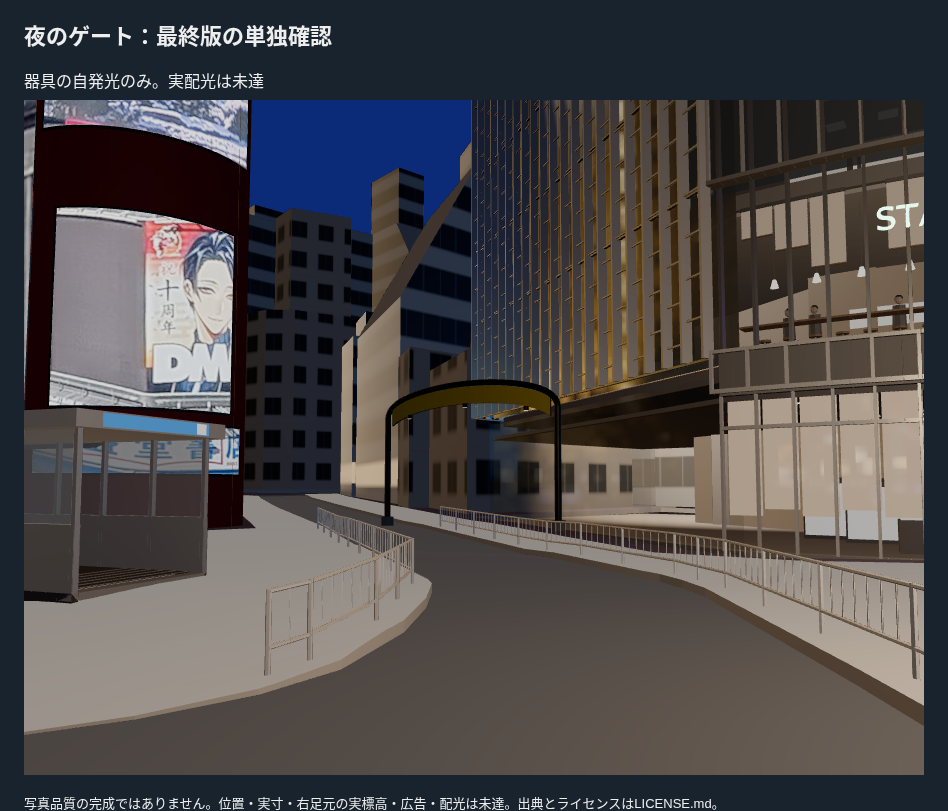

# センター街入口のアーチ型ゲート：構造のB試作

PR #20マージ後main dd7c438から、既存写真に写り、現在の街路資産にないセンター街入口ゲートを自作した。支柱、曲線フレーム、湾曲した掲示面、小さな照明器具を通常表示へ追加。QFRONT・西武・信号・樹木・出入口と既存建物の資産は変更していない。

## 写真と制作

2025-01-31のStream写真（Syced、CC0）を形の種類と大まかな比率の参考にした。QFRONTと西側街区の間へ推定配置し、足元をC2aへ照会。OSMやPLATEAUの設備IDを独立同定したわけではないため、photo/center-gai-entrance-gateという台帳IDを使う。

支柱間8.261 m、アーチの肩4.7 m・上昇1.2 m、掲示面の高さ0.7 mは試作値。位置・寸法・2025年10月の状態は未実測・未独立照合。文字・ロゴ・広告は写真から切り貼りしていない。黄色い面は構造表現で、特定月の広告を確認した根拠にしない。

初版では掲示面の黄色がくすんで見えた。**掲示面の色だけ**RGB(0.74,0.60,0.025)→(0.90,0.72,0.003)へ補正し、位置・形・照明を固定して再撮影した。写真との測定色差や画素誤差を改善したという認定ではない。

前後は同じカメラ・寸法・昼の条件で撮影。Streamの写真カメラは既存の仮校正で、写真対モデルの画素誤差や実位置精度は未計測。初期画面は既定のQFRONTカメラを維持した1000×750。ゲート正面は別の固定poseで900×675。縦長・左右約30度を含む初期画面全体のP4確認は引き続き残る。

## 接地・開口・統合

足元2か所を各5点、10/10点で照会。左中央値はT.P.15.270 m、右は15.326 m。**左5点はground_road、右5点はground_fill（補填面）**へ当たる。ground_surface_audit.jsonへ記録。右側を現地の実測標高として扱わない。台座下面を近傍の最小地面より0.025 m下げたが、正確な基礎・実段差・境界の測量は未達。

T.P.−15の形状とgroundElevationTP=15を使用。中央は掲示面下端まで4.276 m以上の空間を確保し、目線高さの光線は通過する。支柱には衝突する。支柱周辺0.4 mの水平光線がQFRONT・西側街区の壁へ当たらないことを実GLBで確認した。これは推定位置の近接チェックで、現地位置の証明ではない。

既存の独立資産ロードを再利用し、新たな専用街路ローダーは作っていない。通常は既存11資産＋ゲート1。street=offではゲートも除外し、context=nostationではゲートを維持する。置き換えるC形状はないため、contextの除外は増やしていない。

夜は器具の自発光のみで、道路・壁への配光と実光量は未調整。2025年11月の夜写真（Joli Rumi、CC BY-SA4.0）は街の照明の文脈であり、ゲートを独立同定した写真ではない。夜のモデルは単独確認で、同じカメラの夜写真との一致は認定しない。

## 検証と残る差

- **19ファイル・85テスト、型チェックを含むビルド成功。** 実GLBで台座の接地、通れる中央と衝突する支柱、既存壁との近接を確認した。
- 新資産2,424三角形・4描画単位・162,216 bytes。全体310,469三角形・255描画単位・18,989,932 bytesで現行予算内。FPSはクラウドで評価していない。
- 撮影時の資産は各ビルド版で固定。ブラウザを一つずつ実行し、計10回の撮影で失敗・ブラウザエラー・レイヤーエラーは0。初期画面・正面・Stream・夜の画像と読込状態を保存した。street=offで11資産・ゲートなし、context=nostationで7資産・ゲートありとなることも実ブラウザで確認した。
- 掲示面の文字・広告、支柱とアーチの実寸、正確な位置と実基礎、配光、10月の外観は残る差。写真品質の完成・Gate合格とは扱わない。

次は初期画面の左右・歩行で目立つ未制作正面、ハチ公広場や歩道の仕上げを評価する。広告補正は後工程を維持する。
