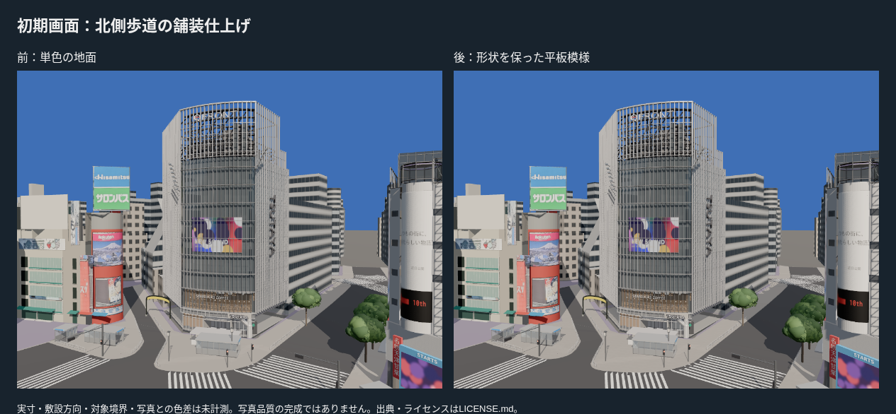
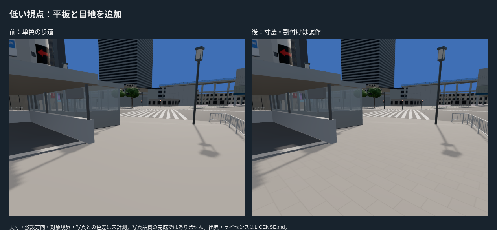
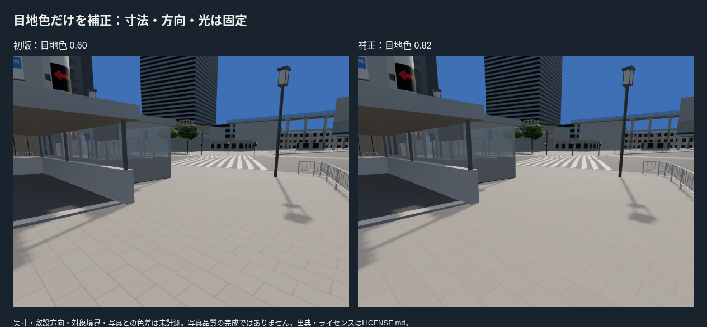
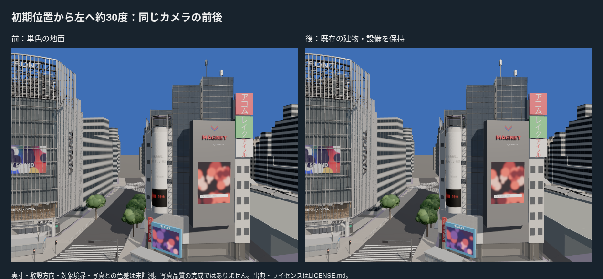
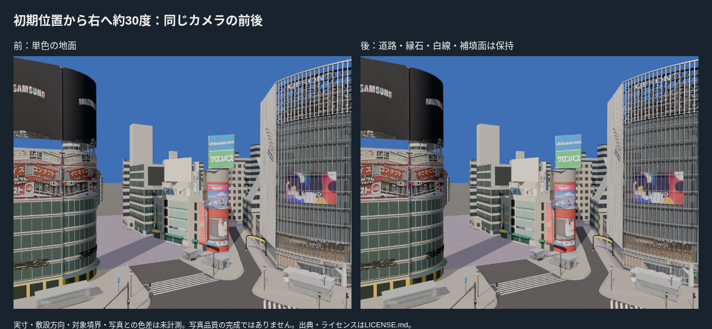
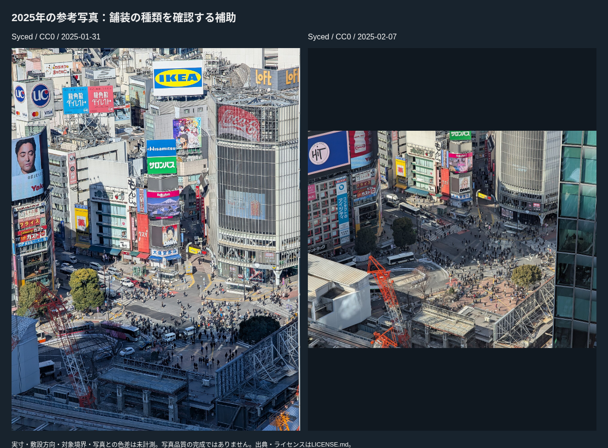
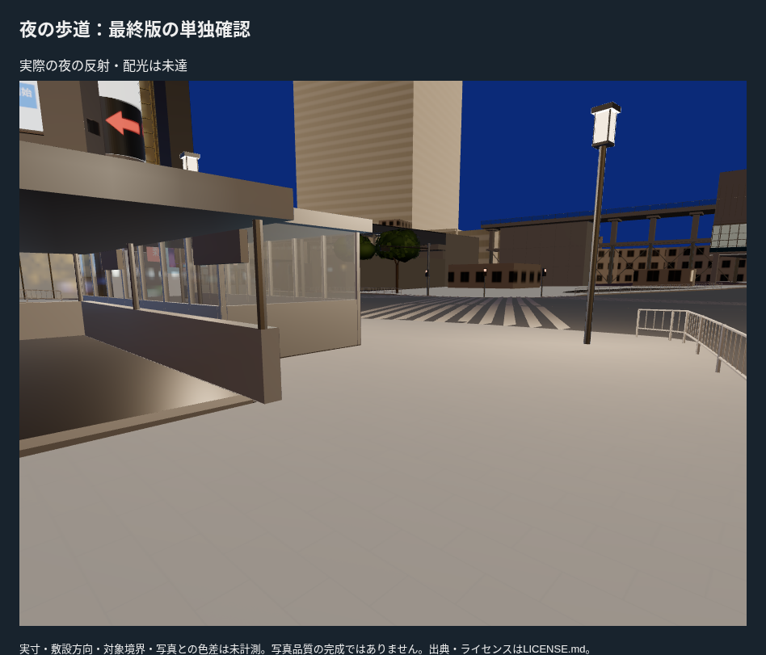

# 初期画面周辺：北側歩道の平板舗装を試作

PR #21マージ後main 3f5c954から、北側の歩道と島の面へ平板・目地の模様を追加した。写真の切り貼りではなく、自作のグレースケールアトラス。建物・信号・樹木・出入口・ゲートの資産は保持し、地面の高さや輪郭を動かしていない。

## 範囲と制作

- PLATEAU由来の歩道・島の面のうち、重心がX=-80〜50 m、Y=0〜65 mにある面を試作対象にした。約1,623.3 m²（生成面積）。道路・縁石・白線・補填面には模様を貼っていない。
- 2025-01-31と02-07の高所写真（Syced、CC0）を平板の種類の参考にした。平板0.6×0.3 m、目地6 mm、敷設角6.4度は推定で、実際の寸法・方向・対象境界を測量した値ではない。
- 1024×512のアトラスに16枚分を自作し、2.4×1.2 m周期で繰り返す。微小な色差を付け、平面座標のUVで斜面や不規則な三角形でも尺度をそろえた。粗さ・凹凸・夜の配光は同時に変更しない。
- 初版は近距離で目地の格子が強く出た。**目地色だけ0.60→0.82**へ薄くし、平板寸法・角度・模様の色差・露出・光は固定して比較した。

元の単色と新材質は既存の共通Lookに従う。BlenderのMultiplyノードがglTFの色係数として出ない場合があるため、生成時に新舗装材質のbaseColorFactorのみを明示して、BlenderとポータブルGLBのTintをそろえた。ロード後の共通WebGL色設定は維持する。

## 地面とカメラを保った確認

変更前のGLBと全パーツの三角形の頂点座標を10 µm単位で比較し、全6パーツの形状・高さと三角形数が一致した。材質グループや頂点順序は比較対象に含めない。geometry_audit.jsonへ元コミット・元GLBハッシュ・パーツごとの結果を保存した。

初期画面は既定のQFRONTカメラ、1000×750。前回の実カメラ位置を使って同じ位置から左右約30度を見た画像も、変更前後で保存した。低い歩道視点は位置(-15,25,1.9)、注視点(-8,19,0.3)、画角65度を固定。テクスチャの変更を、カメラの変更で良く見せていない。

既存の地面と歩行・衝突の基準は維持。GLBに埋め込んだ色アトラスを通常ロードするため、独立した重複地面や新しい専用ローダーは追加していない。material passも歩道として扱う。

## 実写真に対して評価できる点と限界

2025年1月・2月の写真で、北側の淡い舗装の種類と目地の見え方を参考にした。ただし同じカメラでの舗装拡大写真や寸法資料はなく、平板幅・方向・色の実物との数値誤差は未計測。

既存の写真合わせM027（2025-09-01、Taufik、CC0）でも変更前と初版のbeauty/classを撮り、look-metrics.pyを実行した。歩道は元のマスク2,066画素に対して境界除去後0画素。必要な400画素に届かず、人物で地面が隠れるため、**歩道の色差評価と合否判定には採用しなかった**。photo_region_audit.jsonへ記録。ほかの材質の総合点を舗装の改善点数として扱わない。

## 検証と残る差

- **20ファイル・87テスト、型チェックを含むビルド成功。** 新材質だけに模様が付くこと、glTFの色係数、UVの実寸尺度、対象領域の外へ材質が広がらないことを検証。既存の地面・街路・建物のテストも成功した。
- 追加したのは色の模様のみ。構造の高さ・縁石・横断歩道の位置や建物の足元は変更していない。地面は71,323三角形・8描画単位・3,036,424 bytes。全体は310,469三角形・256描画単位・19,407,296 bytesで現行予算内。描画単位は+1、容量は約417 KB増えた。
- 撮影中は各ビルドの資産を固定し、ブラウザを一つずつ実行。計15回の撮影で読込失敗・ブラウザエラー・レイヤーエラーは0。初期画面・左右・低い視点と夜を記録した。

実際の舗装切替位置、平板の正確な寸法と割付け、凹凸・摩耗・汚れ、点字誘導、排水・マンホール、広場の異なる舗装、夜の反射は残る。写真品質の完成・Gate合格や初期画面全体のP4完了は認定しない。縦長画面も引き続き確認対象。次は広場の不足や、左右・歩行で目立つ未制作正面を優先する。
