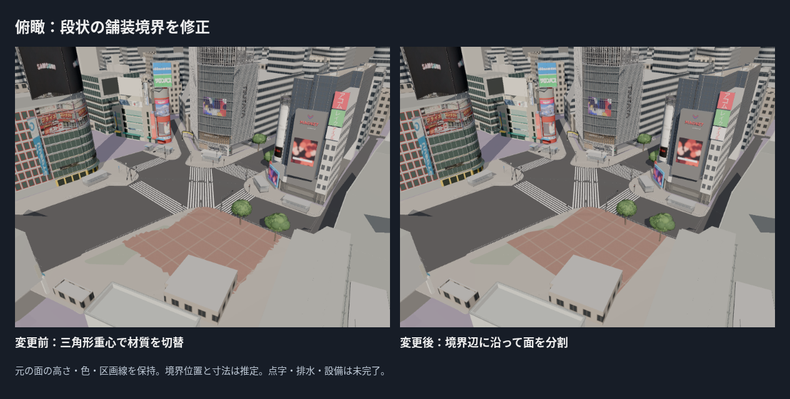
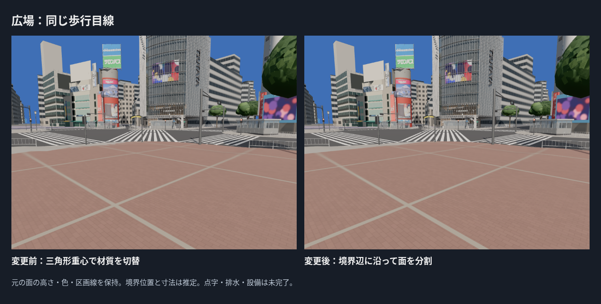
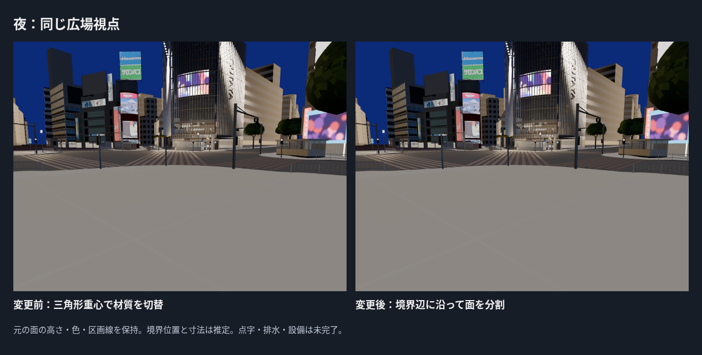

# ハチ公広場の段状の舗装境界を修正

PR #23マージ後main 3e99483を基準に、三角形の重心だけで切り替えていた広場舗装を、推定ポリゴンの辺で面を分割する方式へ変更した。色・ブロック寸法・淡い区画線・境界ポリゴンは前回の設定を保持。実際の境界位置の測量・確定ではない。



## 制作と地面の保全

`paving_boundary.py`で三角形を境界辺の延長線で凸片へ分け、各片を内外へ分類する。凹型のポリゴン、辺上の頂点、逆向きの境界も扱う。新しい頂点のZは元の三角形から補間する。既存の重なる面を勝手に溶接・平坦化しない。

分割対象は歩道だけ。縁石・補填面を元の歩道から生成した後に分割し、素材の境界が地形や縁石を変えないようにした。881面を分割し、GLB全体の三角形は71,323→73,263。描画単位は9のまま。広場の生成面積は1,002.33→1,002.96 m²で、元の重心選択から境界内への切替により僅かに変わる。

## 元GLBとの検証

- 道路・交差点・縁石・白線・補填面の5パーツは、世界座標の三角形集合が変更前と一致。
- 歩道は44,376→46,316三角形。43,615面は10 µm単位の頂点座標が一致。残り2,701面は元の三角形の3D平面と投影範囲へ対応し、対応不明0。
- 補間高さと3D平面の差は検査許容0.1 mm以内。高さ比較は垂直に近い面を除き、垂直に近い面は3D平面距離で扱う。元データの現地測量精度を保証する数値ではない。
- 平面上の被覆の対称差は約0.00000222 m²。面積の合計差も0.001 m²の検査許容内。三角形数が変わるため、以前の「全三角形座標の一致」を歩道へ適用していない。
- **22ファイル・91テスト、型チェックを含むビルド成功。** 凹型の領域・逆向き境界で面積と斜面高さを保持すること、実GLBの舗装頂点が境界内に収まること、既存UV・地面・街路・建物・予算を検証。

地面は73,263三角形・9描画単位・3,700,232 bytes。全体312,409三角形・257描画単位・20,071,104 bytesで現行予算内。FPSはクラウドで評価しない。

## 比較画像と根拠の限界

変更前はPR #23に保存した画像を加工せず再利用し、SOURCE.jsonへ元コミットと取得元を記録した。変更後は同じカメラ・画面寸法・時刻で撮影。新しいカメラへ変更して境界を隠していない。変更後4回の撮影で読込失敗・ブラウザ・レイヤーエラー0。初期画面は変更前後でカメラ位置も画像の画素も一致。これはレンダーの回帰確認で、写真精度の評価ではない。




種類の参考は前回と同じ2025年2月の高所写真（Syced、CC0）と10月10日の南西側写真（ウィ貴公子、CC BY-SA 4.0）。今回変更したのは境界への材質切替方法で、写真から境界の位置を新しく求めたわけではない。写真との画素誤差や位置精度は認定しない。元の歩道・補填面の境界による欠けは今回の材質境界修正とは別に残る。

## 再生成と面照合

READMEのBlender生成コマンドを使う。照合は元コミットのGLBを作業用フォルダへ取り出し、次を実行する（Node依存関係・Python numpy/shapelyが必要）。

```bash
mkdir -p /tmp/paving-boundary-audit
git show 3e99483:assets/ground/core/web/ground_core.glb > /tmp/paving-boundary-audit/before.glb
node evidence/c2-paving-boundary/audit/export_triangles.mjs /tmp/paving-boundary-audit/before.glb assets/ground/core/web/ground_core.glb /tmp/paving-boundary-audit
python3 evidence/c2-paving-boundary/audit/check_surface.py /tmp/paving-boundary-audit /tmp/paving-boundary-audit/result.json
```

実際の境界位置・舗装の割付け、10月の全区画、点字誘導、排水・マンホール、ハチ公像・台座・ベンチ・案内板・植え込みは残る。次は点字・排水と広場設備の欠落を補う。写真品質の完成・Gate合格とは認定しない。
