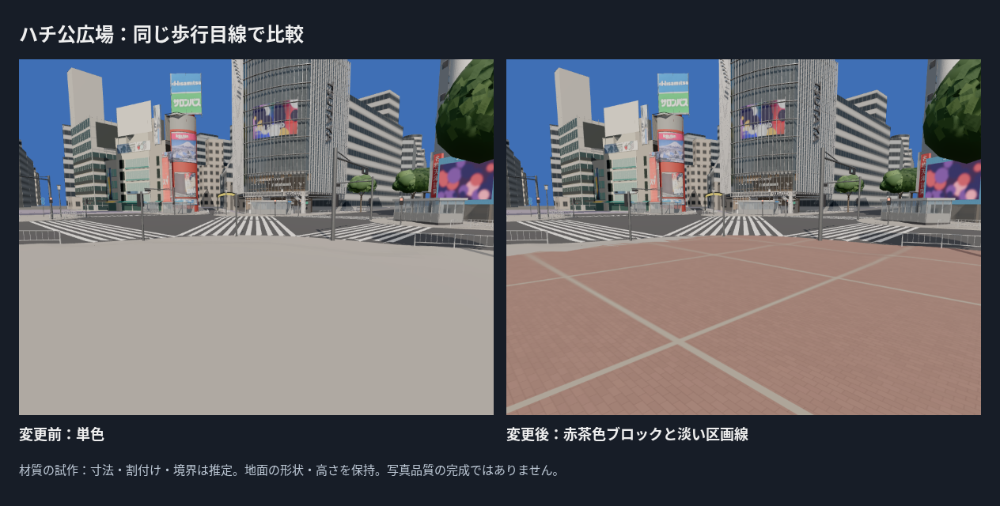
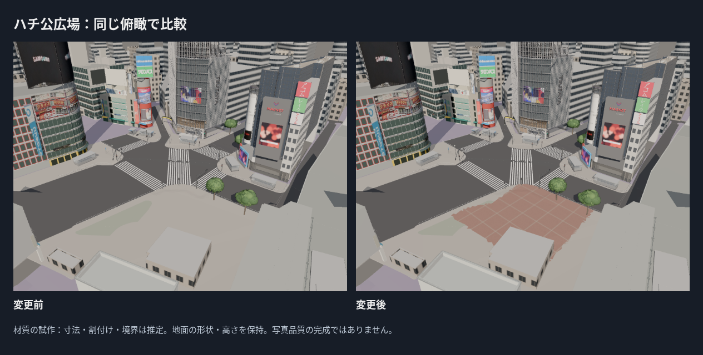
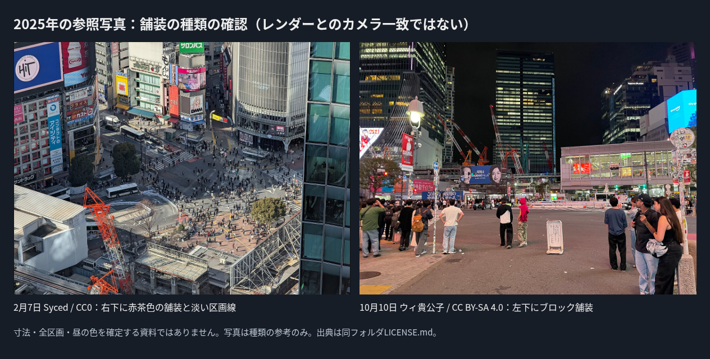
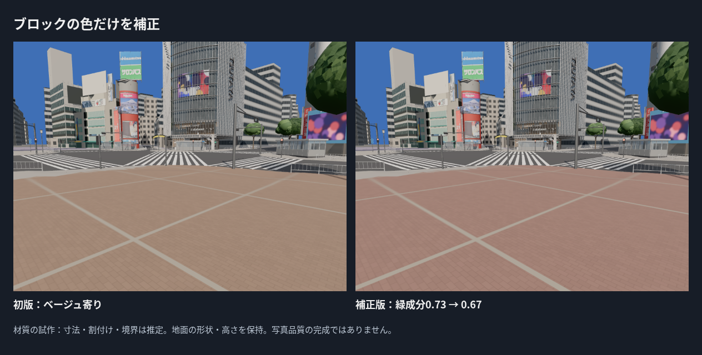
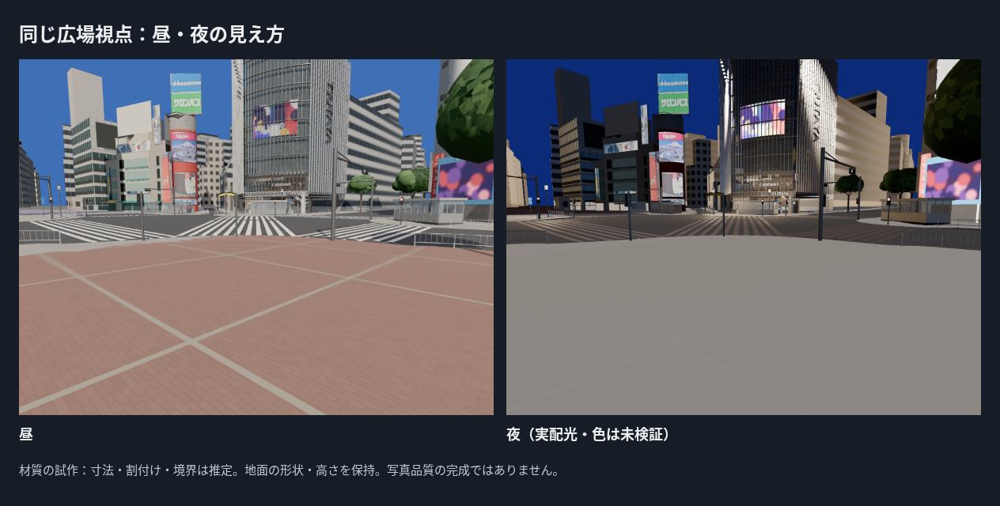

# ハチ公広場の舗装を材質の試作として追加

PR #22マージ後のmain ea235f9を基準に、ハチ公広場の歩道面へ赤茶色のブロックと淡い区画線を追加。北側歩道と広場の違いを通常表示で見えるようにした。既存の地面・建物・信号・樹木・出入口の形は保持する。

## 種類と配置の根拠

2025-02-07の高所写真（Syced、CC0）の右下に、赤茶色の舗装と淡い区画線が見える。2025-10-10 23:13の写真（ウィ貴公子、CC BY-SA 4.0）の左下でも、南西側の赤茶色のブロック舗装を確認した。10月の夜写真では広場全体や区画線の配置を確認できず、昼の色も評価できない。1月・2月の写真を10月の全区画の確定資料とは扱わない。

- 設定は`assets/ground/core/source/data/plaza_paving_layout.json`。東西・南北の平面座標で推定ポリゴンを指定し、その中の歩道・島の三角形重心へ新材質を割り当てる。対象約1,002.33 m²（生成面積）。
- ブロック0.2×0.1 m、目地3 mm、区画6×6 m、敷設角-10度、基準位置(14,-15) mは推定。実測した幅・位置・方向ではない。
- 1024×1024の自作カラーアトラスをGLBへ埋め込み、平面座標から実寸UVを作る。ブロックごとの小さな色差と淡い区画線を表現。人物・影・広告の写真を素材にしていない。
- 道路・縁石・白線・仮補填面には新模様を付けない。新しい地面を重ねず、元の衝突・歩行面と高さを使う。対象境界は材質の試作で、実際の舗装境界と一致するとは扱わない。

## 比較と補正

初期画面・左右約30度・俯瞰・ハチ公側の既存カメラに加え、広場内の低い固定視点を追加した。広場視点の位置(27,-32,2.3)、注視点(18,-18,0.4)、画角65度を前後・初版・夜で固定。初期画面は広場を背にするので、この変更の効果を初期画面の改善量として誇張しない。

初版は赤茶色の参考写真に対してベージュ寄りだったため、**ブロック・目地の色の緑成分だけ0.73→0.67**へ補正した。区画線の色・幅、寸法・位置・カメラ・露出・粗さは固定。初版と補正版を保存する。写真から正確な色を測った値ではない。

写真との確認は舗装の種類・赤茶色と淡い区画線の組合せまで。写真と新しい低い視点のカメラは一致していないため、画素位置の誤差や色差の数値を算出しない。人物や夜の看板光を含む写真の平均色を正解にしていない。M027は前段階でも歩道評価領域不足だったため、今回の広場の品質評価に使わない。

## 地面・既存成果の保全と検証

`geometry_audit.json`で変更前GLBのハッシュと基準コミットを記録。全6パーツの世界座標の三角形頂点の集合を10 µm単位で比べ、形状・高さ・三角形数が一致した。材質グループ、頂点順序、法線・巻き方向の一致を証明する監査ではない。北側舗装のアトラスは変更前と同じSHA-256。

設定と出典・ハッシュを再生成時にも残すよう`write_manifest.py`を更新した。外部の大きな入力を再取得していない場合でも、既存台帳に記録した元入力ハッシュを保持する。GLBの新材質の色係数を明示し、共通Lookの露出や材質既定値は保持する。

## 検証結果

- **21ファイル・89テスト成功、型チェックを含むビルド成功。** 新材質のglTF色係数・繰返し・歩道分類、実際のGLBのUV尺度と対象ポリゴンを検証。既存の街路・地面・建物のテストも成功。
- **15回の撮影で読込失敗・ブラウザエラー・レイヤーエラー0。** 変更前6、初版2、補正版7。初期画面と左右はカメラ位置も画素も変更前と一致（差0）。これはレンダーの回帰確認で、実写真との誤差ではない。`entry_regression.json`と各撮影ログに保存。
- 地面71,323三角形・9描画単位・3,517,960 bytes。全体310,469三角形・257描画単位・19,888,832 bytes。描画単位+1、容量+481,536 bytes、三角形数は保持。現行予算内。クラウドFPSは評価しない。

## 残る差と次の対象

ブロックの実寸・実際の割付けと区画線の位置、材質境界（三角形重心で切替えるため、俯瞰では端が段状に見える部分が残る）、10月の全区画の独立照合、凹凸・摩耗・汚れ、夜の配光・反射は未達。ハチ公像と台座、広場のベンチ・案内板・植え込み、点字誘導、排水・マンホールは残る。写真品質の完成・Gate合格とは認定しない。次は写真と元の歩道線で舗装境界を整理し、点字誘導・広場設備の欠落を補う。左右・歩行で目立つ未制作正面も候補として保持する。
