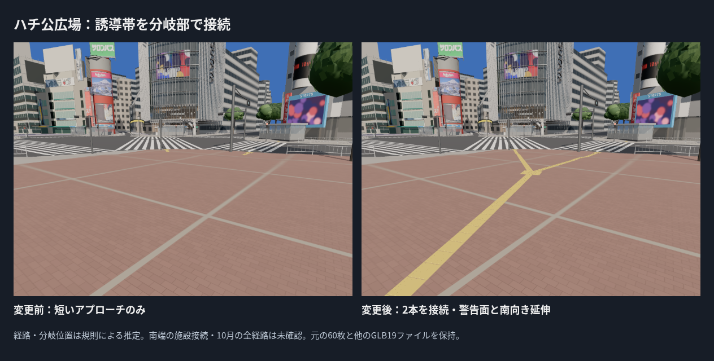
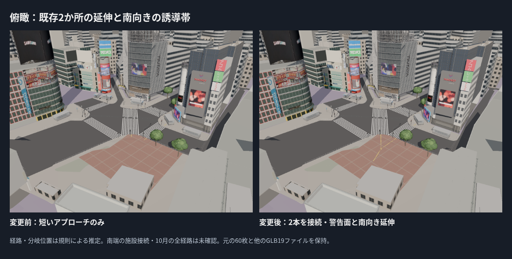
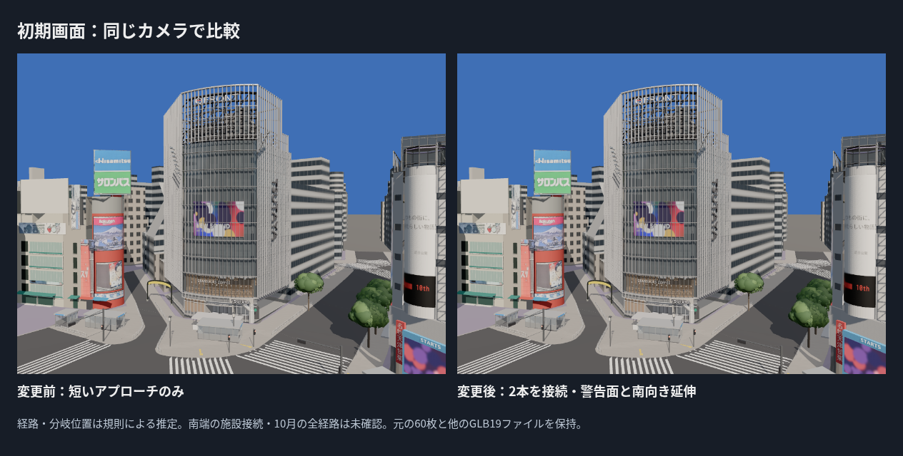
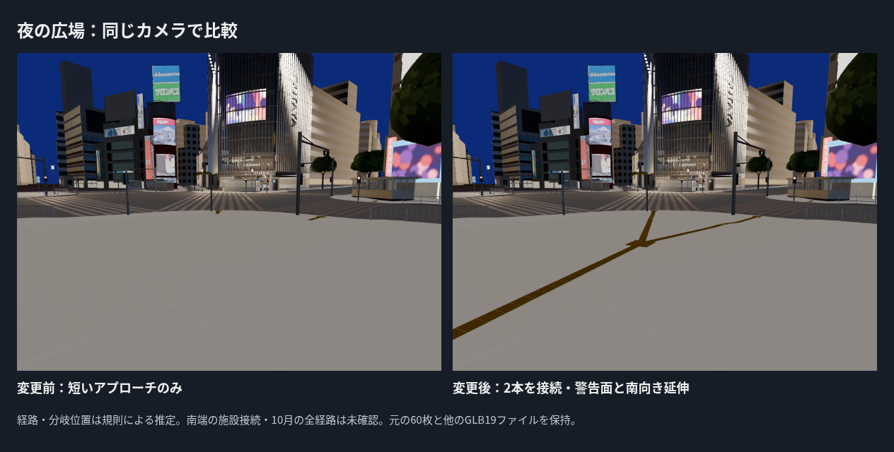

# ハチ公広場の点字誘導を接続

PR #25マージ後main 8594e86を基準に、ハチ公広場側の2か所の短い誘導帯を延ばし、中央の警告面で接続した。そこから南へ9 mの誘導帯を追加した。分岐・経路の位置は推定で、南端を確認済みの施設入口へ接続したとは扱わない。

## 制作した範囲

- 元の6か所・60枚を保持し、104枚を追加。合計164枚（警告33、誘導131）。色・突起の形・高さ・タイル寸法は前回と同じ。
- way/355248081/startとway/754454449/startの警告面から、既存の外向き軸線を延ばす。分岐中心は2本の交点(21.214,-24.681) m。警告面中心から分岐中心までの軸線長は約11.67 m・12.45 mで、元の短い誘導帯を含む。
- 分岐の警告面は300 mm角を3×3枚、0.9×0.9 m。2方向の平均軸を南向きに使い、警告面の外側から9 m延ばす。終端は約(23.238,-33.912) mで、確認済みの施設名や入口を付けていない。
- 接続用の誘導面と線状突起は警告面の外形で切り詰める。警告用の点状突起の上へ線を重ねず、深度のちらつきも避ける。既存の`paving_boundary.py`の純粋な幾何処理を再利用した。
- 各タイルの歩道接地・出入口平面・樹木根元・支柱からの離隔の確認は前回の規則を継続。車道や仮補填面へ延伸しない。南端は広場の売店候補の範囲外であり、施設を通り抜ける延伸を行っていない。

## 根拠と写真との差

2025-02-07の高所写真（Syced、CC0）には広場の長い黄色い誘導帯と分岐が見える。形は前回と同じ国土交通省のガイドライン・JIS T9251:2014の説明を参考にした。写真や標準図をテクスチャにしていない。

**今回の経路は写真から投影・測量した座標ではなく、既存アプローチの軸線を接続する規則による試作。** 基準の白線は既存C2aで、航空写真タイルの撮影年は不明。写真に対して長い誘導帯と分岐という種類の欠落を補ったが、位置・角度・枝の数・南側の接続先・2025年10月の全経路は未照合。写真と今回のカメラは一致しておらず、位置・色の画素誤差を算出していない。実施設の誘導やバリアフリー適合の認定ではない。

## 接続・接地と保全の検証

- **24ファイル・96テスト、型チェックを含むビルド成功。** 実GLBの全三角形を平面へ投影して接続を確認。タイルの設計目地3 mmだけを許容する2 mmバッファで、2か所の警告面・分岐・南端が同じ経路に属することを検証した。警告面の中心は4枚のタイルの目地交差なので、中心点の判定にも目地幅だけを許容している。
- 生成時57,372回の頂点接地照会で欠落0。実GLBの抽出頂点でも、基面2 mm〜突起頂部7 mmの接地範囲を確認。
- 実GLBの細長い線状突起の三角形と警告面の重なりは検査許容0.00001 m²未満。接地・支柱からの離隔・非発光材質・独立ロード・既存予算のテストも成功。
- 元の60枚の配置記録が一致。元の点字GLBの15,960三角形は、世界座標の頂点を10 µm単位で比べてすべて新GLBに保持されている。材質グループや頂点順序の一致を証明する比較ではない。
- 点字以外のGLB 19ファイルは変更前と同じSHA-256。地面、QFRONT・既存建物、信号・樹木・出入口を再生成・移動していない。
- 点字GLBは25,386三角形・1描画単位・1,530,368 bytes。全体337,795三角形・258描画単位・21,601,472 bytesで予算内。描画単位は増やしていない。クラウドFPSは評価しない。

## 比較画像

新しい広場カメラは位置(25,-33,2)、注視点(21.2,-24.7,0.2)、画角65度。変更前後で固定した。初期画面・俯瞰・夜の広場も既存の同じカメラで比較。既存の変更前画像はPR #25から加工せず再利用し、SOURCE.jsonへ記録。広場カメラの変更前は変更前の資産を保持した作業ツリーから新規撮影した。新規撮影5回（変更前1・変更後4）で読込・ブラウザ・レイヤーエラー0。全4視点で変更前後のカメラ位置が一致した。

再生成は`assets/street/tactile/README.md`のコマンド。独立資産のロード・除外・失敗時の表示継続は前回の実装を保持する。

残るのは、実際の分岐位置と全経路・施設接続、北側など残る4か所の接続、実寸・摩耗・色・夜の配光、排水溝・マンホール、ハチ公像・台座・ベンチ・案内板・植え込み。次は根拠を残した排水設備や広場設備を進め、接続先の同定も継続する。広告補正は後工程を維持する。
