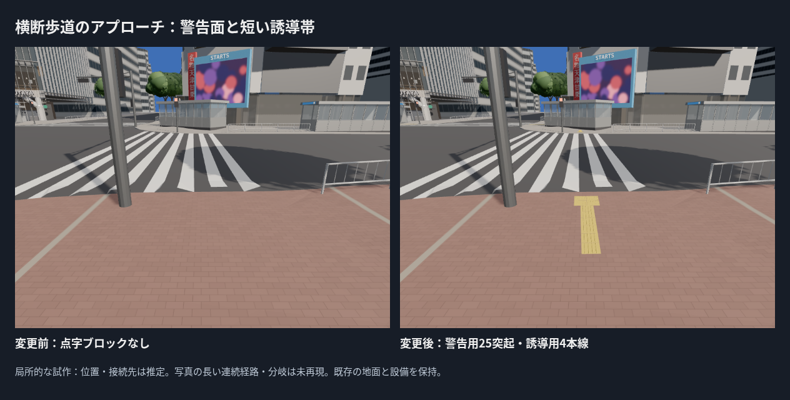
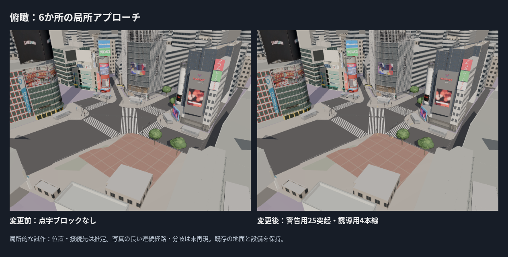
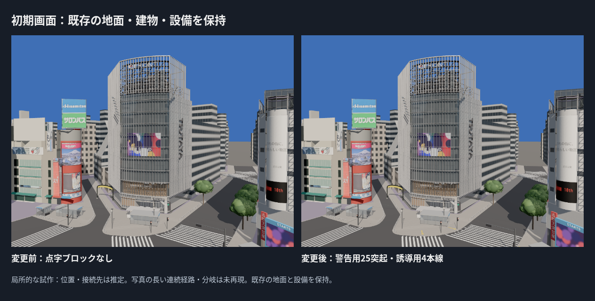
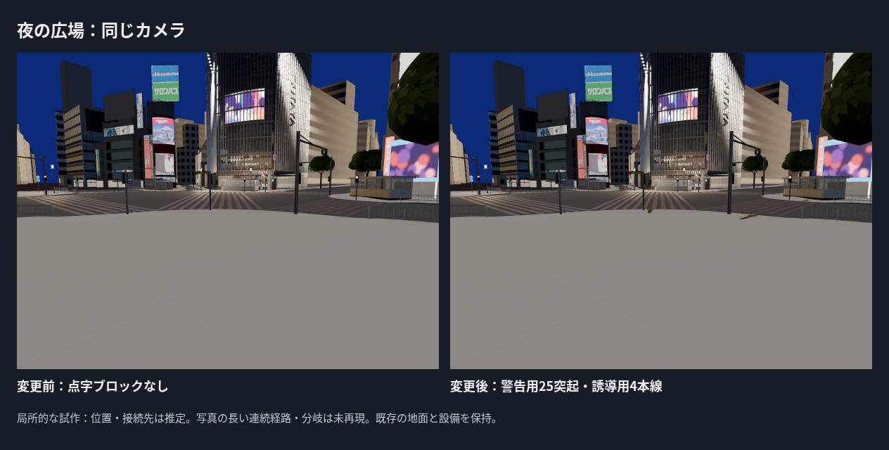

# 交差点の点字ブロック：局所アプローチを追加

PR #24マージ後main 7678d39を基準に、中央の3本の横断歩道の両端へ警告用・誘導用ブロックを通常表示で追加した。6か所・60枚（警告24、誘導36）。既存の地面・建物・信号・樹木・地下鉄出入口のGLB 19ファイルはすべて変更前と同じSHA-256。

## 種類・形の根拠

2025-02-07の高所写真（Syced、CC0）で、広場と北側の黄色い誘導帯の種類を確認した。写真の画素はテクスチャに使っていない。国土交通省「道路の移動等円滑化に関するガイドライン」第2部第7章・参考2-7-5、図2-7-11/12のJIS T9251:2014の説明を形の参考にした。

- 300 mm角のブロック。警告用は5×5の25突起、誘導用は4本線。
- 点状突起は底径22 mm、頂径12 mm、高さ5 mmを設計値として使用し、8分割の円錐台へ近似。線状突起は上辺長270 mmで、タイル継ぎ目の上辺間隔を30 mmにした。
- 警告面0.6×0.6 m、その後ろに幅0.3 m・長さ1.8 mの短い誘導帯。配置・長さ・幅を現地で測った値ではない。
- 黄色・粗さ0.9、自発光なし。地面へ沿わせた低分割の形で、製品形状やJIS適合の認定ではない。

資料URL・参照PDFのハッシュ・写真の撮影日とライセンスは`assets/street/tactile/source/refs/SOURCES.json`。

## 配置・接地と既存設備の保全

対象はway/355248080、way/355248081、way/754454449。基準は既存C2aの白線で、航空写真タイルの撮影年は不明。2025年の点字の実配置を保証する入力ではない。既存の横断歩道の測定端点から外向きの軸へ進み、警告面全体が歩道に収まる位置を探索する。各タイルの中心・辺・角を確認し、OSMの出入口平面と樹木根元を避ける。既存支柱からタイルの縁まで0.2 m以上を確保する。信号などの既存位置を移動していない。

QFRONT側のway/355248080/startは初期候補が支柱の根元に近かったため、端点からの距離0.75→1.5 mへ規則で移動した。他の5か所は0.6 m。これは横断歩道の測定端点からの距離で、現地の縁石からの実測距離ではない。

生成時36,720回の頂点接地照会で欠落0。歩道面だけへ照会し、車道・仮補填面へ置いていない。基面の2 mmは描画用オフセットで、その上に5 mmの突起を追加。GLBで120点以上を抽出して元の歩道へレイを照会し、2〜7 mmの範囲を確認した。C2a地面そのものは変更せず、歩行・衝突も元の地形を基準にする。

独立した`street/tactile`資産としてロードし、street=off・ground=off・tactile=offでは除外する。失敗時はほかの資産を表示し、HUDへ失敗理由を出す。材質区分はfurniture。通常表示の注記へ位置・接続先が推定であることを記載した。

## 比較・検証と残る差

- **23ファイル・95テスト、型チェックを含むビルド成功。** 独立ロードと失敗処理、黄色・非発光材質、実GLBの接地、既存支柱からの離隔、既存街路・建物・地面・予算を確認。
- ブラウザでtactile=off・street=off時に追加資産を要求しないことを確認。tactileurl=missingの意図した失敗では、地面・既存街路・建物の表示状態を保持し、HUDへ失敗理由を出した。期待した失敗として通常撮影のエラー0とは分けてmode_checks.jsonへ記録。
- 新資産15,960三角形・1描画単位・978,160 bytes。全体328,369三角形・258描画単位・21,049,264 bytesで現行予算内。FPSはクラウドで評価しない。
- 近距離カメラの位置(22,-18,1.9)、注視点(22.9,-13.1,0.2)、画角65度を固定。変更前の近距離画像は点字資産だけを除外して撮影。ほかの変更前画像はPR #24の保存画像を加工せず再利用し、SOURCE.jsonへ記録。新規撮影5回（除外した近距離1、通常表示4）で読込・ブラウザ・レイヤーエラー0。

**写真との差で最も大きいのは、写真に見える長い誘導帯・分岐・施設への接続を今回再現していないこと。** 現段階は6か所の短い局所区間だけ。写真とのカメラ一致がないため、位置や色の画素誤差は算出しない。2025年10月の全経路、警告面の実寸・正確な位置、色、突起の丸み・摩耗、夜の配光は未検証。実際の連続した誘導経路やバリアフリー適合を認定しない。

次は写真に見える連続経路と分岐・接続先を段階的に補い、排水・マンホールと広場設備を制作する。高度な既存成果の再制作や広告画像の補正には戻らない。
