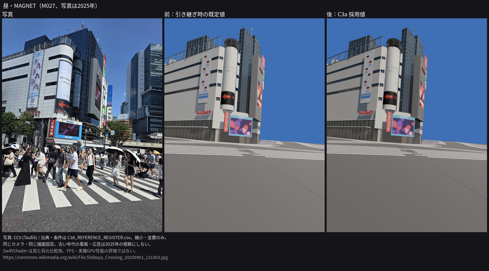
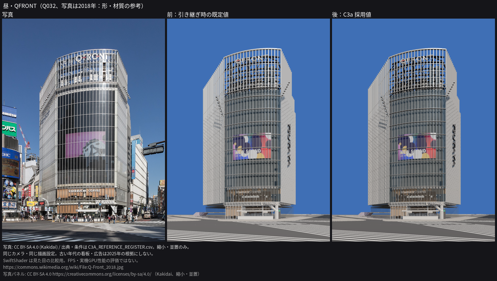
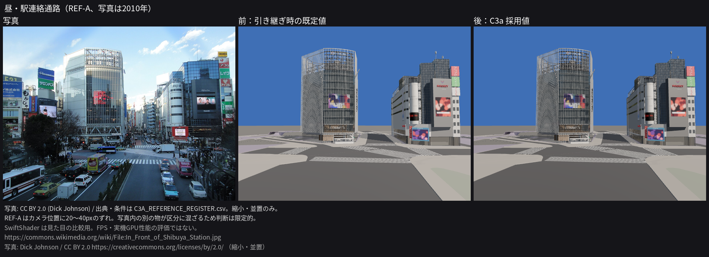
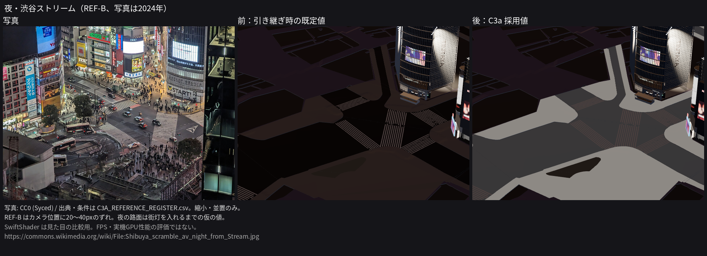

# C3a 報告：WebGL の共通品質の比較と既定値

2026-10-13（日本時間）。`HANDOFF_CODEX.md` の「次にやること」1〜6 に沿って作業した。
対象は共通の露出・反射・夜の路面。建物の形、資産、カメラ、地面の高さ、広告の年代は変えていない。
写真品質の街並みが完成したという判定ではなく、比較に基づく共通パラメーターの更新である。

## 1. 採用値

`src/world/look.ts` の `LOOK_DEFAULT` に反映した。

| 項目 | 前 | 後 | 根拠 |
|---|---:|---:|---|
| 昼の露出 | 1.0 | 0.85 | E1。引き継ぎの指定を同じ環境で再確認 |
| ガラスの反射 | 1.0 | 1.6 | G2。露出・外壁を調整した状態でも、昼の平均と合う2視点の平均が下がった |
| 外壁の反射 | 1.0 | 0.5 | W1。露出0.85に加えても昼の平均と合う2視点の平均が下がった |
| 夜の路面 | 0 | 0.5 | N3。N4（0.8）より夜の平均差が小さい。街灯を入れるまでの仮の値 |

夜の露出1.35、車道0.045、歩道0.30、夜の看板倍率1.0は維持した。
反射の値は写真1枚ごとの調整ではなく、すべての資産に使う共通値である。

## 2. 残りの案と、1項目ずつの組み合わせ検証

最初に `evidence/c3a/sweep/{G2,W1,N3,N4}/metrics.json` と撮影ログを読んだ。4案とも結果があり、再実行による上書きはしていない。

| 引き継ぎ済みの案 | 昼の平均 | 合う2視点の平均 | 夜の平均 |
|---|---:|---:|---:|
| base / base2 | 9.73 | 3.07 | 19.50（base） |
| G2：ガラス1.6 | 9.69 | 3.02 | — |
| W1：外壁0.5 | 8.90 | 2.30 | — |
| N3：夜の路面0.5 | — | — | 18.65 |
| N4：夜の路面0.8 | — | — | 20.85 |

現在のクラウド環境で基準を撮り直し、元の数値が再現することを確認した。
その後、露出 → 外壁 → ガラス → 夜の路面の順で、1回に1項目だけ変えた。

| 今回の撮影 | 昼の平均 | 合う2視点の平均 | 夜の平均 |
|---|---:|---:|---:|
| validation/base | 9.73 | 3.07 | 19.50 |
| validation/E1 | 8.78 | 2.58 | — |
| validation/E1_W1 | 8.52 | 2.53 | — |
| validation/E1_W1_G2 | 8.44 | 2.43 | — |
| final：上記 + N3、URLで上書きせず既定値を使う | 8.44 | 2.43 | 18.65 |

各段階の画像・撮影ログ・`metrics.json` を同名ディレクトリに残した。
途中段階の区分画像は、カメラ・形状を変えていないため今回の base の画像を再利用した。
最終段階は全4視点の通常画像と区分画像を8枚すべて撮り直した。
base と final の区分画像は全4視点で画素単位に一致した。比較領域を変えて改善させたものではない。

## 3. 最終比較の数値

指標は区分内の平均色から求めた CIE L\*a\*b\* の明るさの差、平均 |ΔL\*|（小さい方がよい）。
ガラス・外壁・車道・歩道を対象にし、M027・Q032 は重み1、REF-A・REF-B は0.5。
年代で変わる看板と画面は採点から外し、個別の値だけを記録する。仮の地面も採点には入らない。
写真と完全に一致する面積や、知覚品質全体を測る指標ではない。

| 対象 | 前 | 後 | 改善率 |
|---|---:|---:|---:|
| 昼3視点 | 9.73 | 8.44 | 約13.3% |
| 合う2視点（M027・Q032） | 3.07 | 2.43 | 約20.8% |
| 夜1視点（REF-B） | 19.50 | 18.65 | 約4.4% |
| 昼夜全体 | 10.88 | 9.64 | 約11.4% |

全体の平均 ΔE も14.97 → 13.87に下がった。
一方、ガラス区分だけの平均 |ΔL\*| は4.0 → 4.4、平均 ΔE は16.4 → 16.5で、元の既定値より悪い。
G2 は組み合わせ途中の値より改善するが、ガラスの色・反射がすべて写真に近づいたとは言えない。
M027 のガラスはまだ暗く、Q032 は青みが強い。

元のデータは `validation/base/metrics.json`、`final/metrics.json`。
比較領域の一致と集計結果は `validation/summary.json` に記録した。

## 4. 写真・前・後の比較画像

写真を描画と同じ大きさに縮小して並べた。写真への色補正や生成による修正はしていない。









写真4枚の公式 Commons API のライセンス情報を確認した（2026-10-13）。
記録は `C3A_REFERENCE_REGISTER.csv` と `evidence/c3a/refs/licences.json`。
M027 は Taufik / CC0、Q032 は Kakidai / CC BY-SA 4.0、REF-A は Dick Johnson / CC BY 2.0、REF-B は Syced / CC0。
比較画像には作者・ライセンス・出典を記載し、Q032 の写真パネルの継承条件も明記した。
主台帳で未確認だった Q024（REF-A）の年・作者・ライセンスを、公式メタデータに基づいて訂正した。
2018年・2010年の看板や広告を2025年の根拠にはしていない。夜の2024年写真も2025年10月の駅形状の根拠ではない。

## 5. 検証と再現手順

- `npm run typecheck`：成功。
- `npm test`：7ファイル、39件が実行され、すべて成功（look 6件、budget 3件を含む）。
- `npm run build`：成功（型チェックを含む）。
- 最終撮影：4視点 × 通常・区分の8枚。通信・ページエラー0件。建物3棟、地面、看板レイヤーの読み込み失敗0件。画面の警告表示なし。
- 初回の base 撮影は、M027 の通常画像にリソース404が1件記録された。favicon エンドポイントは404だった。元のログを保持し、撮影スクリプトで favicon だけを204に応答させたうえで、同じ旧パラメーターのM027を再撮影した。現在の base 撮影ログはエラー0件。
- 資産・形状は変更していない。性能予算テストが成功。クラウドのFPSは性能判定に使っていない。
- 撮影コマンドの失敗検出：`groundurl=missing` を指定する機能確認では、地面のフォールバックを検出して終了コード1になった（意図した失敗、アプリのテスト失敗ではない）。その失敗画像が残った状態で再実行しても終了コード1となり、保存済み画像を誤って合格扱いしないことを確認した。失敗確認の画像は `/tmp` に置き、PRの証拠には混ぜていない。

作業場所は `/workspace/ss2-c3a`。以下は同ディレクトリで実行する。
Node.js 24.19.0、npm 11.9.0、Python 3（NumPy 2.3.5 / Pillow 12.3.0）、Chromium 154.0.8037.57で確認した。
Playwright には既存の Chromium を指定できるようにした。指定がなければ従来どおり同梱ブラウザを使う。

```sh
npm ci --cache /workspace/.npm
npm run dev -- --port 5182 --strictPort
# 別ターミナル。撮影中は src を編集せず、sync-assets や npm test を実行しない。
# 新しいディレクトリに保存し、以前の証拠を上書きしない。
PLAYWRIGHT_CHROMIUM_EXECUTABLE_PATH=/usr/bin/chromium \
  node scripts/capture-look.mjs http://127.0.0.1:5182 evidence/c3a/recheck/base \
  'look=dayExposure:1,glassEnv:1,wallEnv:1,nightGround:0'
PLAYWRIGHT_CHROMIUM_EXECUTABLE_PATH=/usr/bin/chromium \
  node scripts/capture-look.mjs http://127.0.0.1:5182 evidence/c3a/recheck/final
python3 scripts/look-metrics.py evidence/c3a/recheck/base evidence/c3a/recheck/base/metrics.json
python3 scripts/look-metrics.py evidence/c3a/recheck/final evidence/c3a/recheck/final/metrics.json
# 保存済みの今回の base/final から画像を再生成する。
python3 scripts/board-c3a.py
npm run typecheck && npm test
```

検証済みログのある既存画像は撮影をスキップする。未検証・失敗ログのある画像をスキップして成功にはしない。
古い撮影ログに読み込み状態がない場合や、再撮影が必要な場合だけ `FORCE=1` を使う。
撮影ログは各フレームの直後に保存し、通信エラーや資産のフォールバックがあればコマンドを失敗させる。
部分再撮影時も他のフレームのログを保持する。

## 6. 未達と次の作業

- **REF-A・REF-B のカメラ**：旧模型から求めたカメラで、現模型と20〜40pxずれる。区分の境界を13px縮めて重みを下げても、写真内の別の物が混ざる。屋根の角を目印に加えた再推定は未実施。`solve-ref-camera.py` は完成扱いにしない。
- **夜の路面**：比較写真はREF-Bの1枚だけ。車道のΔL\*は−27.2 → −5.2に改善するが、歩道は−11.8 → +32.1となり、明るすぎる。全区分が改善したとは言えない。0.5はN3/N4から選んだ仮の値で、街灯を入れるC2bで0に戻して再比較する。
- **看板の明るさ**：夜写真で十分な領域を取れず未調整。夜の看板倍率は1.0を維持。
- **材質と街並み**：路面・外壁の細かな質感、周辺建物、街路設備、人と車が未完成。今回の平均色の改善で写真品質の完成を宣言しない。
- **実機性能**：FPS未測定。次の節目にオーナーPCで `?bench=auto` を使う。SwiftShader のログに出るFPSは無効。

次はオーナーが採用した順序の C2b（街灯・信号・地下鉄出入口など）。西武A館の保全済み作業は変更していない。
