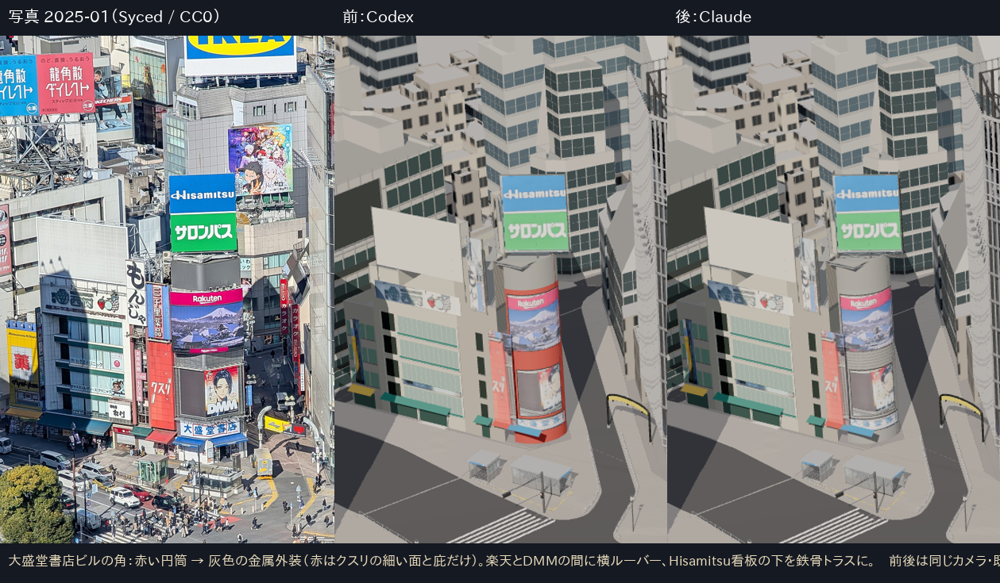
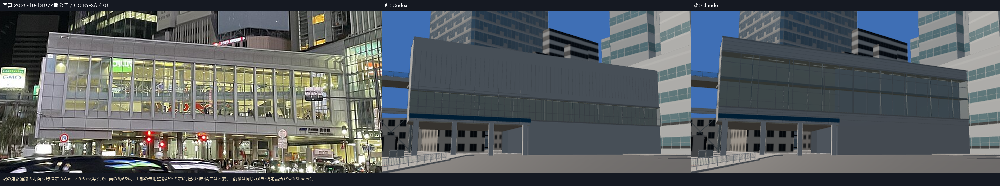
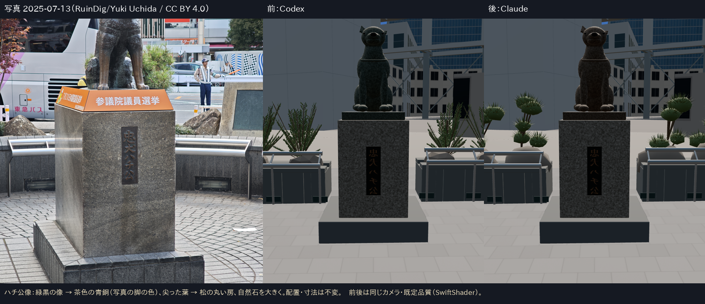
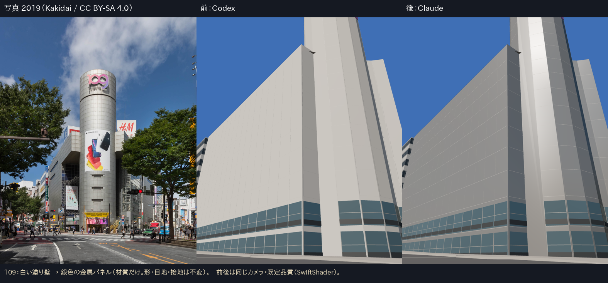

# Claude による PR #12〜#36 の精査と修正（第 1 回）

- 2026-10-14、ブランチ `claude/core-exterior-review`（`codex/core-exterior-walk` = main + 引き継ぎ資料 から開始）。
- 方法：最新ブランチを既定品質で開き、初期画面・目線・高所の 13 視点を撮影 → 参考写真と並べて、**一目でわかる形と材質の誤り**から順に直した。1 項目ずつ、同じカメラの前後で確認した。
- 撮影：`scripts/capture-review.mjs`（1 視点ごとにブラウザを起動）。画像は `evidence/claude-review/`（before / after / boards）。
- QFRONT・MAGNET・西武（別ブランチの WIP）・既存の街路設備（信号・樹木・出入口）には手を入れていない。

## 1. 直したもの

| # | 対象 | 何が違っていたか（根拠の写真） | 直したこと | 変えていないもの |
|---|---|---|---|---|
| 1 | センター街入口・大盛堂書店ビルの角（`west-block`） | 角全体が**赤い円筒**だった。2025-01（WB01、CC0）・02（WB02）・11（WB03）の 3 枚とも、本体は**灰色の金属外装**で、楽天の画面だけが角に沿って曲がる。赤いのは隣の細いビル（クスリ）の平らな面と庇だけ | 角の本体と、その区画の PLATEAU 壁を灰色の金属に（新しい材質 `west_wall_corner_body`）。楽天と DMM の間に横ルーバー（0.45 m 間隔）。Hisamitsu 看板の下を、柱 3 本から**2 列の柱＋X 筋交いの鉄骨トラス**に | 看板の画像・位置・寸法、屋根、裏側、クスリの赤い面と庇 |
| 2 | 駅の連絡通路の北面（`station-concourse`） | ガラス帯が高さ 3.8 m しかなく、上に約 8 m の**無地の灰色壁**があった。2025-10-18（SC05）では、床（T.P.21.0）から北壁の上端（T.P.34.2）までの約 65 % がガラスで、上下は細い銀色の帯 | ガラスを T.P.23.3〜31.8（8.5 m）に。縦の方立を約 2.8 m 間隔（18 区画）、上から 1.6 m に横の枠。外装を明るい銀色の金属に、上下の帯に横目地。内部の奥行を 0.75 m→3 m にし、中間の床の縁を追加 | 屋根の頂点、床、東側の開口、西側の下部 |
| 3 | ハチ公像（`hachiko`） | 像が**緑がかった黒**。2025-07（july095）の日の当たる脚は茶色の青銅（sRGB 約 98,89,81） | 青銅の地の色を 76,84,74 → 94,82,68 に（同じ乱数の模様で作り直し） | 像の形・寸法・台座・銘板 |
| 4 | 像の周りの植栽と自然石（`hachiko-surround`） | 植栽が**放射状に尖った葉（アガベのような形）**だった。写真は刈り込んだ黒松の**丸い房**。自然石も写真より小さかった | 短い枝の先に丸い房（芯＋外向きの短い針葉 150 本）を 6 個ずつ。自然石を高さ約 0.6 m に大きくし、房と石をなめらかな陰影に | 石縁・レール・掲示板の位置と寸法 |
| 5 | SHIBUYA109（`shibuya109`） | 円筒も翼部も**白い塗り壁**。参考写真（2019、Kakidai、CC BY-SA 4.0）以降のどの写真でも**銀色の金属パネル** | 外壁と屋根の材質だけを銀色の金属に（`scripts/patch-glb-material.mjs` で GLB の材質を直接変更。生成器 `tools/core/build_facade.py` にも `wall_metal`・`wall_rough` を追加し、layout に同じ値を記録） | 形・目地・接地（作り直すと足元の照会が変わるため、材質だけを変えた） |

## 2. 検査
- `npm test`：35 ファイル・138 件すべて成功。`tsc` 成功。
- 連絡通路のテストは、横の枠の高さを layout から読むように変え、「ガラスの上端近くも壁ではなくガラス」の確認を足した。内部の奥行が 3 m になったので、光線の長さを 2 m → 5 m にした。
- 予算：西側街区 1,873 三角形（以前 1,257）、連絡通路 630 三角形。どちらも B 予算の内側（budget テスト成功）。
- ブラウザ：撮影した全視点でエラーなし、資産の読み込み失敗なし（`capture_log.json`）。

## 3. 見つけたが、今回は直していないもの（次の候補）
優先度の高い順。

1. **駅の西側の小施設（`station-service`）が、広場から見ると巨大な無地の灰色の壁。** 交差点から南東を見ると画面の大半を占める。施設の用途と 10 月の外観を写真で確かめてから外装を付ける。
2. **JR 北側（`station-north`）の低い部分も無地の灰色。** 同上。
3. **Hisamitsu 看板の鉄骨トラスは、目線の距離ではほとんど見えない。** 写真では看板の下の黒い箱（画面の筐体）が目立つ。角の上部を円筒でなく箱として作り直すと、さらに写真に近づく。
4. **大盛堂ビルの DMM の画面**は、写真では平らな黒い枠の中の画面。今は円筒に沿って曲がっている。
5. センター街のゲートは黄色のアーチだけで、文字（SHIBUYA CENTER GAI）がない。
6. ハチ公像の顔：鼻先と耳の形は Codex の補正のまま。写真の柴犬らしい顔の幅と首輪の太さは未確認。
7. 歩行（ハンドオフ §6）：像・小施設の衝突、段差の制限は未修正。

## 4. 方法上の注意（次に作業する人へ）
- 写真を**3 枚以上の別の年月**で見て、同じ形が写っているかを先に確かめた（例：大盛堂ビルの角は 1・2・11 月で一致）。1 枚だけの読み取りで形を決めない。
- 材質の色は、写真の**日の当たっている部分**の画素の平均で決めた（影の部分は青く暗いので使わない）。
- 生成器を作り直すと足元の照会も変わる資産（共通外装の 13 資産）は、材質だけを直すときは GLB の材質を直接変えて、生成器と layout にも同じ値を書いた。
- 撮影中に `sync-assets` を走らせると vite の配信が壊れる。資産を作り直したら `public/` へコピーするか、vite を再起動する。

---

# 第 2 回（同日）：第 1 回で残した 5 件

比較画像は `evidence/claude-review-2/boards/`。前は第 1 回の後（ゲート・駅側は Codex のまま）、後は今回。前後は同じカメラ。

| # | 対象 | 根拠の写真 | 直したこと | 推定のまま残る点 |
|---|---|---|---|---|
| 1a | 駅西側の小施設（`station-service`） | 2025-11-01 の広場の写真（hachiko.jpg、CC BY-SA 4.0）。同じ方向に白い仮囲い・足場・大きな広告。2025-10-10（SC04、CC BY-SA 4.0）に同じ枠の 10 月の広告 | 広場に面した 2 面に足場（1.8 m 区画、2 m ごとの段、筋交い、作業床）、足元に高さ 3 m の白い仮囲い。北面に枠付きの広告（15.5×7 m）。広告は SC04 から透視変換で切り出し、手前の信号機と標識の部分は周囲の色で埋めた（ぼかしで、描き足していない）。広告は別レイヤー（`signs-2025-10.glb`） | 足場がこの PLATEAU の建物かは、見る方向から推定した。寸法も推定 |
| 1b | JR 北側の低い部分（`station-north`） | 同じ 11 月の写真。濃い灰色で、縦ルーバーの設備箱。10 月は足元に白い仮囲い | 南側の施設の壁に縦ルーバー（0.45 m 間隔）、下部の壁の前に白い仮囲い（3 m、1.8 m ごとに支柱） | 位置と間隔は推定 |
| 2 | 大盛堂ビルの角の上部 | 2025-01・02・11 の写真で、楽天の上は灰色の箱（画面の筐体） | 角の上部を、円筒から 2 面の平らな箱に変更（高さは不変）。上下に横の見切り | 箱の奥行は推定 |
| 3 | DMM の画面 | 同上。DMM は平らな画面が黒い枠に入っている | 曲面をやめ、黒い枠の箱＋平らな画面に。PLATEAU の外形の内側に収めた（テストで確認） | — |
| 4 | センター街のゲート | 2025-01（WB01、CC0）と 2025-02 の高所写真。先が内側へ曲がる灰色の支柱 2 本と、その間の平らな横断幕。黒い連続アーチではない | 曲がった支柱 2 本（つなぎ目の輪、先端の灯具）と、吊り金具で下げた平らな横断幕。横断幕の絵柄は 1 月の写真から切り出し、別レイヤー（`signs-2025-01.glb`）に置いた | 柱の文字（「渋谷センター街」と読める縦書き）はまだない。10 月の横断幕の内容は未確認 |
| 5 | 歩行 | ハンドオフ §6 | ハチ公像・像の周り・広場の小施設を衝突の対象に追加。足元の高さ 0.25 m でも当たり判定をとる。0.35 m を超える段差は壁として止まる。足元に歩ける面がない所では止まる（以前は高さ 0 に落ちた）。屋根や樹冠を床と取り違えないよう、地面を足元の少し上から探す | 階段・坂の歩き心地の調整はしていない |

## 歩行の検証（実際の場面、`scripts/walk-check.mjs` → `evidence/claude-review-2/walk_check.json`）
| 経路 | 結果 |
|---|---|
| 広場からハチ公像へ直進 | 像の手前で停止（以前は通り抜けた） |
| 売店候補へ直進 | 壁の 0.25 m 手前で停止 |
| 交差点の中心から駅側の歩道へ（縁石を越える） | 最後まで歩けた。1 歩（0.25 m）あたりの高さの変化は最大 1.8 cm |
| 広場を斜めに横断 | 売店候補の角で停止 |
- 単体テスト `tests/walk.test.ts`：0.15 m の縁石は上る、0.65 m は止まる、歩ける面の外へは出ない、設備には当たる。

## 検査
- `npm test`：36 ファイル・142 件すべて成功。`tsc` 成功。
- 書き換えたテスト：ゲート（柱の材質名が `gate_crook` になった）、小施設（足場が屋根より最大 1 m 上に出てよい、発光は広告だけ）。どちらも、元の殻・屋根の頂点を残すという検査はそのまま。
- 撮影した視点はすべてブラウザのエラーなし、資産の読み込み失敗なし。

## 次の候補
- ゲートの柱の縦書きの文字。
- 夜の見え方（広告・横断幕の明るさ）の確認。
- 駅側の他の建物（`station-west-viaduct` の青い養生網、`station-southeast`）も、10〜11 月の写真と照合する。
