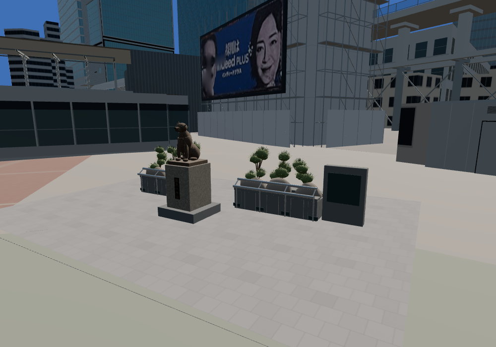
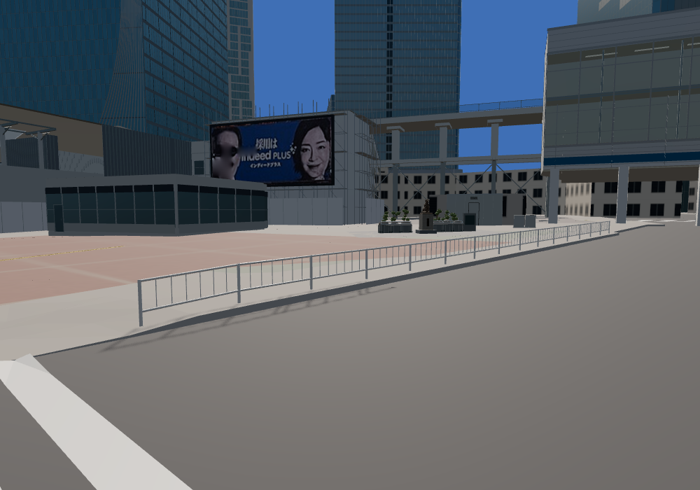
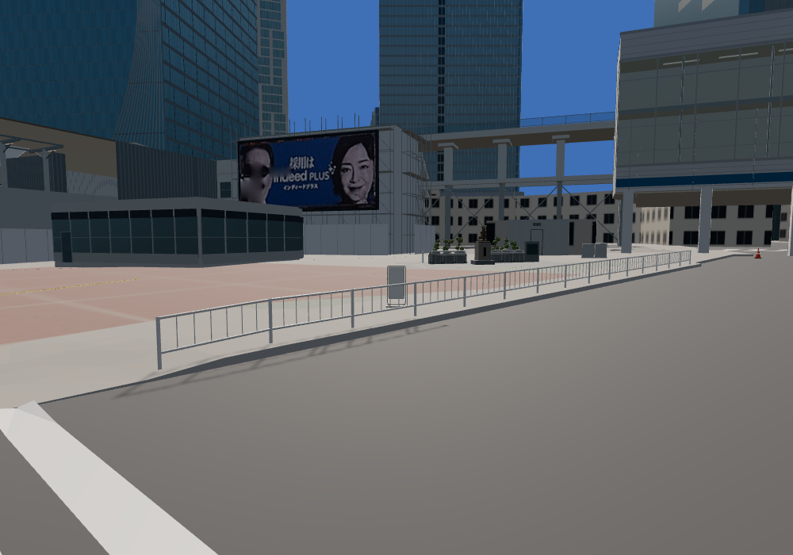
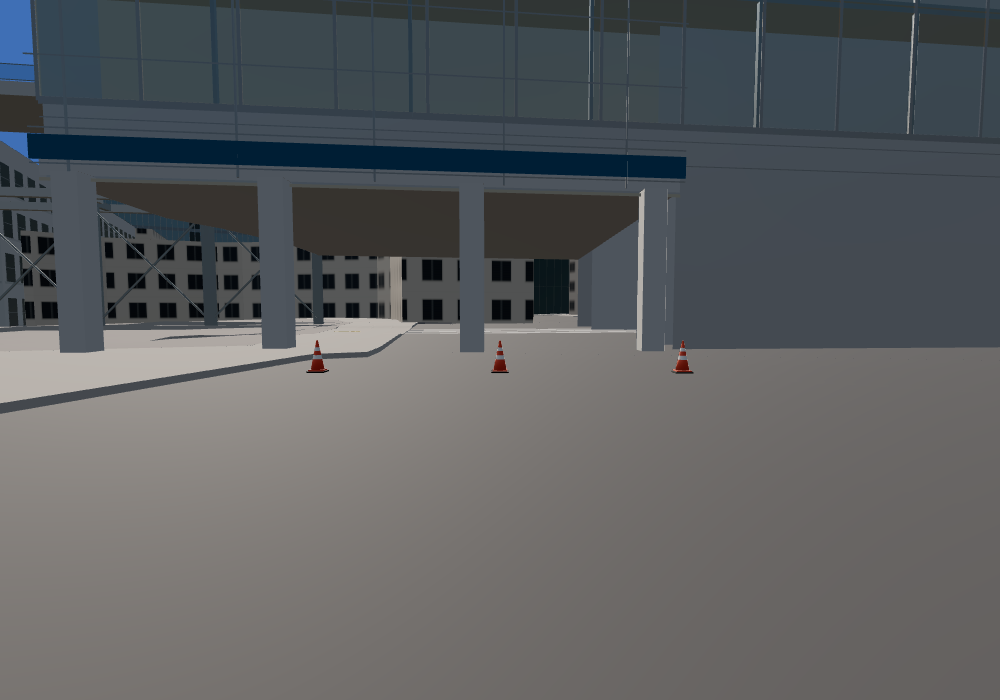
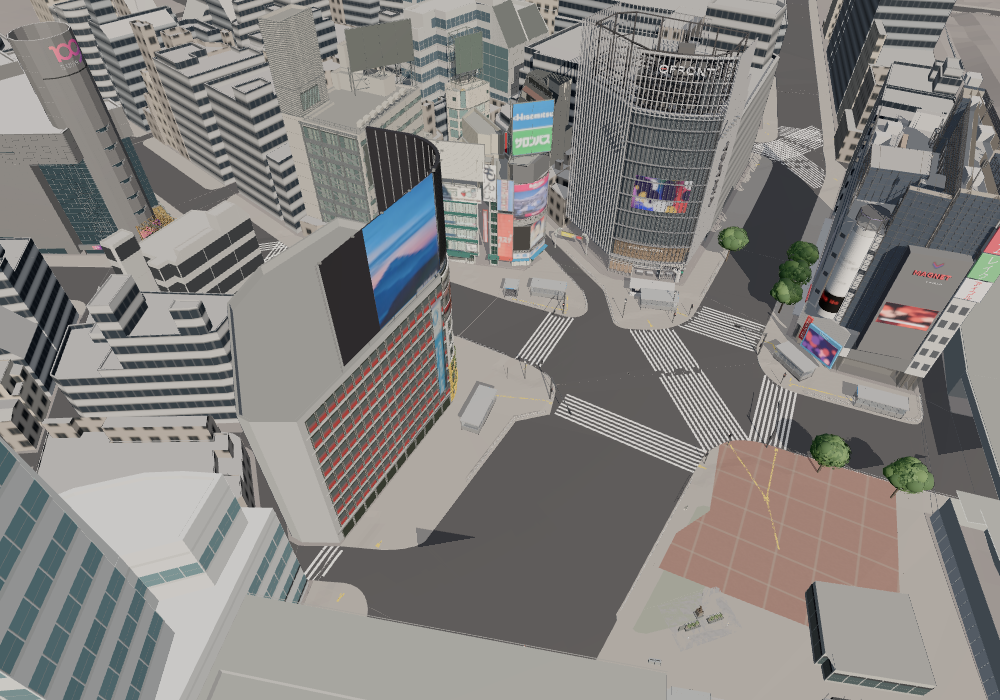
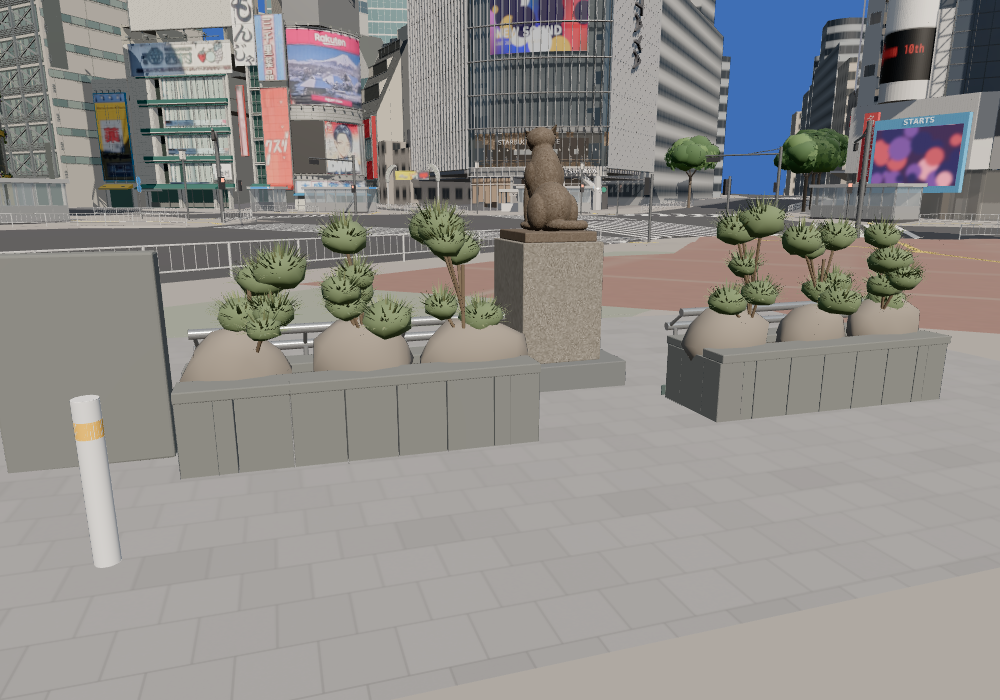
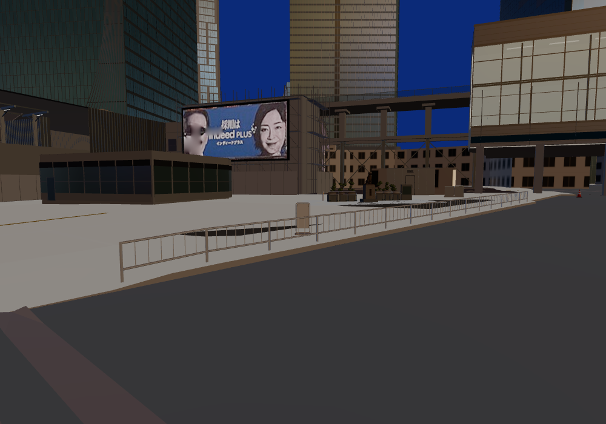

# PR #57までのdots資産：街への配置

比較基準main: `f8068ce`。#39〜#57はmainへマージ済み。建物更新はすでに通常一覧へ接続されていたため、既存28建物の座標・形状はそのまま使用した。#44の駅前ビルreview案は通常資産へ一括採用しない。今回の新規実装は小物6点の通常表示と接地・衝突の統合。

## 配置したもの

|対象|個数|平面座標 x東/y北 (m)|GLB実寸 幅×奥行×高さ (m)|根拠・精度|
|---|---:|---|---|---|
|白黄ボラード|2|(10.413,-52.791), (15.819,-49.007)|0.1142×0.1142×0.8|July095の像背後の2本。既存像/植栽基準の相対推定。10月存続は未確認|
|自立掲示板|1|(8,-31)、yaw210°|0.56×0.2901×1.096|SC04の待機空間の形式。ハチ公側広場へ推定配置、文字なし|
|白帯2本コーン|3|(-12,-61),(-8,-61),(-4,-61)|0.38×0.38×0.7|SC04の駅工事境界の形式。既存コンコース北縁からの規則配置、4m間隔は推定|

台帳は `assets/street/props/web/layout.json`。地図原点とT.P.15 mは既存規約。全点が写真からの校正済み投影座標であるという主張はしない。7月と10月の資料を使っており、単一日の設備全数復元ではない。元モデルの寸法自体も実測ではなくdotsの推定寸法を継承した。

南麻布を参照した設備箱と#57緑の柵上部パネルは未配置。渋谷の位置・型の根拠がなく、柵は支柱・基礎を持たない部分形状。現在の渋谷の柵をそれで置き換えない。未配置をロード不具合と扱わない。

## 実装

- `src/world/props.ts`: 同種をInstancedMeshで共有、各足元bboxの9点を実地面へ照会。欠測/高低差6cm超ではその配置を除外、ほかは継続。既知の寸法から2cm以上異なる資産は誤単位として拒否し、自動拡縮しない。
- 地面の最大点へ合わせて浮き/埋まりを限定。底面原点差をbboxで補正。平面位置・yawのみ台帳で編集可能。
- 通常表示、昼夜材質、分類表示、歩行衝突へ登録。`?props=off` は同一カメラ比較用、`?street=off` も尊重。UIに推定配置の注記。
- 3配布GLBはincoming正本とSHA256一致。Blenderモデルの再生成、既存ビルの置換、地面/高度な街路資産の変更なし。PR #38の未マージimporterには依存しない。
- main由来の `scramble-square-fidelity.test.ts` の型エラー5件も修正。未使用変数を削除しVector3配列の型を指定、既存幾何検査の条件は保持。

## 検証

- 224テスト/49ファイル、TypeScriptとVite production build成功。元の三角形/描画/容量予算を維持。ログは `evidence/dots-placement-57/placement57-{tests,build}.log`。
- 実行時小物は6/6、スキップ0、10,983三角形、12描画単位（影等の追加パス別）。ダウンロード資産の予算検査と、配置後インスタンス数の計測を区別。
- 実際の足元9点の高さ差は2.51〜12.23mm。最大値を採用するため低い側に同程度の微小隙間が残る。実地面の測量誤差を示す値ではない。
- 6点の周囲16方向×2高さで既存障害物との近接ヒットなし。各点の周囲9本の下向き光線で点字メッシュのヒットなし。これはサンプル照会であり連続体の完全な干渉証明ではない。
- 各小物に水平の光線が当たり、歩行衝突に登録。全シーンの歩行は近くの既存設備でも停止しうるため、小物だけの障害物でも別途検証する。コーン間の経路(-10,-58)→(-10,-62)は16歩×0.25m成功。
- 前/後は同じ5視点、同じ昼・1000×700・通常品質。28建物ロード失敗0、地面/外側道路を含む資産の状態も確認。画像は小物on/off比較で、過去のdots建物改修前を再現した画像ではない。
- 初回撮影は同期中にサーバーを起動したため12建物の読み込み失敗を検出して破棄。sync/build完了後に再起動して取り直した成功画像のみ採用。
- クラウドSwiftShaderで見た目と読み込みを確認。オーナーPCのFPSや実際の現地配置の一致は認定しない。

## 同じカメラの前後

|場所|配置前|配置後|
|---|---|---|
|ハチ公周囲|||
|広場の案内板|||
|駅側コーン|||
|全体|||





追加の裏側・夜視点と実行時検査は `runtime.json` と `scripts/check-prop-placement.mjs`。裏側・夜は配置後の補足画像で、前後比較ではない。

初期画面は同じディレクトリの `entry.png`。小物は地上の近景に効き、初期画面で大きく見える対象ではない。駅・広場に簡略形状は残っており、街が完成したという報告ではない。

## 再現

```sh
source /workspace/setup-tools/core-env.sh
npm test
npm run build
npm run dev -- --host 127.0.0.1 --port 5237
# 別ターミナル、ブラウザは一つずつ。撮影中のsrc/assets変更禁止。
EXTRA=props=off node scripts/capture-prop-placement.mjs http://127.0.0.1:5237 /tmp/props-before
node scripts/capture-prop-placement.mjs http://127.0.0.1:5237 /tmp/props-after
node scripts/check-prop-placement.mjs http://127.0.0.1:5237 /tmp/props-clearance.json
```

ソース写真と元モデルの条件は [小物README](../../assets/street/props/README.md)。写真一致の新しい画素誤差を計測していないため、同じカメラの街の前後比較と混同しない。配置確定に必要なのは根元を読める追加写真と座標照合。次にdotsへ渡す制作依頼は [90候補の一覧](DOTS_NEXT_ASSETS_57.md)。
