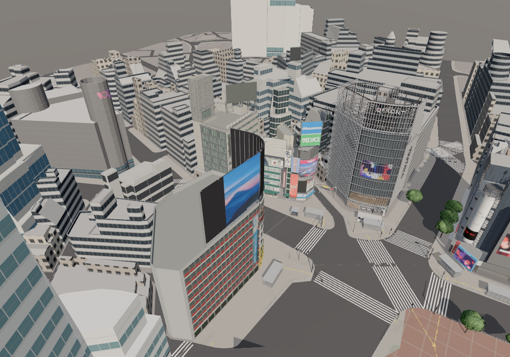
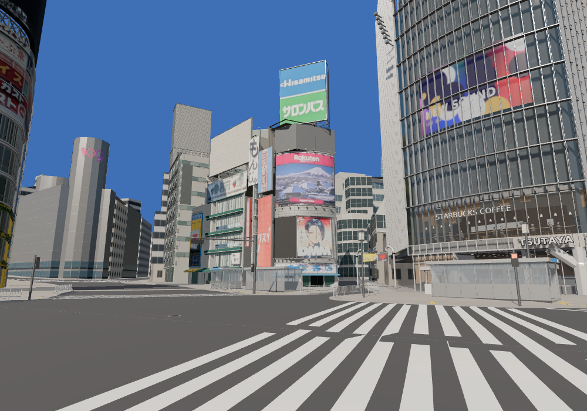
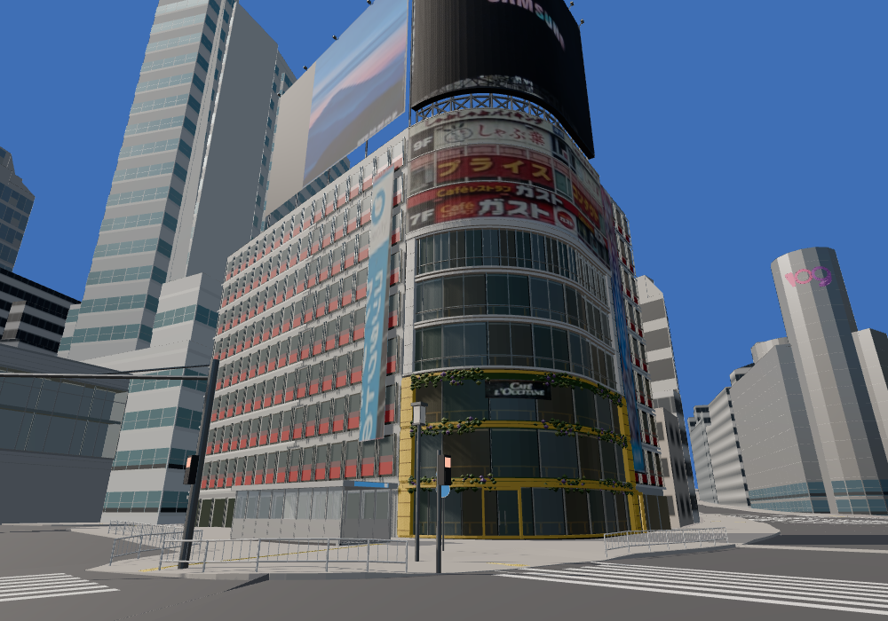
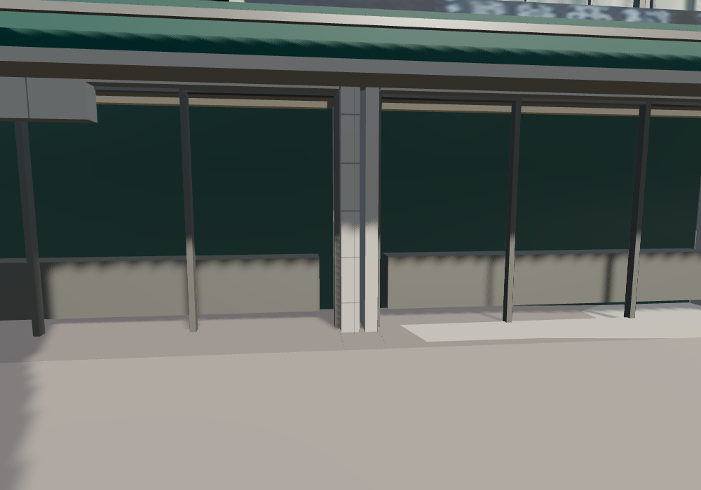
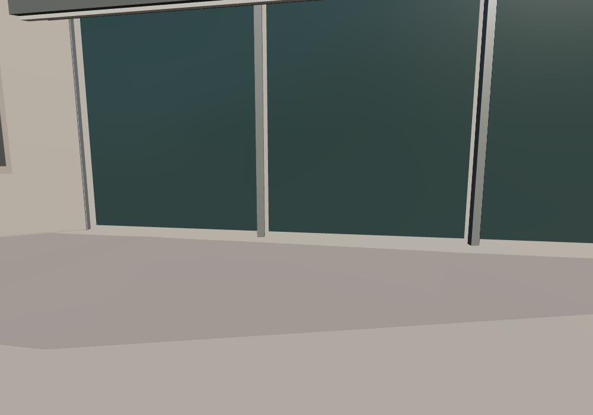
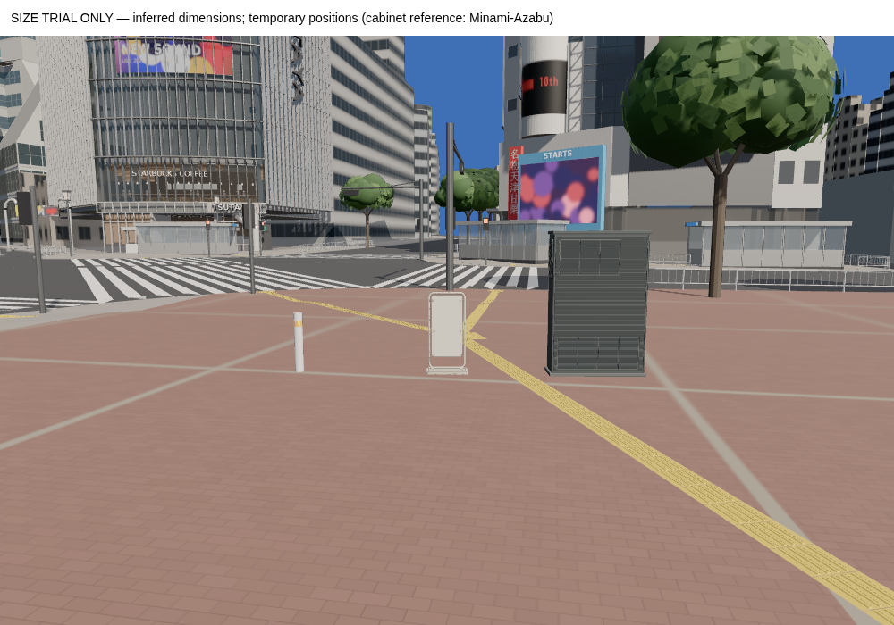

# dots資産の街全体への適合確認（#39・#40）

対象main: `275f832018f1fb8f052c672522f43a86e1fd87fc`。オーナーの「サイズ・配置を試す、微調整は可、建物モデルを丸ごと作り直さない」という指示に基づく検証。

## 結果

西側街区・第一勧銀共同ビル・駅前ビルは、そのままの座標・スケールで全景へ読み込める。交差点からの見た目、周囲との位置関係、店先の衝突を確認した範囲では、建物全体の拡大・縮小・移動を必要とする不具合は見つからなかった。建物・地面・既存街路を含む54 GLBのハッシュを記録し、**資産と本番コードは変更していない**。

これは全域の写真測量精度・入口の通行可能性・全メッシュ間の無衝突を保証するものではない。足元の地面記録との差、既存柵に遮られる経路、未接続の看板は下記に残す。





## 何がmainにあるか

| 資産 | 状態 |
|---|---|
| #40 西側街区・第一勧銀共同ビル・駅前ビル | mainへマージ済み。通常の28建物に含まれる |
| #39 ボラード・自立案内板・設備箱 | mainのincomingに保管済み。通常表示への配置はまだない |
| 添付の4棟画像にある新センター244 | 確認時は未マージの#41、head `cca4895ed063c7ab47c4b6f540d3101045d14265`。今回の街では従来モデルを表示。新モデルの適合確認には含めない |
| #38 props等の基盤 | featureブランチへのマージのみでmain未反映。今回も取り込んでいない |

第一勧銀共同ビルの `signs-2025-01.glb` は存在するが、viewer.jsonのlayersに登録されておらず、全景ではUC塔の広告面が無地になる。写真の1月広告を10月の確定状態として接続していない。既存の西側1月／駅前11月広告は現行表示を記録したもので、単一日の再現ではない。

## 寸法と隣接

実際にブラウザへ読み込まれたオブジェクトを測定。順序は東西幅×南北奥行×高さ。看板・庇等を含む外接寸法で、建築の実測寸法ではない。

| 資産 | 全景での外接寸法（m） | 追加スケール |
|---|---|---|
| 西側街区 | 34.72 × 35.55 × 40.01 | 1,1,1 |
| 第一勧銀共同ビル | 24.58 × 35.45 × 52.31 | 1,1,1 |
| 駅前ビル | 30.11 × 46.46 × 50.40 | 1,1,1 |

3棟同士の外接箱は重ならない。西側街区とquattroは外接箱だけでは重なるが、本体GLBの全三角形を平面へ投影した和集合では重複0㎡、距離11.45m。既存center244とtakagiも同じ検査で重複0㎡、距離4.88m。別広告レイヤーはこの投影検査に含めていない。これを街全体の全メッシュ衝突検査と扱わない。

## 足元と歩行

制作時に記録された地面の座標を、現行のCore・外側道路・DEMへ再照会。全213点で地面に当たるが、以前の記録値との差が残る。

| 資産 | 点数 | 現在T.P. − 記録T.P. |
|---|---|---|
| 西側街区 | 82 | −0.118〜+0.230m |
| 第一勧銀共同ビル | 49 | −0.285〜+0.491m |
| 駅前ビル | 82 | −0.0004〜+0.210m |

これは**地面同士の差**で、すべてが入口の段差やモデルの浮きという意味ではない。屋根とPLATEAU外殻を保つため、建物全体の上下移動はしなかった。地面は推定DEMを含み、今後は入口ごとに局所的な敷居・地面接続を確認する。




現行の歩行処理で9経路を照会。西側・UC・駅前の3店舗方向は各対象のガラス／枠の0.43〜0.56m手前で停止。UC前の道路方向は40m進み、各25cm移動の高さ変化は最大約1.7cm。初回の西側・駅前への経路は地下鉄出入口のパネルに当たっており、建物の不具合と切り分けた。

ゲートへ北向きに直進する2本（plan x=-27, -30）は既存 `street_rail` で停止。新しい西側建物が通路を塞いだわけではないが、**この直進経路は通れない**。実際の通行経路との対応は追加確認が必要。既存の高度な街路モデルを根拠なく移動しない。

## 小物の大きさ試験

既存ローダーでincoming GLBを読み込み、ハチ公側の広場に一時的に並べた。位置はサイズ比較のための試験座標で、写真から求めた実在配置ではない。本番のlayoutや台帳には書き込んでいない。



| 資産 | 読み込んだ寸法（幅×奥行×高さ） |
|---|---|
| 白いボラード | 0.1142 × 0.1142 × 0.800m |
| 自立案内板 | 0.560 × 0.2901 × 1.096m |
| ルーバー設備箱 | 1.280 × 0.441 × 1.920m |

メートル単位・上方向に不整合はなく、中心直下の地面に底を合わせて表示できた。面全体の接地・通行・小物の衝突は本配置時に別途確認する。寸法自体はdotsの推定値。設備箱の参考写真は港区南麻布であり、渋谷への配置根拠にはしない。写真等の出典は各incoming READMEとspecを維持する。

## 検証と再実行

- `npm test`: 36ファイル・145テスト成功。
- `npm run build`: sync-assets・型検査・Viteビルド成功。
- 全28建物、Core、外側道路、DEM、街路、背景の読み込み成功。失敗資産・看板読み込みエラー・ブラウザエラーなし。
- 通常の昼夜・全景・近景と小物試験で13画像を保存。SwiftShaderのため実機FPSは測っていない。
- `input-manifest.json`: 対象mainと54 GLBのSHA-256。
- `scene-fit.json`: 初回の全景・低い頂点・地面照会・小物試験。
- `followup/scene-fit.json`: 9歩行経路、停止対象のメッシュ名、足元の再確認。低い頂点の差には壁の目地やガラス下端も含まれるので、最大値を「建物の浮き」と解釈しない。
- `projected-footprints.json`: 外接箱が重なる2組の本体メッシュ投影結果。

```sh
npm run build
npx vite --host 127.0.0.1 --port 5230 --strictPort
# 別ターミナル。ブラウザは順番に実行する。
VIEWS=entry,entry_night,west_eye,gate node scripts/capture-review.mjs http://127.0.0.1:5230 evidence/dots-scene-fit/current
node scripts/check-dots-scene-fit.mjs http://127.0.0.1:5230 evidence/dots-scene-fit
VIEWS=west_base,uc_base node scripts/check-dots-scene-fit.mjs http://127.0.0.1:5230 evidence/dots-scene-fit/followup
```

検証スクリプトはPlaywrightのレスポンスに読み取り用の参照を追加し、実際のシーンへアクセスする。本番srcには追加しない。小物の仮配置もブラウザを閉じれば消える。

次は#41のセンター244と#38の基盤の統合状況を確認し、既存モデルを保ったまま、看板の年代選択・入口の局所接続・実在小物の配置へ進める。
