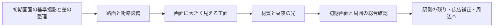

# 初期画面とスクランブル交差点を先に仕上げる設計

2026-10-13。PR #18マージ後のmainを基準にする。オーナーの「最初に画面が映るので重要」という指示を受け、施設を順に追加する進め方から、初期画面に見える差を先に減らす進め方へ変更する。今回は設計資料だけで、カメラ・モデル・材質・通常表示は変更していない。

## 1. 到達点と対象範囲

最初に開いた交差点の画面と、その直後に左右を見たり歩いたりした範囲で、目立つ欠落・形の間違い・浮き・二重表示をなくす。B資産があることやテスト成功を、写真品質の完成と同一視しない。

- **最優先**：通常URLの初期画面に見える路面、横断歩道、信号、柵、樹木、地下鉄出入口、建物の正面と輪郭。
- **同時に守る範囲**：同じ位置から左右約30度を見た画面、および交差点の歩道側から見る歩行視点。初期画面だけよく見える書き割りにしない。
- **次の範囲**：初期画面に小さく写る遠景、駅側の奥や内部。JR施設候補bldg_d7fb4726は台帳に残すが、初期画面の不具合より先に進めない。ただしこの施設が初期画面の大きな欠落を生むと実画像で分かれば、見える面だけを優先対象へ繰り上げる。
- **継続して後工程**：広告画像の切り貼り・割り付け補正、西武A館の再開、周辺拡張、人・車・ゲーム。初期画面に見える看板の枠・大きさ・取付位置は先に補正し、広告内容の補正とは分ける。

年代は既存決定の2025年、駅前は2025年10月を維持する。別月・別年の写真は構造の補助資料として区別し、10月を確認した根拠にしない。

## 2. 初期カメラを確認して固定する

現在の通常表示はsrc/main.tsでQFRONTを選び、ViewerControls.frameBuilding()でarcMid/arcNormalから位置・注視点を決める俯瞰。既定の垂直画角は55度。これはQ032の写真合わせや歩行モードとは別で、初期画面の写真一致は未検証。モデルのhint変更でも構図が動き得る。

最初の実装作業で実際の通常URLを撮り、カメラ座標・注視点・画角・画面寸法・時刻・品質・コミット・資産一覧を記録する。この実値を比較の基準にする。初期カメラ自体の変更は必要性を実画像で判断し、変更するなら独立した比較で扱う。構図を変えて不具合を画面外へ隠さない。

| 視点 | 用途 | 設計上の撮影条件 |
|---|---|---|
| ENTRY | 利用者が最初に見る画面 | パラメータなしの通常URL、既定品質・既定時刻。実値を記録 |
| ENTRY-L / R | 画面端と隣接面の破綻 | ENTRYと同じ位置・画角で視線を左右約30度回す。確定した座標を保存 |
| WALK | 路面・設備・接地 | 歩道上でC2a地面+目線1.6 m。最初の撮影で位置を決めて保存 |
| M027ほか既存写真視点 | 実物との照合 | 既存のカメラを使う。写真とモデルの対応・残るカメラ誤差を記録 |

ENTRYを昼夜、横長1440×900と縦長390×844で確認する。L/R/WALKはまず横長・昼を基準にし、照明変更時は夜も追加。これは品質確認用の画面寸法で、モバイル対応完了を意味しない。写真比較は元写真に対応する画面比率・投影で別に撮る。

## 3. 実装の順序とPRの切り方

| 段階 | 制作内容 | 完了を判断する証拠 |
|---|---|---|
| P0 基準 | 通常表示を撮影し、目立つ差を場所・対象ID・参考写真・影響する視点とともに短い一覧にする | ENTRY昼夜、左右、歩行の基準画像。各項目を「実装の差／カメラの差／根拠不足」に分ける |
| P1 路面・設備 | 斜め横断歩道2本の有無を現行データと写真で確認。縞・端・縁石の接続、信号の位置と向き、柵の過剰区間、樹冠の輪郭と数、出入口の向きを順に補正 | 一項目ごとの同一カメラ前後画像と根拠。路面の重なり・浮き、設備の遮蔽を歩行視点でも確認 |
| P2 正面 | P0で大きな差が見つかった面から修正。候補はQFRONT、MAGNET、栄楽ビル、西側街区、渋谷駅前ビル、駅連絡通路。高さ・輪郭・角・窓割り・1階・看板の枠を優先 | 写真との輪郭・開口位置の対応、地面照会と屋根差、Cとの重複がないこと。単なる資産追加件数では評価しない |
| P3 材質・光 | 大きな形を固定してからガラス、壁、道路、店・看板の発光を順に調整。照明器具の自発光と路面・壁への配光を区別 | 昼夜別の同一カメラ比較。局所の改善が他の面を悪化させていないこと。夜の路面発光0.5の扱いを独立して比較 |
| P4 総合確認 | ENTRYの昼夜・縦横、左右と歩行、既存Core視点で回帰確認。残る差を一覧にまとめる | 読込失敗・ブラウザエラー・二重表示がなく、目立つ差を修正または未達として説明。予算チェックと節目のオーナーPC計測 |

P0を長い調査だけのPRにしない。次の実装PRでは基準撮影と、最も目立つ一つの補正を合わせる。2本目の斜め横断歩道が本当に欠けていれば第一候補にする。既にあるなら、確認した信号の向きや路面の接続などの差を選ぶ。過去の未達を現行実装の事実と決めつけない。

P1/P2は全対象を一度に変更せず、路面、信号、柵、樹木、正面ごとに小さく区切る。各PRで実装、資産と証拠、資料を別コミットにし、通常表示の改善を画像付きで報告する。P3も露出と材質と光を同時に変えない。

## 4. 優先度と確認方法

優先度は、(1) 明らかな欠落・誤形状・浮き・二重表示、(2) 初期画面で大きく見える輪郭・前景・ランドマーク、(3) 左右や歩行で見える破綻、(4) 色や細部、の順とする。奥のホーム内部や細かい葉より、交差点の白線・信号・主要正面を先に直す。P0の実画像で順序を決め、未測定の画面占有率を点数として捏造しない。

比較は二種類を区別する。

1. **変更前と変更後**：完全に同じカメラ・画面寸法・時刻・品質で撮る。変えた項目と改善・悪化を説明する。
2. **写真とモデル**：同じ撮影カメラに対応する既存視点で比べる。ENTRYに一致する写真がない場合、ENTRYの画像を写真一致の証拠にしない。M027などで形の根拠を確認し、ENTRYで通常表示への効果を見る。Q032の2018年写真は形の補助に限定し、2025年の広告や駅前の根拠にしない。

校正済み視点では対応点のずれや輪郭、材質別の明るさを既存の道具で記録する。未校正の写真は種類・本数・前後関係・輪郭の補助に使い、画素差を位置精度として扱わない。差は画面寸法・対応点・測定方法と一緒に示し、異なる写真の点数を混ぜない。新しい一律の誤差閾値だけで完成を認定しない。

既存のcapture-look.mjs、capture-street-fix.mjs、look-metrics.py、?pose、?pass=classを再利用する。基準保存に必要な最小の拡張は可能だが、新しい監査基盤やカメラ校正を作業の中心にしない。存在が明らかな物は規則・標準寸法で通常表示へ作り、推定と根拠不足は台帳へ残して比較で直す。

## 5. 完成扱いにする条件と残す課題

- 主要な横断歩道、信号、前景の設備と正面に目立つ欠落や誤形状がなく、左右・歩行でも浮き・欠け・重複がないことを画像で示す。
- 初期画面の優先課題が未修正のまま、駅側の制作棟数だけを根拠に初期画面完成としない。根拠不足の項目は「未確認」として残す。
- 写真品質は建物・面・視点ごとに確認する。全体平均の色だけで合格にしない。広告内容を後工程に残す間は、初期画面全体を完全再現と表現しない。
- 通常表示と資産読込の成功状態を確認する。変更に対応する既存テスト・型チェック・ビルド・予算確認を行い、必要な形状の回帰だけを追加する。
- 三角形・描画単位・容量は現行budget.tsの予算内を維持する。FPSや体感はクラウドで保証せず、P4の節目にオーナーPCの?bench=autoで確認する。
- 写真・素材の出典、撮影日、ライセンスを保存し、看板は別レイヤーを維持する。Street Viewをテクスチャに使わない。

この設計で初期画面の優先度を上げる。残るJR施設、駅側試作の高さ・接地・内部、広告補正などは削除せず、初期画面を仕上げた後の一覧に維持する。
