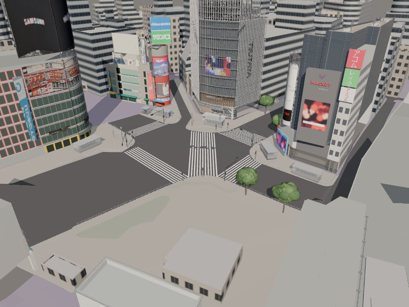

# 初期画面周辺で、既存の高度な制作以外に残る候補

2026-10-13、PR #18マージ後main（e6c5727）を調査。オーナーから、QFRONT・西武・交差点付近の信号・樹木・出入口はClaudeが高度に仕上げているとの説明を受けた。この説明を制作方針の前提とし、それらを再制作対象から外す。

## 調査の範囲と確度

src/main.tsの通常ロード一覧、assets/buildingsの独立資産、context_input.jsonの実収録ID、select_context.pyの除外ID、ASSET_REGISTER_V2.csv、街路・地面の生成コードを照合した。古いVISIBLE_GAPS.mdの「未着手」だけで判断していない。実装や新しい撮影はしていない。

このcheckoutのmainでは西武の独立資産が通常ロード一覧にない。高度な成果が別ブランチ・別環境にある可能性があり、その成果が未制作であるとは判断しない。既存成果の所在・通常表示への統合は確認課題として分離する。旧リポジトリやClaudeの作業は変更しない。

候補の順位は、既存Core視点の可視性と個別資産の有無に基づく暫定順位。初期カメラの画面占有率はまだ測っていないため、初期画面で最も大きいと断定しない。

## 次に制作する候補

| 優先 | 対象 | 現行mainで確認した状態 | 制作する内容 |
|---|---|---|---|
| 1 | センター244ビル way/136691379、渋谷平和クワトロビル way/136691389 | 両方ともcontext_inputに収録され、独立資産・C除外がない。制作済みwest-blockは別IDのway/136690966だけ | 共通窓柄を個別の外壁・窓割り・1階店舗・看板枠へ置換。PLATEAUと写真で面の所属を確認し、west-blockの看板と二重に作らない |
| 2 | 渋谷第一勧銀共同ビル way/114755219 | contextの簡略モデル。独立資産なし | 道玄坂側の正面・輪郭・店舗と看板支持物。初期画面に見える面の大きさを確認して1との順位を決める |
| 3 | スクランブルスクエア way/617560918、フクラス way/55588118 | contextに実収録、共通材質、独立資産なし | 高さ・輪郭を保持して固有のガラス帯、外装の分割、上部の特徴を再現。全内部や細かい窓の立体化は後回し |
| 4 | ハチ公広場の小施設と広場の仕上げ | 売店候補way/155538676は台帳にあるが独立資産なし。街路の生成対象は出入口・樹木・信号・街灯・標識と柵で、広場の像・ベンチ等の専用制作は確認できない | 2025年10月の存在・位置を確認したハチ公像と台座、ベンチ、案内板、植え込み、売店・交番の外観。bldg_5369333eの既存小施設を交番と断定せず、重複を避ける |
| 5 | 歩道・広場の仕上げ | 地面コードは道路・歩道・縁石・横断歩道・補填面。街路設備以外の歩道点字誘導・排水溝・マンホール・舗装割りの専用制作は確認できない | 初期画面と歩行視点で見える舗装の切替、点字誘導、排水、段差のつながり。白線・信号・樹木・出入口の高度な既存成果は維持 |

センター244とクワトロの可視視点数は台帳で4と2、最大可視面積比は0.00556と0.00545。これは既存7視点の評価値で、初期画面の占有率ではない。ランドマークの知名度だけで、映らない細部を先に制作しない。

マークシティEAST、ヒカリエ、サクラステージも個別資産がなく候補になる。ただし台帳のsource_idそのままではcontext_inputに見つからないため、PLATEAU IDとの対応・他の無名モデルによる収録・現在の表示範囲を調べてから「欠落」と判断する。特にマークシティEASTは台帳のgeometry_v2がosm_prismで、PLATEAUだけのcontext生成へ入らない可能性がある。

JR施設bldg_d7fb4726、駅側の試作の接地・床高・光量は引き続き残るが、初期画面に見える不足の補正後に進める。広告画像の切り貼り補正、人・車・ゲームも後工程を維持する。

## 実装後の更新

広場舗装の三角形重心による段状境界を、元の面の高さを保った分割へ変更。`C2_PAVING_BOUNDARY_REPORT.md`。実際の境界位置・全区画の照合、点字・排水・広場設備は引き続き未達。

ハチ公広場の赤茶色舗装と淡い区画線を材質の試作として追加。結果は`C2_PLAZA_PAVING_REPORT.md`。元の地面・北側舗装と既存設備を保全。寸法・境界・10月の全区画、像・台座・ベンチ・案内板・点字・排水は引き続き未達。

北側歩道の平板舗装を材質の試作として追加した。結果は`C2_NORTH_PAVING_REPORT.md`。台帳・地面形状を保全し、点字誘導・排水・マンホール・広場の別舗装と、実際の割付け照合は引き続き未達。

初期画面の基準撮影で2棟の遮蔽を確認し、第一勧銀共同ビルを先行して個別B試作へ置換した。結果は`C1_DAIICHI_KANGIN_REPORT.md`。上の表は調査時点の候補記録で、第一勧銀共同ビルの「独立資産なし」は実装前の状態。残る候補を左右・歩行の見え方も含めて再評価する。

## 最初の制作単位（設計時の候補）

**センター街入口の未制作2棟のうち、初期画面に大きく見える一棟の正面を個別B化する**ことを第一候補とする。着手時に通常URLの基準画像を撮り、2棟・第一勧銀共同ビルの見える面と既存west-blockとの境界を確認する。画面への影響が小さければ、スクランブルスクエア等の実際に目立つ面へ順位を入れ替える。

作る→既存の同じカメラで比較→一項目ずつ修正を続ける。高度な既存資産は回帰確認対象として固定し、共通露出・光の変更が既存の仕上がりを悪化させないことを確認する。

この画像はmainへ入った既存の俯瞰記録。QFRONTや信号の再制作の根拠ではなく、周囲に共通窓柄の簡略モデルや単純な広場面が残ることを確認する補助に使う。Claudeの別環境の最新成果まで写っているとは扱わない。
