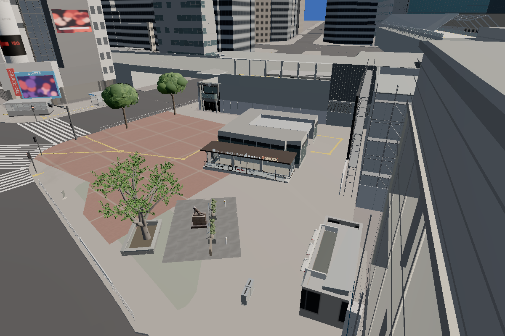

# ハチ公周辺：保留していた形状・接続の実装

PR #86 のマージ後 `51732e6` を基準に、確認用だったA8・駅ルーバー・白柵・誘導線を通常表示へ採用した。石囲いの背面、屋根接合、柵の端部、局所縁石、誘導線の接続も形状として実装した。今回対象の実装保留・確認用限定配置はない。未測量値を確定値に変更したのではなく、既存シーンと資料からの推定復元を通常採用している。

## 対象別の結果

| 対象 | 通常表示での実装 | 基準・推定調整 |
| --- | --- | --- |
| 宝くじ v002 | PR86の3窓正面・細い2脚を保持 | 中心 `(10.900,-61.550)`、187°、原点T.P.15.626216m。今回GLB変更なし。 |
| A8 | 入口シェル、屋根の補完面、左右・背面の接合材 | 中心 `(35.25,-47.00)`、8.3°、原点T.P.15.144106m、均等倍率1。既存屋根 Web up4.60mに対し補完屋根4.04m、左右厚0.08m・背面厚0.16mの接合材。北側既存屋根・残る側面を保持。 |
| 駅ルーバー | 面01に2×4ベイ、下部エプロン、背板、側部と上端の閉じ材 | 中心 `(51.173,-55.148)`、−84.073°、底T.P.18m、均等0.6倍。面01の法線・幅を基準に、幅約10.14mの局所外装で既存縦桟を覆う。他13面・共用鋼材は保持。機器の正確な位置と取付高さは推定。 |
| 大木・石囲い | 採用済みの大木を保持し、4辺の石壁と連続した土面を追加 | 幹 `(7.4,-45.5)`、35°。正面長4.6m、壁厚0.24m、高さ0.50m、正面オフセット−0.95m、背面+1.65m。背面・側面は幹と既存空地に合わせた矩形の推定復元。別の6樹木、像側の植栽・石縁は変更なし。 |
| 白柵 | 既存支柱間4区間、5本の支柱カバー、継ぎ板、閉じた端部 | 既存道路柵の区間2〜6、端点 `(1.530400,-48.028065)` → `(3.695200,-40.806198)`、長7.539344m、73.313567°。梁中心は各地点の地面+0.78m、梁高0.28m。下側既存柵と当たり判定を保持。0.57m切片の反復ではない。 |
| 舗装 | PR86の局所扇形敷石を保持 | 既存plaza-finishと同一の頂点位置・標高。地面全体の高さや道路網を変更しない。 |
| 縁石 | A8左右側壁の足元に各5.4mの低い縁石 | 幅0.16m、最大段差0.06m、入口側端部は0.03m。各ブロックを地面へ埋め込み、入口正面を横断する部材は設けない。位置と断面は既存側壁・歩道からの推定。 |
| 誘導ブロック | 既存の広場南端からA8前まで接続、各曲がり角と終端に警告面 | 約51.757m。既存端→北側空地→低層施設の東側→南側→A8前。幅0.3m、凹凸5mm、警告面0.6m角。案内経路は建物と歩道からの推定で、現地全経路の実測値ではない。 |

plan座標は東・北、Web高さはT.P.−15m。全GLBは変換適用済みで、読込後の二重変換はない。詳細な座標と代表接地点は `assets/street/hachiko-fit/web/*.json`、入力・出力ハッシュは同フォルダの `manifest.json` に記録した。

誘導線の折点は `(23.238174,-33.911884)`、`(23.688005,-35.963142)`、`(44,-35.963142)`、`(44,-55.028770)`、`(36.420898,-55.028770)`、`(36.031139,-52.357048)`。始点は既存最終タイルの中心＋進行方向0.15mから算出し、最初の2.1mは同じ方向を保つ。警告面と線形部はポリゴンを切り分け、同じ高さの二重面を作らない。

## 画像比較と修正

先にA8を実装・撮影した。上面確認で残る屋根内側の隙間を発見したため、屋根面を補完した。その後、全周囲い・ルーバー取付部・4区間の柵・接続経路・縁石を追加した。誘導線は初回案の始点の小さな折れを修正し、土面は箱の継ぎ目が見える方式から連続面へ変更した。

比較はPR86に保存済みの同一カメラ画像を再利用し、最終buildの通常表示を撮影した。旧 `normal` はPR86通常表示、旧 `before` は施設原形、旧 `preview` はPR86確認案。今回追加した上面・背面は接合確認のための追加視点である。

| 対象 | 前 | 後（すべて通常表示） |
| --- | --- | --- |
| 全景 | [PR86通常](../../evidence/hachiko-fit-20261017/normal/fit_overview.png) | [全景](../../evidence/hachiko-complete-20261017/normal/fit_overview.png) |
| A8正面 | [原形](../../evidence/hachiko-fit-20261017/before/fit_a8_front.png) | [正面](../../evidence/hachiko-complete-20261017/normal/fit_a8_front.png) |
| A8斜め | [確認案](../../evidence/hachiko-fit-20261017/preview/fit_a8_oblique.png) | [斜め](../../evidence/hachiko-complete-20261017/normal/fit_a8_oblique.png) |
| 屋根接合 | [補完前の試行](../../evidence/hachiko-complete-20261017/all-step/fit_a8_roof.png) | [補完後](../../evidence/hachiko-complete-20261017/normal/fit_a8_roof.png) |
| A8足元・縁石 | [確認案](../../evidence/hachiko-fit-20261017/preview/fit_a8_feet.png) | [足元](../../evidence/hachiko-complete-20261017/normal/fit_a8_feet.png) |
| ルーバー | [確認案](../../evidence/hachiko-fit-20261017/preview/fit_louvre_front.png) | [正面](../../evidence/hachiko-complete-20261017/normal/fit_louvre_front.png)、[斜め](../../evidence/hachiko-complete-20261017/normal/fit_louvre_oblique.png) |
| 石囲い | [PR86正面側だけ](../../evidence/hachiko-fit-20261017/normal/fit_enclosure.png) | [正面](../../evidence/hachiko-complete-20261017/normal/fit_enclosure.png)、[背面](../../evidence/hachiko-complete-20261017/normal/fit_tree_back.png)、[接地](../../evidence/hachiko-complete-20261017/normal/fit_enclosure_feet.png) |
| 柵 | [1区間の確認案](../../evidence/hachiko-fit-20261017/preview/fit_fence.png) | [4区間・端部](../../evidence/hachiko-complete-20261017/normal/fit_fence.png) |
| 誘導線 | [未接続の短い確認案](../../evidence/hachiko-fit-20261017/preview/fit_tactile.png) | [入口前](../../evidence/hachiko-complete-20261017/normal/fit_tactile.png)、[全経路](../../evidence/hachiko-complete-20261017/normal/fit_route_top.png)、[既存端との接続](../../evidence/hachiko-complete-20261017/normal/fit_route_join.png) |
| 舗装 | [PR86](../../evidence/hachiko-fit-20261017/normal/fit_paving.png) | [保持した舗装](../../evidence/hachiko-complete-20261017/normal/fit_paving.png) |
| 夜 | [PR86](../../evidence/hachiko-fit-20261017/normal/fit_whole_night.png) | [今回](../../evidence/hachiko-complete-20261017/normal/fit_whole_night.png) |

## 根拠・利用範囲

[出典・権利台帳](../../assets/street/hachiko-fit/source/RIGHTS.md)を継続使用する。A8は公式2025年2月案内図・8月外観写真、ルーバーと幹・笠石はJoli Rumiの2025年11月1日写真、白梁・舗石はRuinDig/Yuki Uchidaの2025年7月13日写真。旧報告の候補照合、OSM輪郭、PLATEAU屋根・壁、既存歩道を共通基準にした。新たな資料画素や他地点の形状部品は追加していない。

駅設備と幹の11月資料は目標の2025年10月より後であり、大木の葉には従来の2026年8月資料も併用されている。写真のない背面、屋根接合断面、白梁の区間割当て、誘導経路は今回採用した推定である。推定を理由に表示を止めず、画面注記と座標台帳へ明示した。写真測量や現地寸法確定を達成したという主張ではない。

## 検証

- 最終 `npm test -- --maxWorkers=2 --testTimeout=30000`：**60ファイル・268件通過**。
- `npm run build`：成功。最終PNGはそのbuildをpreview配信して取得。
- 最終通常18・標準品質2・分類2の計22状態で、8部品・大木の読み込み成功、HTTP/JSエラーなし。14組の前後カメラ位置・poseが一致。[検査記録](../../evidence/hachiko-complete-20261017/review.json)。
- [標準品質のルーバー](../../evidence/hachiko-complete-20261017/medium/fit_louvre_front.png)、[標準品質の入口前](../../evidence/hachiko-complete-20261017/medium/fit_tactile.png)、[分類](../../evidence/hachiko-complete-20261017/class/fit_overview.png)も確認。細いルーバーや5mmの誘導突起は距離・解像度によって画素単位の模様となるため、実景の材質再現精度とは分けて評価する。
- 追加回帰：A8屋根の25接点が塞がっていること、幹から32方向で石壁に当たること、既存端との位置・方向一致、経路上0.3m間隔の3高さで既存建物・A8・縁石に干渉しないこと。
- 既存回帰：舗装全頂点・標高、A8北側屋根、限定した可視root切替、読み込み失敗時の原物保持、分類。
- `hachiko-fit`全8GLB：**2,851,700 bytes / 36,255 triangles / 38 primitives**。B上限3,000,000 / 120,000 / 40および全シーン予算を変更せず通過。
- 元の建物・歩道・道路、像・台座・石碑、大木本体、BOX、JR入口、交番、QFRONT・西武の資産に変更なし。歩行処理・FPS処理のソースも変更なし。新しい囲いは既存の障害物登録で判定され、元の出入口等の当たり判定は保持。
- 検証済みローカル資産を再利用。ZIP転送・全CRC・ハッシュ再検証の繰り返しなし。新生成GLB/JSONのmanifestのみ更新。

形状・配置・接続は全対象で実装した。実測との差や非可視面の形は推定としてレビューする。テスト成功を実景との完全一致やオーナーPCでのFPS測定済みとは扱わない。マージ・デプロイは行わない。
