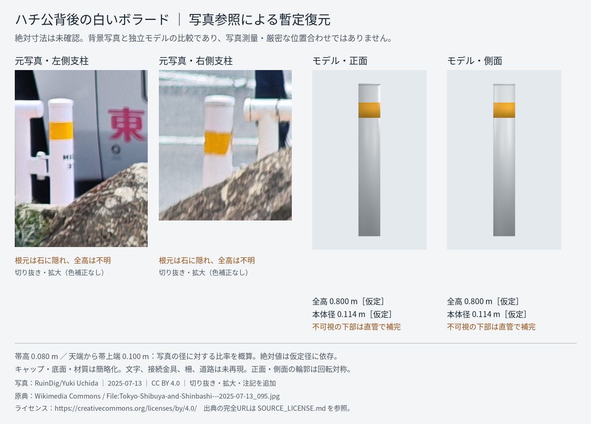

# ハチ公背後の白いボラード: 素材のみの追加

2026-10-14。承認済みの白い円柱＋黄色帯を、Blender 4.2.3 LTSで再生成。形状は変更せず、圧縮した編集用blend、GLB、再生成スクリプト、寸法仕様、検証記録、写真比較を取り込み口へ整理した。

## 範囲

このPRは独立素材だけ。web/・layout・src・既存シーン・配置・既存レールは変更しない。すでにあるハチ公周囲資産の代替や重複配置ではない。配置と2025年10月の現地状態確認は別作業。

写真は2025年7月13日のハチ公背後、RuinDig/Yuki Uchida、CC BY 4.0。
[原典](https://commons.wikimedia.org/wiki/File:Tokyo-Shibuya-and-Shinbashi---2025-07-13_095.jpg) / [利用条件](https://creativecommons.org/licenses/by/4.0/)。切り抜き・拡大・JPEG再圧縮・注記の加工あり。

## 検証結果

- Blender 4.2.3 LTSによる再生成とGLB再読込を実行。
- 底面中央原点 (0,0,0)、底面 Z=0、外形 0.114200003×0.114200003×0.800000012 m（丸め誤差）。GLBにカメラ・ライトなし。
- incoming正本: 2,676三角形、3メッシュ、3描画プリミティブ、2材質、62,772 bytes。
- PR #38 importerのコピーで検証: 一様倍率1.0、LOD0 2,676/上限3,000、LOD1 669/上限750、prop_furniture_0/1、出力95,720 bytes。寸法不一致・減面警告なし。
- 唯一の警告は「no UVs: textures cannot be used, solid colours only」。写真テクスチャを使わない単色材質のため意図どおり。
- 検証用出力には重なったLOD0/LOD1があるためコミットしない。正本へ再取り込みしない。今後のランタイムは一方のLODだけを選択する必要がある。
- 全体のnpm test/typecheck/buildは完全なリポジトリ・依存環境がないため未実行。シーン表示、配置、FPSの合格は主張しない。

## 見た目と未達

写真に見える白い円柱と黄色帯を保持。固定正投影の正面・側面で再描画した。回転対称なので両面の輪郭は同じ。比較画像は位置合わせしたシーンの前後比較ではない。

全高0.800 mと本体径0.114 mは実測・メーカー値ではなく仮定。帯の比率も画素の概算で、絶対値は仮定径に依存する。不可視の下部は直管で補完、基礎・固定方法は不明。キャップ・塗装・帯の反射特性は近似。文字・接続金具・柵・傷・汚れは未再現。7月資料を10月の確認済み資料とは扱わない。

## 再現・依存

[README](../../assets/street/props/incoming/hachiko_white_bollard/README.md) にポータブルな再生成・検証コマンドを記載。
[出典](../../assets/street/props/incoming/hachiko_white_bollard/SOURCE_LICENSE.md) と source/data/specs/hachiko_white_bollard.json に推定と素材条件を記録。

tools/props/import_prop.py は PR #38 の依存。このPRにはコードを重複追加しない。main に存在しない場合はPR #38由来の版が必要。検証したファイルのSHA-256は検証環境記録を参照。元の承認済み出力は変更していない。
