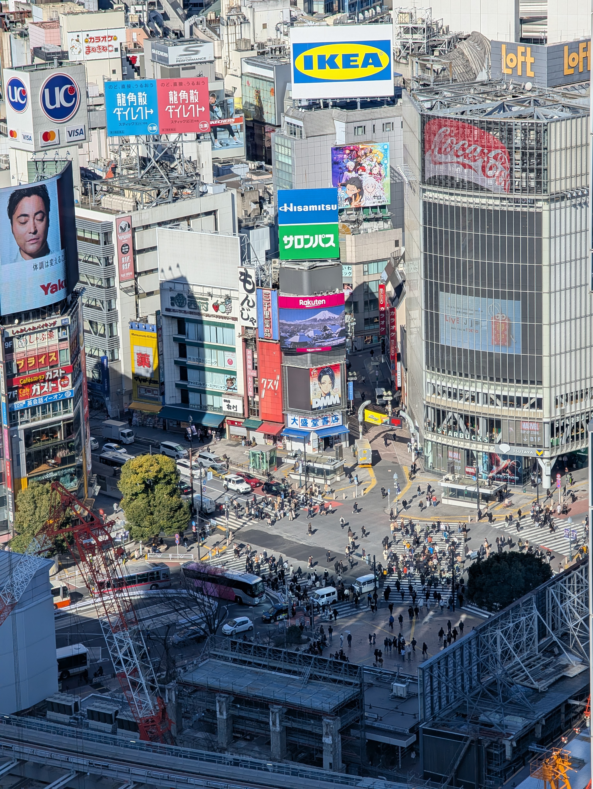
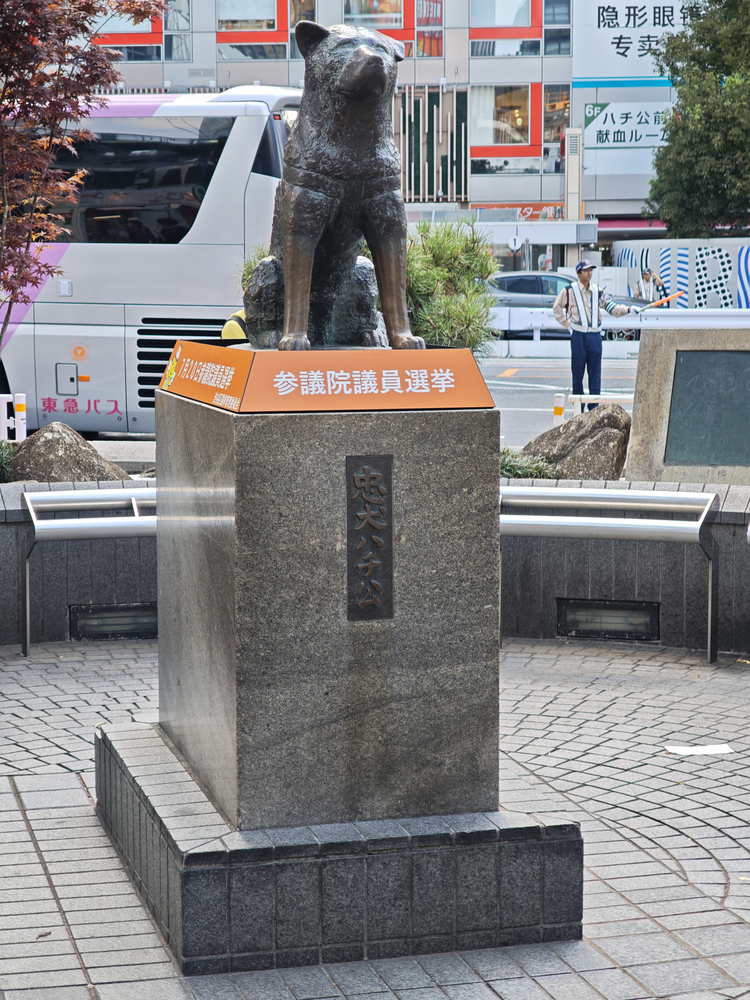
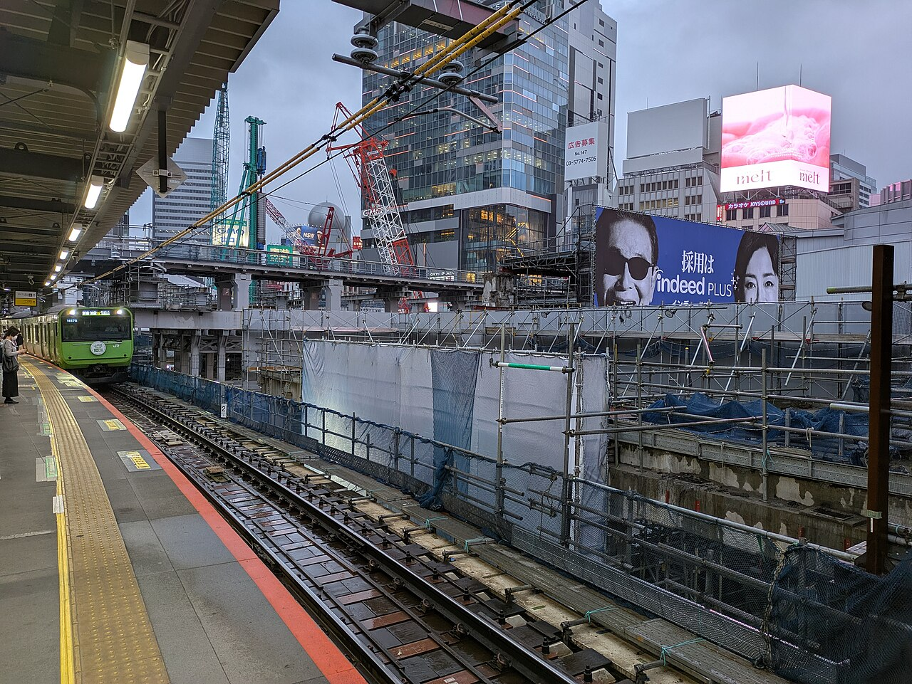

# 渋谷の外観写真 → 必要部品 → BlenderKit候補

調査日: 2026-10-15（日本時間）。基準main `c854530`。内装・人物・車両・建物丸ごとの置換は対象外。既存の公開Webビューアーの画像、生成コード、2025年の写真8枚を照合し、**24部位の判断表、候補8素材と具体的な改変方法**をまとめた。

今回行ったのは調査・選定。モデルの購入・ダウンロード・Blenderへのインポート・形状変更・街への配置はまだ行っていない。素材のプレビューは実際に目視したが、トポロジーやGLB変換の可否を実モデルで検証したという意味ではない。

## 結論と着手順

1. **ハチ公周辺の自然石の輪郭**：写真と現モデルの差が読みやすい。BK08の石から近いものを選び、既存の石だけを局所置換/変形する試作が第一候補。像・樹木・石縁・銀色レールは保全。
2. **駅側の足場と養生の細部**：10月写真があり重要。ただし適切な無料CC0の完成品は今回の検索範囲で見つからない。既存の足場生成器にクランプ・端部・シートの折れを追加する方が適切。BlenderKitを使うこと自体を目的にしない。
3. **屋上の空調設備**：BK01が形の出発点になる。1月の駅屋根に見える設備と、10月の工事状態を混同しない。10月の同じ屋根区画を確認できるまで配置は保留。
4. **配管・雨樋・換気口**：適合する素材はあるが、今回の写真では取り付け面/端点の確認が不足。先に置かず、対応する写真と建物を確定してから使う。

「調べれば全部BlenderKitで埋められる」という結果ではない。すでに作られている屋上枠・庇・投光器も多く、単純な金具は既存生成器の修正の方が軽く、正確に作れる。

## 目視した写真8枚

既存リポジトリへ収録済みのCommons写真を再調査した。新しい撮影や新規の現地測量はしていない。ファイル名に建物名があっても、その建物単独の写真とは扱わない。特にbic-cameraのreference.jpgは交差点の広角写真。

|ID|写真・出典|撮影時期/作者/条件|読み取ったこと・限界|
|---|---|---|---|
|P01|[Streamからの高所写真](https://commons.wikimedia.org/wiki/File:Shibuya_crossing,_seen_from_Shibuya_Stream.jpg) / `assets/buildings/bic-camera/source/refs/reference.jpg`|2025-01-31、Syced、CC0|看板の支持架構・灯具、駅側屋根のファン付き設備。個々の用途/メーカー/10月存続は未確定|
|P02|[12214](https://commons.wikimedia.org/wiki/File:Shibuya_crossing_(12214).jpg) / `docs/core/building_refs/crossing_12214.jpg`|2025-02-07、Syced、CC0|店舗庇と街路の位置関係、駅側屋根の設備。屋根形状が10月と同一とは限らない|
|P03|[M027](https://commons.wikimedia.org/wiki/File:Shibuya_Crossing_20250901_131850.jpg) / `assets/buildings/magnet/source/refs/raw/M027.jpg`|2025-09-01、Taufik、CC0|MAGNET屋上アンテナ/灯具・看板支持。保全対象の既存モデルにすでに多く含まれる|
|P04|[July095](https://commons.wikimedia.org/wiki/File:Tokyo-Shibuya-and-Shinbashi---2025-07-13_095.jpg) / `assets/street/hachiko/source/refs/july095.jpg`|2025-07-13、RuinDig/Yuki Uchida、CC BY 4.0|像周辺の角張った自然石、針状に見える葉、石縁の横長埋込器具、銀色レール。選挙掲示は季節物で不採用|
|P05|[駅周辺10月11日](https://commons.wikimedia.org/wiki/File:渋谷区_渋谷駅_東急東横デパート撤去後_20251011.jpg) / `docs/core/building_refs/station_oct2025.jpg`|2025-10-11、Mikagekawase、CC BY 4.0|外部工事の単管・クランプ・白い養生・青系ネット・梁。ホームからの写真なので交差点から見える範囲を別に絞る|
|P06|SC04 / `docs/core/station_glazing_refs/oct2025_6646.jpg`|2025-10-10、ウィ貴公子、CC BY-SA 4.0|交差点から見た駅の外壁/ガラス帯・工事境界・掲示板。暗部の小設備の型番や寸法は読めない|
|P07|SC05 / `docs/core/station_glazing_refs/oct2025_8427.jpg`|2025-10-18、ウィ貴公子、CC BY-SA 4.0|別角度のコンコース外壁分割・下部通路・駅側境界。室内の家具は調査/制作対象外|
|P08|[Joli Rumiの交差点](https://commons.wikimedia.org/wiki/File:Shibuya_crossing,_Tokyo,_Japan.jpg) / `docs/core/building_refs/crossing_joli_2025.jpg`|2025-11-01、Joli Rumi、CC BY-SA 4.0|駅前ビルの広告上端の投光器、店舗庇、周辺との見え方。11月広告を10月状態とはしない|

P06/P07の原典URL・作者・ライセンスURL・ハッシュは [SOURCE.json](../station_glazing_refs/SOURCE.json)。そのほかの既存出典は `building_refs/REFERENCE_REGISTER.csv`、各資産のrefs、白ポストの `SOURCE_LICENSE.md` にある。写真を新しいモデルのテクスチャへ転用したり、再ライセンスしたりしていない。

## 必要部品・既存実装との対応（24部位）

「改良候補」は既存あり、「保留」は写真による設置場所/形の確定が不足、「保全」は重複追加しない対象。写真に写るだけで現在のモデルに欠落すると断定しない。

|ID/優先|場所と部品|写真での根拠|現状・判断|BlenderKit/変更方針|
|---|---|---|---|---|
|E01 高|ハチ公周囲の自然石|P04左右の石の角・割れ面|既存は丸い近似形が目立つ。改良候補|BK08。近い石を1〜2種選び、比率/下面/向きを修正|
|E02 高|ハチ公周囲の低木|P04針状の葉と不規則な枝|既存葉束は簡略形。改良候補|検索の広葉樹Shrubは不採用。既存の枝/葉束を調整|
|E03 中|石縁の埋込灯具らしき横長器具|P04石縁正面下部|既存に非発光の器具あり。細部改善候補|横長枠とスリットを局所制作。屋内ダウンライトは不採用。発光量は未確定|
|E04 中|像の台座・石縁の石肌|P04粒と目地|既存あり。材質改善候補|granite材料検索は予備候補。色/粒径を調整し焼き付け。銘文は既存を保持|
|E05 高|駅側足場のクランプ/管端|P05直交管の結合|station-serviceに足場の骨組みあり。改良候補|今回のCC0検索に適合品なし。既存生成器へ円管と接合金具を追加|
|E06 高|駅側の養生シート|P05白い幕、P06工事境界|既存に平面の養生あり。改良候補|写真の端/折れ/固定点を局所制作。全体の布シミュレーション不要|
|E07 中|駅側の防護ネット|P05青系ネット|既存安全帯の簡略表現からの改善候補|BK07の金網は材質/目が違う。布ネットを軽い面＋アルファで作る方が適切|
|E08 中|足場床板・幅木|P05梁と足場の縁|既存の床/梁との所属確認が必要|個別寸法の薄板を追加する案。汎用桟橋は不採用|
|E09 中|駅コンコース外壁の桟・柱脚|P06/P07外装の分割と地上部|既存外装あり。寸法・接合の改善候補|専用の枠を既存メッシュへ追加。家具・内装は不要|
|E10 中|駅側屋根のファン付き設備|P01/P02下部の屋根|種類は見えるが1〜2月資料。10月の屋根区画との対応は保留|BK01。ファン数・胴体長・支持脚を変更する候補|
|E11 中|西側街区屋上の箱状設備|P01第一勧銀周辺|第一勧銀にすでに屋上の箱を生成。既存を精緻化する余地はあるが用途照合は保留|BK01/BK02を候補にする。既存箱の横へ新しい箱を重ねない|
|E12 低|外壁の小型室外機|今回の8枚では取り付け面を確定できず|保留。前段の一般候補を設置確定としない|BK02の形は利用可能だが、写真追加が先|
|E13 低|屋上の曲がり排気口|今回の8枚ではBK03型を明瞭に同定できず|保留|BK03。存在が分かる写真を得てから曲率/高さを調整|
|E14 低|外壁・屋根の角ダクト|狭い隙間の暗部は用途不明|保留|BK04。端点が決まってから断面と曲がりを再構成|
|E15 低|雨樋/縦管|今回の8枚では経路を確定できず|保留|BK05の縦管/肘だけ使える。住宅用の軒樋セットをビルへ丸ごと置かない|
|E16 低|屋外設備盤|人・車で根元が隠れ同定不足|保留。南麻布の盤を渋谷へ流用しない|BK06は壁掛け形。地上大型盤へ拡大するだけでは不適合|
|E17 保全|MAGNET屋上アンテナ・設備|P03|build_magnet.pyにアンテナとplantあり|追加不要。見える部位の不足が示された場合だけ局所修正|
|E18 保全|第一勧銀の看板架構|P01/P02|筋交いと支持脚はdots制作済み|汎用トラスで置き換えない|
|E19 保全|第一勧銀の看板投光器|P01|build_daiichi_fidelity.pyに投光器アーム/面あり|追加不要。照射や細部は別課題|
|E20 保全|駅前ビルの広告上端灯具|P08|現行Web撮影でも灯具列が見える|屋内用Double spot lightは不採用。二重追加しない|
|E21 保全|西側店舗の庇・腕金|P01/P02|#40以降で庇/支持を修正済み|汎用awningを置き換えに使わない|
|E22 保全|像両側の銀色レール|P04|hachiko-surroundに既存2区間あり|汎用ベンチ/金網柵では形が合わない。終端不足だけ局所制作|
|E23 保全|白黄ポスト・掲示板・コーン|P04/P06|#58で計6点を配置済み|BlenderKitで再制作不要。写真座標の精度向上は別作業|
|E24 中|舗装の目地・敷設方向|P04とP02、地上Web画像|地面/点字は既存あり。局所材質の改善候補|paving材料検索は予備。写真と異なる石のパターンは使わず、歩行面を動かさない|

### 既存実装を確認した場所

- `assets/buildings/magnet/source/blender/build_magnet.py`: `06_ROOFTOP`、アンテナとplant。
- `assets/buildings/daiichi-kangin/source/blender/build_daiichi_fidelity.py`: 屋上箱・看板架構・投光器。
- `assets/buildings/station-service/source/blender/build_station_service.py`: `ss_scaffold`、床板、筋交い、白い囲い。
- `assets/buildings/station-concourse/source/blender/build_station_concourse.py`: 10月参考の養生/足場。
- `assets/street/hachiko-surround/README.md`: 低木・自然石・金属レール・非発光器具の推定範囲。
- `evidence/dots-placement-57/` と `/workspace/dots-buildings57-review/` の現行街画像を補助に使用。後者の撮影時点は#58後、建物を再制作していない。

## BlenderKit候補8点と形の変更

以下は公式検索APIで **isFree=true / license=cc_zero** を確認し、各ページHTTP200とプレビュー画像を確認したもの。無改造で写真に一致する採用品はない。対象部位が保留ならモデルの取得を急がない。APIのface数は三角形数と同じではなく、サイズもカタログ値で実モデルの測定ではない。

|ID|素材|適用先・改変案|注意|
|---|---|---|---|
|BK01|[Commercial Air Conditioning Unit](https://www.blenderkit.com/asset-gallery-detail/4fef73c7-443c-4114-b2a2-931374e4bdcb/)|E10/E11。上面ファンを分離し、写真の台数に合わせて胴体を短縮/延長。脚高・通気ルーバー・背面配管を局所変更|3ファンのプレビュー。API 4,994 faces、約4.07×2.36×1.67m、4K。縦横一括の非等方拡縮でファンを楕円にしない|
|BK02|[Exterior Aircon Unit](https://www.blenderkit.com/asset-gallery-detail/e2d95d66-39bb-4173-8dd1-193f2ddfdf81/)|E11/E12。複数の状態から1台を選び、脚/金具を交換、錆を抑え、胴体とグリルを別に寸法調整|API render faces 10,906、textureCount16、4K。部品/差分を全部配信せず、不要な画像を統合|
|BK03|[Air Duct Vent](https://www.blenderkit.com/asset-gallery-detail/9c34b364-0584-42ed-af5b-43f5e34e1aa1/)|E13。曲がりフードの高さ・曲率と開口を調整し、矩形メッシュの格子は近景だけ|プレビューは壁の薄い換気グリルではなく大型の曲がり排気筒。API 947 faces、約1.09×1.50×2.17m、procedural=true。素材のベイクが必要な可能性|
|BK04|[Modular Airduct Rectangular](https://www.blenderkit.com/asset-gallery-detail/e536cb75-d1e7-4ace-b44b-41c5e42afd07/)|E14。直管・肘・継手から写真に必要な部品だけ組む。曲がりを作り直し、端点を実壁面へ合わせる|セット全体を置かない。説明は8K。Webでは1K〜2Kを初期候補にし、見た目と予算で決定|
|BK05|[Modular Metal Gutter](https://www.blenderkit.com/asset-gallery-detail/deda76d0-5679-466b-9a82-6d3dee072614/)|E15。縦管と肘、支持金具だけ取り出し、口径/長さ/色を調整|プレビューは住宅的な軒樋も含む。ビルの冷媒管・ダクト・雨樋を同一用途として扱わない|
|BK06|[Electrical control panel](https://www.blenderkit.com/asset-gallery-detail/014eedf5-987a-4dd2-952e-ce4822fdf1a9/)|E16。対応する壁掛け箱の写真があれば扉寸法・導入管・金具を調整し、根拠のない注意表示を削除|プレビューは壁掛けの小箱。自立式制御盤の代替にはしない。設置位置の根拠なし|
|BK07|[Modular Chainlink Fence](https://www.blenderkit.com/asset-gallery-detail/b374e710-4d49-40cc-a447-dabe0aefe8f0/)|E07との比較用。枠/金具の一部は参考になるが、写真の布ネットに替えるには大きい改造が必要|今回は非推奨。駅の養生ネットや渋谷の道路柵へそのまま使えない|
|BK08|[Rock Moss Set 02](https://www.blenderkit.com/asset-gallery-detail/a7094891-62b0-4a55-801e-c9c41f69ac16/)|E01。近い角張った石を選び、苔量/色を抑え、下面を切り、写真に合わせて向きと縦横比を調整|7月写真の石の厳密な複製ではない。既存石と二重にせず、現位置を基準に置換比較|

素材の作者名、API申告の寸法・face数・プレビューURLは [shortlist.json](shortlist.json) に保存。候補の表示は調査時点のもので、取得直前にも条件を確認する。

## 採用しなかったもの・検索の限界

- `Shrub`（8d028649… / 2810ce15…）はプレビューで広葉樹。P04の針状の葉とは違い、縮小しても直らない。
- `Double spot light`（ebbc97e5…）は室内埋込型。屋外看板の投光器へ使わない。
- `Windows AC Unit`は窓付け型で、写真の屋上設備とは違う。空調機という名前だけでは採用しない。
- scaffold/scaffolding検索では木製桟橋や梯子が返った。駅の単管足場への適合候補とは数えない。
- 外国語ステッカー付きの設備盤、英字WATERの蓋、一般的な街灯は現地の根拠を満たさない。
- materialのgranite/pavingは検索結果までの予備候補。画像とシェーダー内容の精査は未実施で、候補8点とは区別。

20検索（モデル18、材料2）、各上位5〜8件の結果を [search-results.json](search-results.json) へ保存した。検索語の部分一致/関連語により無関係な結果も返るため、ヒット数を使える素材数として数えていない。「見つからない」は今回の無料CC0・上位結果での判断で、BlenderKit全件に存在しないという意味ではない。

## 形を変えてよい範囲と納品条件

CC0候補は改変用の出発点にできる。購入や有料素材の利用は行わない。公式条件: https://www.blenderkit.com/docs/licenses/ 。無料とCC0を区別し、Royalty Freeを無料という理由だけで公開GLBへ混ぜない。

- 写真の見える輪郭/比率→設置面→材質の順に調整。モデルの縦横一括拡縮だけで済ませず、ファン・扉・管の口径を必要に応じて分離して編集。
- 使う部品だけを残す。ビスや裏側の細部は遠景では省略し、4K/8K画像は必要な解像度へ。Cycles用手続き素材はGLB対応のPBRへベイクする。
- メートル/scale1/底面原点。既存建物の地理座標・高さは動かさない。複数配置は形/材質を共有する。
- 台帳に元assetBaseId・取得日・作者・ライセンス・元ハッシュ・改変内容・写真ID・推定寸法を記録する。編集blendと再生成手順を残す。
- 写真・現在・変更後を同じカメラで比較。未校正なら画素誤差の合格値を捏造しない。接地/壁との交差、材質/容量/描画負荷、昼夜を実Webで確認する。
- 本調査ではBlenderKitのモデル取得やログインはまだ行っていない。公開検索・プレビューを確認できたことと、モデルのダウンロード・Blender4.2.3互換・GLB変換成功は別。パスワードをチャットへ送る必要はない。

## 写真で見る判断例

### 屋上設備と看板の区別（P01）

### 自然石・低木・金属レール（P04）

### 単管・養生・ネット（P05）

画像は元ファイルへの参照。新しい画像加工や複製はしていない。建物・街路資産の変更なし。調査資料のみなので描画テスト/Blender再生成は実行していない。
