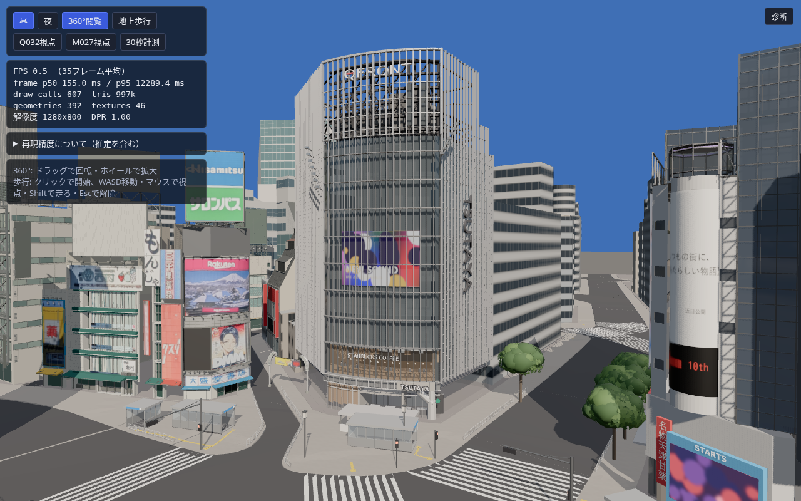
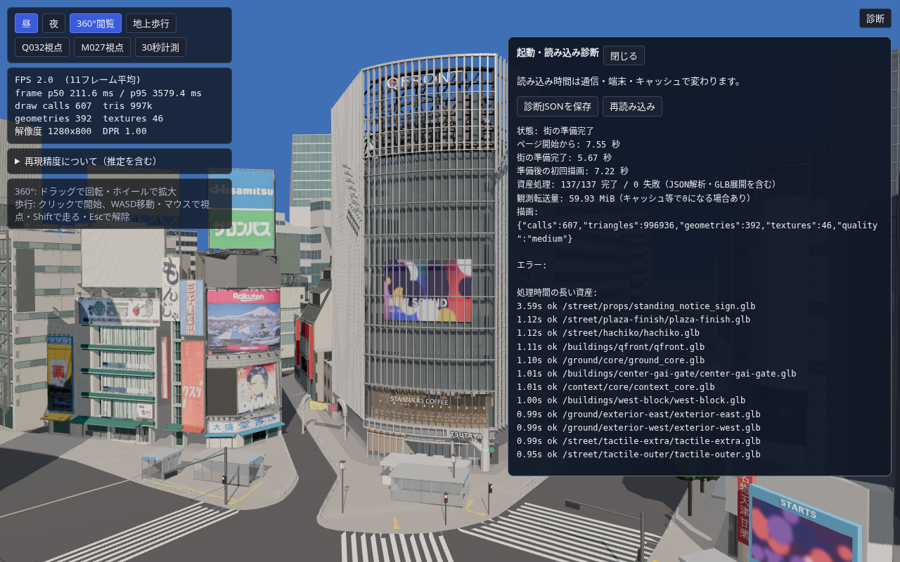
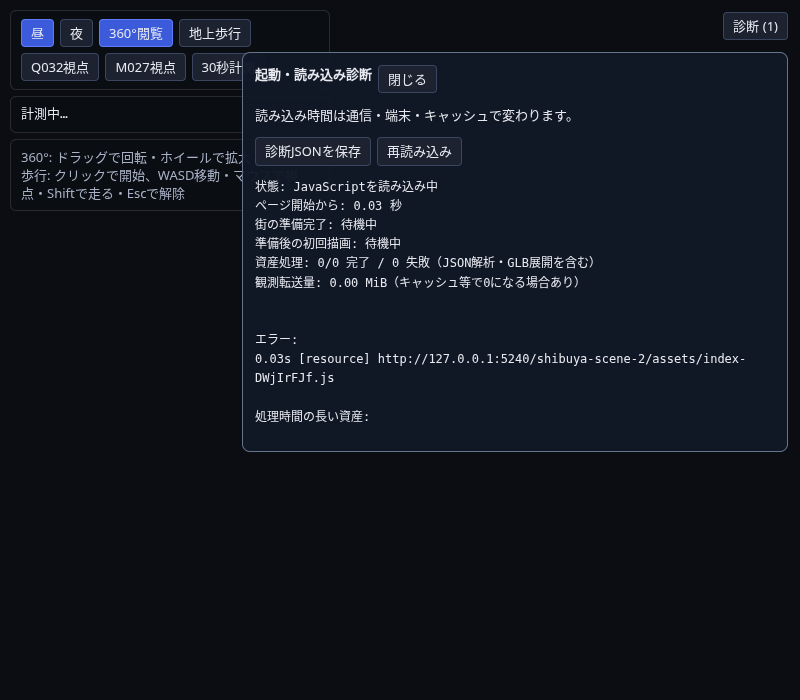

# Web版の公開と起動診断

街の通常画面から「診断」を押すと、起動時間・資産処理・エラーを確認できる。`?debug` では最初から開く。診断JSONは端末へ保存するだけで、外部へ自動送信しない。

## GitHub Pagesへの公開

配信対象は `dist/` のみ。BlenderやPythonは閲覧者にもPagesのビルドにも不要。保存済みGLBを読み込む。Blender編集用ファイルやsource写真は公開成果物に含めない（配信用GLBに含まれるテクスチャは配信される）。

1. この変更のPRをmainへマージする。
2. リポジトリの **Settings → Pages → Build and deployment → Source → GitHub Actions** を選ぶ。
   https://github.com/kesusugar/shibuya-scene-2/settings/pages
3. **Actions → Publish Shibuya viewer** の実行結果を確認する。設定前のマージで失敗した場合は **Run workflow → main** または失敗実行の再実行。
4. deployジョブが成功したら、そのEnvironmentに表示されたURLを開く。カスタムドメインがない通常構成での予定URLは `https://kesusugar.github.io/shibuya-scene-2/`。成功確認前は公開済みとは扱わない。
5. 昼/夜、360°閲覧、地上歩行を試す。地上歩行は画面クリック後WASD・マウス、Escで解除。現在はキーボードとマウスを備えたPCが主対象で、スマートフォンの仮想スティックは未実装。

現時点のリポジトリは非公開。GitHubの契約によっては非公開リポジトリのPages利用にPro/Team等が必要（ChatGPTのProとは別）。設定で利用不可と表示された場合はGitHub側の契約/公開先の選択が必要。リポジトリを勝手に公開へ変更しない。Pagesサイトの公開範囲はリポジトリの非公開設定と同じとは限らないので、Settings上の配信範囲を確認する。

今回のクラウド認証ではPages/Actions管理APIが403 `Resource not accessible by integration`。コードのpush/PR作成とPagesの設定変更は権限が別。workflowの準備とローカル配信検証まで行い、公開設定や本番配信の成功を偽って報告しない。

## 診断の読み方

- ページ開始から: ブラウザのnavigation開始を基準とした経過時間。
- 街の準備完了: 資産の取得・GLB展開・配置等が終わった時点。部分失敗時はエラーを残したまま継続するので「すべて正常」の意味ではない。
- 準備後の初回描画: 街の準備完了後、最初のrender呼び出しが戻った時点。GPUが画面へ提示し終わった時間の保証ではない。
- 資産処理時間: GLB/JSONのロード開始〜解析完了。並列処理なので足し合わせても起動時間にはならない。HDRや画像の通信はJSONのresources欄にも記録する。
- 転送量: Resource Timingが観測できた値。キャッシュやブラウザ制限では0になるため、配信ファイル総容量とは異なる。
- 描画: draw calls、三角形、geometry/texture数、品質設定。FPSは既存の画面左上または30秒計測を使う。クラウドのCPU描画時間を手元PCの性能として扱わない。
- エラー: GLB/JSON、Three.jsリソース、シーン構築、JavaScript、未処理Promise、WebGL context喪失。捕捉済みの同一失敗がasset/resource/sceneの複数段階に現れることがある。

アプリのmoduleを取得できない場合も診断スクリプトは独立して動く。HTML自体や診断スクリプトも届かない場合、JavaScriptが無効な場合、ブラウザそのものが停止した場合にはブラウザ側の診断が必要。JSONは最大100エラー/直近300リソースを出力し、URLのquery/hashを含むHTTP URLは除去。実行端末のUser-Agentと公開資産名を含む。

## ローカルでの再現

Node.js 22.22.2（少なくともViteの要件22.13以上）、npm、既存の配信用GLBが必要。

```sh
python3 -m pip install -r requirements-ci.txt
npm ci
npm test
npm run dev
# 公開時と同じサブディレクトリを検証する場合（bash）
VITE_BASE_PATH=/shibuya-scene-2/ npm run build
VITE_BASE_PATH=/shibuya-scene-2/ npm run preview -- --port 5240 --strictPort
# 上記サーバー起動後、別ターミナルで
node scripts/check-web-debug.mjs http://127.0.0.1:5240/shibuya-scene-2/ /tmp/web-debug-evidence
```

`npm run dev` の端末に表示されるアドレスは、そのPC自身で開くもの。クラウド内部のlocalhostを共有URLとして渡さない。公開はGitHub Actionsのdeploy成功をもって確認する。

テストにはPlaywright Chromiumの導入が必要。リポジトリのDEV_ENVIRONMENT.mdを参照。撮影・テスト中にsrc/assetsや配信distを変更しない。`public/startup-debug.js` はmodule初期化前に実行するためclassic scriptとして配信する。Viteの「can't be bundled」表示はこの意図的な別配信によるもので、distへコピーされたファイルの読み込みをブラウザで確認する。

## 今回の検証結果

226テスト/50ファイル、TypeScript・production build成功。通常品質で28建物、137件のGLB/JSON処理、エラー0を確認。配信distは約65 MiB（未圧縮）。モデルをページ起動時に生成するのではなく、配信用GLBを取得・展開する構成を維持。

同じ配信用ビルドに対し、application moduleの取得拒否でも診断が動くこと、ground_core.glbへの503を記録して他資産の表示を継続すること、JavaScriptエラーと未処理Promiseの記録、JSONダウンロードを確認した。故障注入はPlaywright側だけで行い、公開コードに故障を入れていない。正常時と失敗時のログは `evidence/web-debug-pages/`。normal.jsonとdownload.jsonは別の計測タイミング/撮影回のため経過時間が異なる。

撮影はクラウドChromium/SwiftShader。初回描画時間にはソフトウェア描画が含まれ、ローカル配信なので実インターネットの通信速度も再現していない。実際の公開URLとオーナーPCで診断JSONを再取得すること。Pages管理権限が不足しており、デプロイ成功はまだ未確認。





## CIのPython依存関係

`npm test` の点字経路検査はPythonのShapelyを使用する。Pages workflowはNode.jsに加えてPython 3.11と `requirements-ci.txt` をインストールし、テスト前に幾何演算を確認する。npmだけの導入では不十分。制作環境の既存Pythonパッケージに依存せず、新しい仮想環境でも全226テストと公開用ビルドを検証した。

mainの実行38730317819ではShapely未導入により子プロセスが終了し、Node側にはEPIPEも出ていた。幾何の不一致ではなくCIの依存導入漏れ。テストの削除・skip・continue-on-errorは行わない。checkout/setup-node/setup-pythonはNode24対応のv7へ更新。アプリのNodeは22.22.2を維持。PRでもテストとbuildを実行し、mainへのマージ/手動実行だけで公開する。
